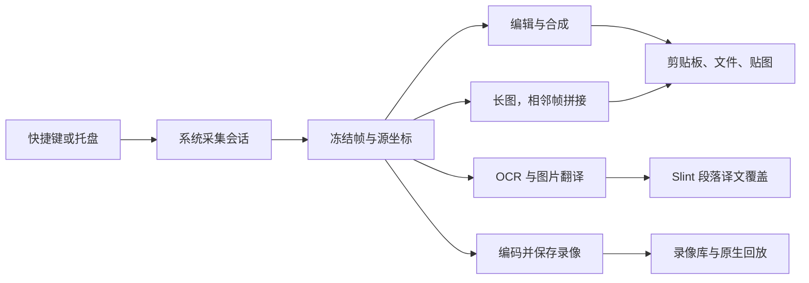

# Clippy Slint 新版实现计划

需求 ID `SLINT-NATIVE-PIPELINE-01`，上位规格为 [SLINT-UI-MIGRATION-01](../specs/2026-11-23-slint-ui-migration.md)。

从可用的原生剪贴板开始，第二个可手测版本交付快捷键截图、编辑、复制和落盘。截图的帧与坐标模型随后接长截图和录屏，OCR 的四点框接原图选字和图片翻译。三平台真机功能、空闲内存和从 v0.1.x 升级共同决定 v0.2.0 正式切换。

## 当前进度

截图编辑已接入 Slint 快捷键和托盘入口。Linux 隔离回归验证框选后标注、复制、落盘与像素相等，
共享渲染器沿用 legacy 原图、工程文档与金图。圆角的直接掩码候选出现 24 个像素差异，保留 v2
圆角路径。普通矢量层直接合成到预乘像素，输出仍采用同一个渲染结果。 [共享渲染器](../../../crates/clippy-capture/src/render_v2.rs) · [编辑器控制](../../../apps/slint/src/app/editor.rs)

贴图和工作区已接入截图编辑器与托盘。X11 回归实际创建标注贴图、核对修订文档、隐藏窗口并从
工作区重新打开。窗口状态和分组兼容已有存储表。系统摆位、缩放与层级留在对应平台实机验证。

长截图共享层已迁移原四向估计、预算、回访、撤销与像素拼接用例。隔离 X11 已验证 140×100 的
独立目标像素发生 32 px 位移后，经原生界面追加并导出 140×132 PNG。GNOME 50.1 虚拟显示器
复现了 RecordArea 静止后第二次读取超时。修复后，一个流连续返回 8 帧 384×280 的选区，静止读取
约 40.3 ms，日历出现后 5.8 ms 返回新像素，结束合成器后报告断流。自动输入权限和自动滚动待验证。

截图、历史图片和贴图现在可接结构化识字和扫码。Tesseract 的 TSV 接口提供行框
和读序，主动选择某一段才提交给设定的翻译服务。旧增强模型通过同一共享运行时使用。
固定样图已校验识别文字、源图尺寸和四点框位置。Rust OCR 分发模型和复杂版面对照仍待验证。

区域录屏已接共享 VP9/Opus 会话、托盘控制和录屏库。隔离 X11 验证了无声录制的区域尺寸、
暂停扣时、文件解码参数和导出内容。录屏库可导出、播放和合并恢复分段，播放由按需的
`ffplay` 进程完成。Linux/Windows 音轨选项沿用 PipeWire/WASAPI，需设备实测。PipeWire 1.6.2
虚拟输出确实送出 512 帧 PCM，但两种 `Meta`/`Buffers` 协商均没给出 `SPA_META_Header`，现有音源
按原合同拒绝。可单独验证以原生 graph 时间和设备延迟推导首个样本时间的方案，覆盖 Jammy、缓冲积压、
重采样、暂停与长时漂移后再审议音频合同。[现有 Linux 音频合同](../specs/2026-09-22-recording-linux-audio.md)

设置和操作窗口接入了本机主题、保存配置、凭据、贴图兼容归档、统计、文本工具与
翻译历史。数据迁移先保存一致的 SQLite 快照及原配置。正式 tag 已接 Slint 安装包
和草稿发布，老客户端 updater 的安装行为和签名合同仍要验证。

2026-11-24 从 `7fd1bda49b5236e5eaf57731de24fe1f6cd68154` 继续在当前分支开发。双目录、tag 路由、默认 Slint 门禁和 SQLite/FTS5 已落地。QA 私有数据目录与正式目录分开。 [Slint 应用入口](../../../apps/slint/src/app.rs) · [存储线程](../../../crates/clippy-storage/src/service.rs) · [原计划及已有证据](2026-11-23-slint-ui-migration-plan.md)

| 验证项 | 本轮证据 |
|---|---|
| Linux 本地门禁 | `./scripts/ci-local.sh` 共 11 项通过。启用 VP9/Opus 和 Linux 音源后，媒体层 387 个用例通过，2 个显式忽略。隔离 X11 跑真实托盘菜单、快捷键、Unicode/HTML/透明 PNG 入库、搜索、复制粘贴和焦点变化。 |
| Linux QA 包 | 本机 Ubuntu 26.04 构建 deb 和 AppImage。两份安装包各自解包运行 Release 二进制，通过 X11 回归。安装包保留 Slint、字体和录屏依赖的许可文档。 |
| 快速截图 | X11 验证快捷键、托盘、框选、取消、复制和落盘，核对 140×100 选区像素。解包 Release 样本首个重绘请求为 114–204 ms，直接复制 0.3 ms、落盘 0.9 ms。GNOME 50.1 双屏原始帧样本为 188.3 ms，虚拟 1280×800 显示器分别取到日历、快速设置和概览。 |
| 托盘空闲 PSS | GNOME 真实桌面，旧版临时退出，QA Release 每轮静置 60 秒。复测连续五轮为 18,548、18,918、18,972、19,000、19,061 KiB（18.11–18.61 MiB）。每轮 1 个进程、开窗次数为 0，满足每轮低于 50 MiB。 |
| 数据升级 | 用已安装的 v0.1.21 和从 deb 解包的新正式入口，在独立 X11 会话验证外部文本入库、原配置一致、历史读取和备份恢复。原位安装行为与旧 updater 下载验签仍待实机验收。 |

内存测试对应 `74c8cb4`，QA 二进制 SHA-256 为 `23538e6bcd3c6171a197154c8373d5f4ccf7c26bcd83335a143d0dac6a0b4ab7`。
首轮第四个样本为 98.34 MiB，期间出现两次开窗，本轮四个空闲样本为 18.16–18.88 MiB。
复测后旧版已启动且重新注册托盘。在同一双渲染器候选构建、同一隔离 X11 环境中，FemtoVG
开设置后 103.57 MiB，关窗静置 12 秒后 104.13 MiB。Skia 软件渲染同两点为 24.00 和 23.43 MiB，
也跑通同套桌面回归。这是单机虚拟显示器对照，默认渲染器仍为 FemtoVG，任务峰值和三平台对照待测。

GNOME 外部快捷键是否收起系统菜单、混合 DPI 覆盖层对齐、Wayland 授权、Windows/macOS 真机和 updater 升级桥仍未验收。截图当前按单块输出选区，
跨屏选区、编辑工程持久化和 Portal 截图兼容路径仍待实现。 [自动桌面回归](../../../scripts/test-slint-x11.sh) · [实机内存脚本](../../../scripts/qa/measure-slint-idle.py) · [发布 workflow](../../../.github/workflows/release.yml)

## Goal

交付原生 Slint 1.19.0 的 Clippy。在真实桌面上按键后尽快出现可交互的冻结画面，图片只在目标格式需要时编码，剪贴板、私有数据和系统授权沿用明确的所有权与生命周期。

## Requirements

- 当前分支串行开发。v0.1.x Tauri 只在维护及对应 tag 构建。v0.2.0 预发布及以上由同一个 semver 解析器路由到 Slint，正式产物只包含该版本的 UI 运行时。
- 启动后保持托盘、快捷键、剪贴板监听和有界存储服务。窗口、截图流、编解码器、OCR 模型与大型预览按需创建。保持生产身份、数据目录、SQLite schema 和升级入口兼容。
- 截图以冻结帧和源图像素坐标为基础。长截图仅采集目标来源，录屏仅采集已授权来源。不同动作共享帧模型和平台适配，权限、光标、是否排除自身窗口随动作明确声明。
- 复制与自动粘贴独立。可恢复的授权由系统决定，用户能查看、关闭和重新授权。截图、录屏、输入设备、全局剪贴板访问与麦克风各自维持最小授权范围。
- OCR 返回行级四点框、置信度、段落、阅读顺序和图像坐标变换。一次识别供选字、复制与翻译共用。图片翻译把已翻译的段落映射回原图，联网服务只接收明确提交的文本。
- 保留旧实现的编辑文档、长截图评分、录屏时间线和恢复约定。更换算法、运行时或编码器的候选按对应基准验收后启用。

## Acceptance Criteria

- [ ] 在安装的 QA 包中完成外部复制→入库→搜索→再次复制→目标应用粘贴。授权拒绝、撤回、应用重启和目标窗口变化均有可核对的结果。
- [ ] 普通截图从快捷键到可交互覆盖层、从确认到成功复制或文件提交分别计时。混合 DPI、旋转屏、负原点和 GNOME 瞬态 UI 各有真实桌面记录。对同一编辑产物，复制与保存的解码像素符合现有 renderer 约定。
- [ ] 长截图每代只打开一次目标采集会话，四方向、撤销、到页尾和取消均经过验证。录像完成区域裁剪、暂停/恢复、选择可用音轨、恢复分段、库内播放和导出。
- [ ] 用固定语料验证 OCR 四点框、文字和阅读顺序。选中字块可复制、整段可翻译，高 DPI 缩放下译文仍对应同一段。纯文本 OCR 结果展示可用能力。
- [ ] 功能矩阵、安装包、升级演练、本地完整门禁和三平台原生 CI 绑定发布 SHA。固定机上无任务静置 60 秒，连续 5 次进程树总 PSS 均低于 50 MiB。正式产物的依赖和进程树检查确认 WebView 缺席。

## Out of Scope

- v0.1.x 的主要功能和界面改造、数据库 schema 更换、同步协议或更新服务换代。
- 常驻录屏流、启动时加载识别模型、启动时申请输入或屏幕权限。
- 把平台专有捕获接口、提权或输入模拟作为通用授权机制。受系统保护的窗口和内容保持系统限制。
- 首版做文档公式识别、复杂图片背景修补、所有平台 GPU 零拷贝，以及启用多套 OCR 运行时或录屏编码器。

## 新版目录与模块边界

| 路径 | 实现职责 |
|---|---|
| `apps/slint/src/bin/`、`apps/slint/src/app/` | 两个部署入口、服务装配、剪贴板/截图/翻译/录屏用例、取消与退出。新的 `app/` 随第一个用例建立。 |
| `apps/slint/ui/`、`apps/slint/src/ui/` | Slint 组件、主题 token、窗口控制器和适配。共享标题栏覆盖设置、查看器、工作区与录屏库。截图和录屏浮层有自己的工具样式。 |
| `crates/clippy-core/` | 已有配置和模型，补可独立验证的动作与图像坐标值类型。 |
| `crates/clippy-platform/` | 已有身份和路径，补单实例、快捷键、剪贴板、原生窗口与授权适配。 |
| `crates/clippy-storage/` | 在容量受限的现有专用线程中追加详情、变更、归档与 Pin 请求。连接归工作线程，列表只带预览所需字段。 |
| `crates/clippy-capture/` | 新增。拥有截图与流采集、源标识、帧和裁切，以及截图/Pin 共用的渲染和长截图拼接。 |
| `crates/clippy-vision/` | 新增。拥有结构化 OCR、扫码与版面规则。输入只用像素视图和图像变换。OCR worker 随原生候选接入。 |
| `crates/clippy-media/` | 随录屏迁移新增。消费采集帧并维护音视频时钟、编码、封装、恢复与回放。 |

Slint 宿主调共享 crate，领域类型不引用 Slint 或 Tauri。媒体可依赖采集层，视觉只依赖图像值类型和像素数据。SQLite 只收领域数据。平台句柄、GPU buffer 和设备线程归各后端所有。翻译 provider 与应用编排先作为 Rust 模块迁移，等出现独立复用需求再拆 crate。



## 阶段交付

| 交付点 | 对应步骤 | 可现场验证的结果 |
|---|---|---|
| 第一个 Slint QA 包 | 1–2 | 托盘、设置、快捷键和剪贴板日常用得起来。 |
| 截图 QA 包 | 3 | 按快捷键框选，改图后可以直接复制或保存。验证关键的 v5 截图响应。 |
| 功能齐套 QA 包 | 4–7 | 贴图、长截图、OCR、图片翻译、录屏与回放，以及其余原计划能力逐项接通。 |
| v0.2.0 切换 | 7 和全部验收 | 发布候选包有三平台原生证据，安装升级和空闲 PSS 达到规格。 |

迁移过程中用隔离身份的 QA 包推进真机测试。Slint 正式打包路由接通后，公开 alpha/beta/rc 标签才有对应的发布产物。

## 1. 托盘、窗口与基线

- 从 `apps/slint/src/lib.rs::run` 拆出装配和首次开窗，先验证只启事件循环和托盘的路径。主窗口、设置和重资源预览由操作按需打开，关闭后释放组件和图片。Linux 在 GNOME 与 KDE 核对真实托盘菜单，包括文字、点击与退出，缺少托盘宿主时保留快捷键或再次启动入口。 [Slint SystemTrayIcon](https://docs.slint.dev/latest/docs/slint/reference/window/systemtrayicon/)
- 从 legacy 的 `app/`、`window_controller.rs`、`gsettings_shortcuts.rs` 和 `portal_shortcuts.rs` 提取系统行为。原生快捷键、GNOME v5 系统绑定和其他 Wayland 的 GlobalShortcuts 按会话选择。用 `DeploymentIdentity` 装配单实例、数据和快捷键命名空间。已发布旧版在隔离系统会话做 QA，升级演练时由同一用户先退出旧程序。 [旧窗口控制](../../../apps/legacy-tauri/native/src/window_controller.rs) · [身份定义](../../../crates/clippy-platform/src/identity.rs)
- 把六套主题映射到一个 token 层。先完成共用的标题栏和设置页，拖动区域通过原生窗口移动能力，按钮、输入与选字区域排除拖动。用同一个界面对比 FemtoVG 和 Skia 在中文、透明、阴影、多屏 DPI、启动到托盘就绪及空闲 PSS 的表现。
- 提前检查原生回放和升级的可行性。先用现有 VP9 视频夹具验证候选解码、seek 和关闭回收。另用现有双轨 writer 生成带 Opus 的样片测音轨。检查旧 updater 期待的安装包和签名格式，以及 macOS 构建实际最低版本。 [VP9 夹具](../../../apps/legacy-tauri/frontend/dev-review/recording-sample.webm) · [双轨 writer](../../../crates/clippy-media/src/recording/av_segmenting.rs)

真机从托盘或快捷键反复打开和关闭主窗口、设置，并验证标题栏拖动。Linux 记录纯托盘、首开、关窗回落的 PSS。 [旧主题](../../../apps/legacy-tauri/frontend/styles/themes.css) · [已有桌面用例](../../native-qa.md)

## 2. 剪贴板、搜索与粘贴

- 用当前 `StorageRuntime` 增加写入、详情、删除、收藏和最近使用顺序。迁移快照、内容分类、敏感 TTL、版本一致性与自复制唤醒。**监听器仍是历史唯一入库入口**，写剪贴板成功后唤醒监听器。列表按页加载，搜索用请求代次过滤迟到结果，图片详情和缩略图仅在选中或可见时读。 [旧监听器](../../../apps/legacy-tauri/native/src/clipboard_watcher.rs) · [旧复制命令](../../../apps/legacy-tauri/native/src/commands/clipboard.rs)
- Windows 用 `WM_CLIPBOARDUPDATE` 驱动读取，macOS 先检查 `NSPasteboard.changeCount`。X11 复用 XFixes、写完成屏障和有界 INCR。Wayland 先检测 compositor 的 data-control 能力，剪贴板事件和内容使用同一后端。支持普通 data device 的情况下提供有焦点的复制与导入，XWayland 读写明确标为受限。Clipboard Portal 用于授权的 RemoteDesktop 会话。 [Windows 剪贴板通知](https://learn.microsoft.com/en-us/windows/win32/api/Winuser/nf-winuser-addclipboardformatlistener) · [Apple changeCount](https://developer.apple.com/documentation/appkit/nspasteboard/changecount) · [Wayland data-control](https://github.com/wayland-mirror/wayland-protocols/blob/main/staging/ext-data-control/ext-data-control-v1.xml) · [Clipboard Portal](https://flatpak.github.io/xdg-desktop-portal/docs/doc-org.freedesktop.portal.Clipboard.html)
- 先提交系统剪贴板数据，待所有权和目标焦点可用后才尝试粘贴。保留已有用户配置，新安装采用显式开启自动粘贴的交互。沿用各平台输入适配和拒绝时的 copy-only 状态。Wayland 复用现有键盘 Portal 会话及一次性 restore token 更新逻辑。token 按部署身份和授权用途私有保存，恢复成功后用系统返回的新 token 替换。持久授权以用户选择及 Portal 支持为准。
- 有能力时试 `ConnectToEIS`，将现有逐次 `Notify*` 往返替换为同一授权会话上的事件流。EIS 和 `Notify*` 在每个会话中二选一。焦点或写入就绪的事件能可靠观测时，再替换现有的固定等待。失效 token 或用户拒绝由设置页继续处理，复制仍给出独立结果。 [现有粘贴会话](../../../apps/legacy-tauri/native/src/paste/portal.rs) · [RemoteDesktop Portal](https://flatpak.github.io/xdg-desktop-portal/docs/doc-org.freedesktop.portal.RemoteDesktop.html)

第一个可手测包的操作顺序为托盘打开→复制 Unicode/HTML/透明图→搜索同一条历史→收藏、复制与粘贴。另测剪贴板繁忙、同图连续复制、敏感项过期、授权撤回、切换前台窗口以及无原生后台历史权限时的可用操作。

## 3. 快速截图、编辑与落盘

### 采集

从 legacy `screenshot/`、`capture/` 和录屏平台帧源提取同一套帧描述。每帧记录来源、拓扑代次、逻辑坐标到源像素变换、尺寸、stride、像素格式、色彩空间和时间戳。采集层对外提供单帧快照与持续会话。调用者声明来源、光标和排除窗口策略。快照取一张新帧，长截图与录屏按操作持有流。原生帧受平台租约约束，借用的缓冲在归还前完成读回或导入同步，以队列容量限制同时持有的帧。 [截图后端](../../../apps/legacy-tauri/native/src/screenshot/backends.rs) · [录屏帧](../../../crates/clippy-media/src/recording/frame.rs)

| 环境 | 第一条实施路径 | 选型验收 |
|---|---|---|
| Linux GNOME Wayland | 保留 v5 快捷键与 Mutter `RecordArea` + PipeWire 原始帧。扩展继续承担已支持的窗口速选等能力。 | 先复测本机双屏首帧和菜单保留率。私有接口失败时记录后端和原因，沿用已验证的截图回退。 |
| Linux KDE 和其他 Wayland | 支持的 compositor 使用已有逐输出后端。授权采集走 ScreenCast Portal + PipeWire，先实现 SHM。 | 系统授权、恢复 token、选错屏和撤回分别验证。新版原生协议及 DMA-BUF 候选按后端探测和测试结果启用。 |
| Linux X11 | 沿用 XRandR 几何与原生 root drawable 采集。长任务复用 X11 连接。 | 覆盖合成器、负原点、旋转与混合 DPI。 |
| Windows 10/11 | 用 WGC。普通快照复用设备与来源对象，长任务保留 D3D11 frame pool，在需要 CPU 的消费者前才读回。 | 证实首帧、热插拔、窗口关闭、HDR 色彩与录制控制窗排除。DXGI Desktop Duplication 用作高频整屏对照。 |
| macOS | 14+ 单帧用 `SCScreenshotManager`，12.3–13 按需 `SCStream` 取首帧，长任务走 `SCStream`。 | 旧正式包标注 11.0，现有 Slint QA 标注 12.3。先验证 11–12.2 能否保留受支持的旧单帧路径和可启动安装包，最低版本若需提高则单独形成兼容性提案。 |

[现有 Linux 路径](../../capture-linux.md) · [ScreenCast Portal](https://flatpak.github.io/xdg-desktop-portal/docs/doc-org.freedesktop.portal.ScreenCast.html) · [Wayland Image Copy Capture](https://github.com/wayland-mirror/wayland-protocols/blob/main/staging/ext-image-copy-capture/ext-image-copy-capture-v1.xml) · [PipeWire DMA-BUF](https://docs.pipewire.org/devel/page_dma_buf.html) · [Microsoft WGC](https://learn.microsoft.com/en-us/windows/apps/develop/media-authoring-processing/screen-capture) · [Desktop Duplication](https://learn.microsoft.com/en-us/windows/win32/direct3ddxgi/desktop-dup-api) · [Apple ScreenCaptureKit](https://developer.apple.com/documentation/screencapturekit) · [SCScreenshotManager](https://developer.apple.com/documentation/screencapturekit/scscreenshotmanager)

需要 Portal 的设备从有焦点的设置页或操作入口发起首次授权。系统支持时可由用户选择记住显示器，后续用新鲜 token 恢复来源，空闲时关闭取流。拒绝或取消结束本次授权流程，UI 报出当前能力。 [ScreenCast 会话与持久化](https://flatpak.github.io/xdg-desktop-portal/docs/doc-org.freedesktop.portal.ScreenCast.html#session-persistence)

截图先冻结合成器输出，再显示覆盖层。应用窗口命中只影响选区候选。GNOME 的 v5 外部快捷键仍可能在应用收到请求前收起日历、托盘菜单和 Activities。把按键是否送达、第一帧是否还含目标、覆盖层何时出现分别记录。先验证按下快捷键后延时冻结的动作，用户可以在计时期间打开菜单。提供系统截图导入，Print Screen 截取后可从剪贴板或文件继续编辑。Shell 内触发的原始帧原型同时通过画面和时延验收才加入产品。 [当前 GNOME 边界](../../capture-linux.md#6-真实桌面上仍需人工验收的部分) · [GNOME 系统截图](https://help.gnome.org/gnome-help/screen-shot-record.html)

### 编辑和输出

1. 先用合成图贯通窗口→选区→源像素裁切，再接本机显示器。Slint 用受控像素缓冲显示一轮，按显示器和选区只更新必要内容。后续原生纹理导入按 renderer 能力和基准决定。
2. 从 `pin/project.rs`、`render_v2.rs` 保留已有操作文档和效果采样邻域。渲染先返回可信像素，矢量层直接合成到现有位图，先对无编辑、透明圆角、模糊/马赛克跨边界和文字夹具做解码像素对照，逐步移除位图嵌入 SVG 的 PNG/base64 往返。
3. Copy 消费像素，剪贴板目标需要 `image/png` 时在适配端编码一次。OCR/扫码从选区读取像素。预览与 Pin 引用同一帧，持久化和复用 PNG 只在消费者需要时生成。外部 PNG 和项目文件继续用入口的完整边界校验。
4. Save 在 blocking worker 往目标同目录的私有临时文件流式编码 PNG，写完并按现有耐久策略同步后原子发布。重名选新文件名，复用已编码的临时文件。沿用同目录 hard link 的 no-clobber 语义，其他文件系统的原语经测试再启用。写入失败清理临时文件并保留可重试产物，取消后回收该次操作的资源。已提交目标只反馈一次。区分“正在保存”和“已保存到路径”。
5. 选区链通过后给确定来源增加“直接保存当前屏”动作。快捷键取一帧即走同一个保存接口，适合无需选区和标注的情况。

从 Linux QA 包的快捷键进入截图，测试框选、撤销标注、复制、保存、失败后重试、Esc 恢复窗口。1080p 和 4K 使用同一画面记录编码次数与各阶段尾延迟。再验证 Windows/macOS 首帧、窗口与 DPI 能力。 [旧渲染入口](../../../crates/clippy-capture/src/render_v2.rs) · [旧输出提交](../../../apps/legacy-tauri/native/src/capture/mod.rs#L590) · [原子保存](../../../apps/legacy-tauri/native/src/image_io.rs#L219)

## 4. 贴图和长截图

- 先接当前选区→Pin→拖动、缩放、透明度、编辑、保存和关窗。复用已有图像修订、可编辑项目、贴图工作区与来源位置。工作区和查看器按需打开，超过内存预算的图片只读可见区域或缩略图。Wayland 的绝对摆位、置顶由真实 compositor 能力决定。
- 把 `capture/longshot/session.rs`、`overlap.rs`、`canvas.rs` 和撤销语义下沉。用目标显示器的流替换每次全屏枚举和重抓，采集侧保留相邻 ROI 帧，拼接历史仍按预算持有。Wayland 自动模式从同一授权的 RemoteDesktop + ScreenCast 会话取帧和发滚动，共用同一来源坐标。
- GNOME 的持续会话在静止画面时可能不送新 buffer。已取到首帧且流仍处于 Streaming 时，短等更新后可复用上一帧，新帧优先。冻结截图仍须取新帧，断流或采集错误须明确报告。
- 先跑通手动追加和确定性夹具，再做自动滚动。观察滚动后的新帧和 ROI 先变化、随后稳定的过程，逐步替代每步固定等待 360 ms。等待到截止时间仍无可信位移时报告未移动或状态不确定。目标窗口变化或用户移鼠标立即停止新输入。保留现有相似度/歧义门限与先提交像素优先级。确有超长图内存瓶颈时，按同一像素语义试分块画布和逐行输出。

从日志核对每次长截图只建立一次目标流。验收上下左右、固定页眉、低纹理、不稳定动图、逆向撤销、页尾、拒权、切换目标和热插拔。统计滚动到提交的 P50/P95、拼接失败率、输出像素、峰值内存与释放。 [旧重捕获](../../../apps/legacy-tauri/native/src/capture/longshot/recapture.rs) · [拼接会话](../../../apps/legacy-tauri/native/src/capture/longshot/session.rs) · [Wayland 自动滚动](../../../apps/legacy-tauri/native/src/capture/longshot/auto_scroll_wayland.rs)

## 5. 结构化 OCR、排版和图片翻译

### OCR 与分发

1. 先迁现有 `StructuredOcr` 和扫码接口。从截图、历史图和 Pin 输入同一个不可变图像快照。文字结果携带 `block/paragraph/line` ID、四点框和排序，纯文本只是它的一个视图。Tesseract 基础链仍提供纯文本，带框视图由支持几何的引擎提供。
2. 用现有 Python/ONNX Runtime CPU 管线和固定语料建立参照。顺序移植检测预处理、轮廓/四点框、透视裁切、动态宽度识别和 CTC，先做张量与几何差分，再变更部署。继承现有 single-flight、1 active + 2 queued 和统一超时合同。候选原生实现首选 Rust worker + `ort` CPU，按需启动，模型在短任务间复用，空闲退出。只传有界像素、几何和任务 ID，取消或超时要等 worker 确认完成或退出后才释放执行额度。
3. 依次核对公开的 PP-OCRv6 small det/rec/字典和可选方向模型。模型包记录固定 revision、SHA-256、许可、NOTICE、运行库及平台架构。当前 EdgeGNN 权重是用户自行核权的外部资产。可分发默认路线采用有来源的公开模型和自有版面规则，先拿固定语料验证段落、双栏、表格顺序和斜字。EdgeGNN 在授权配置中继续作为对照。
4. RTen 比较纯 Rust 的体积和 CPU 性能，MNN/mnn-rs 比较同模型转换后一致性、运行时和封包维护成本。候选需要跑通过宽度多档的 det/rec 和使用的布局模型。用同一机器比较冷启动、热 P95、峰值内存、退出回落、包增量和质量固定集。正式选择一个后端。 [旧结构化协议](../../../crates/clippy-vision/src/protocol.rs) · [模型来源和许可](../../../apps/legacy-tauri/native/ocr-sidecar/README.md#模型来源与许可) · [OCR 质量基线](../../reviews/2026-09-18-ocr-quality-baseline.md) · [ort](https://github.com/pykeio/ort) · [RTen](https://github.com/robertknight/rten) · [MNN](https://github.com/alibaba/MNN) · [mnn-rs](https://github.com/wapznw/mnn-rs)

### 图片翻译接线

1. 截图或历史图选区拿到结构化结果后，先按阅读顺序显示原文和框。所有框在源图坐标内保存，显示时经裁切、旋转、缩放及平移变换。首版按行命中、按段翻译。字词级框在后端有真实位置时提供。
2. 优先保留表格行、多栏正文和 UI 标签各自的边界。按段落 ID 保存翻译结果，支持批量的 provider 用它原有协议，其他服务用受限并发逐块送。用本地请求代次、图片身份、段落 ID 和语言配对验收返回结果。只向已配置的 provider 发送用户明确选择的文本，敏感剪贴板项继续在联网前阻断。
3. Slint 先做非破坏性段落覆盖，译文自适应换行、字体回退、适度缩放，过长移到相邻结果卡。支持切换原文和译文、点击复制、逐段失败提示。用户改变选区或退出后，过期 OCR/翻译结果不再修改覆盖层。
4. 后续导出烧录译文时复用同一坐标和布局。纯色背景先验证可读性，复杂背景修补独立验证。多栏扫描文档需要版面模型时才评估 PP-StructureV3。 [旧截图翻译入口](../../../apps/legacy-tauri/native/src/capture/mod.rs#L788) · [PaddleOCR 四点框与词框](https://github.com/PaddlePaddle/PaddleOCR/blob/main/docs/version3.x/pipeline_usage/OCR.en.md) · [PP-StructureV3](https://github.com/PaddlePaddle/PaddleOCR/blob/main/docs/version3.x/pipeline_usage/PP-StructureV3.en.md)

用固定的多栏、混合中英文、不同方向、透明和暗色样本记录框精度、CER、空白 F1、阅读顺序和每段对应结果。三平台分别在无 Python 的打包环境演示一次带框识别及原图译文覆盖。基础文本 OCR 可用和几何翻译可用分别登记。

## 6. 原生录屏和回放

- 复用第 3 步采集帧、坐标和平台入口，先接无音频区域录屏。迁移已有 VP9/WebM 软件基线、有界队列、时间线、控制、manifest 和周期恢复分段。录制时只有拥有当前会话的控制器可以更改状态。控制窗排除失败时取消启动，Wayland 按已有托盘控制路径验证。
- 加入平台已有音源，Windows WASAPI、Linux PipeWire、macOS ScreenCaptureKit 版本能力。继续使用单调会话时钟和现有 48 kHz、暂停扣时、背压、封尾与恢复约定。音轨按实际授权和设备显示。
- 用第 1 步的样片和实际录屏交付一个按需原生播放器。先验证共同的 WebM 解复用与软件解码链能否覆盖 Linux、Windows、macOS Intel/ARM。按平台核对打包后的解码器、音频设备依赖、seek 与资源。旧版录屏和已提交恢复分段都能正常读。关闭库或播放窗后释放线程和句柄。
- 硬编实验在软件基线之上比较 Windows WGC + Media Foundation、macOS CVPixelBuffer + VideoToolbox、Linux PipeWire DMA-BUF + VA-API。分别记录 CPU、拷贝、丢帧、文本清晰度、音画漂移和安装包依赖。通过后再考虑默认编码与容器切换。 [旧录屏目录](../../../apps/legacy-tauri/native/src/recording/) · [录屏真机场景](../../native-qa.md#9-受门控录屏原型) · [Media Foundation](https://learn.microsoft.com/en-us/windows/win32/medfound/about-mfts) · [VideoToolbox](https://developer.apple.com/documentation/videotoolbox) · [GStreamer VA-API](https://gstreamer.freedesktop.org/documentation/va/index.html)

安装 QA 包后录制并回放真实视频。逐项验证分辨率、指针和控制窗、无声与可用音轨、暂停/继续、30 分钟音画漂移、异常中断与分段恢复、导出及删除。现有 legacy QA 原型作为行为参照，Slint 使用自己的产物和验收记录。

## 7. 其余产品能力和发布切换

补齐原计划的功能矩阵。逐项从正式入口走到保存、复制或界面反馈，并在对应平台记录。

- 历史预览接入受限的富文本、Markdown、代码、图片和元数据模型。用外部恶意 HTML 与内网 URL 夹具验证净化与网络边界。
- Launcher 复用现有动作目录和可信输入，接入扫码、取色、codec、翻译。延伸现有 provider、系统凭据存储、TTS 和翻译历史。
- 通过设置和主面板接入自启、语言、诊断、权限、自定义保存路径、统计、归档导入导出及 Linux tmux。在窗口关闭、任务取消和应用退出时验证各自的资源归属。

[旧版功能清单](../../architecture.md) · [真机 QA 场景](../../native-qa.md)

### 发布切换

1. 扩展 Slint QA 合同。从 `Packager.qa.toml` 生成 Linux deb/AppImage、Windows NSIS/MSI、macOS Intel/ARM app/DMG。安装到隔离测试环境，核对身份、数据/快捷键、运行库加载、授权和许可。在 Ubuntu 22.04 基线上核对新添 PipeWire 等系统依赖，Windows 用干净镜像核对原生 codec/OCR 运行库。macOS 检查实际部署目标和临时签名对应的 TCC 行为。记录安装包的哈希和 SHA。
2. 新建对应的 Slint 正式 Packager 配置。在 `release.yml` 里读取 tag resolver 输出，分别核对选中的 Cargo/打包版本、CHANGELOG、签名与产物元数据。预发布 SemVer 如需转换为原生安装器的数字版本，记录关系并测 RC→正式的安装顺序。发布说明和 `BUILD-INFO.json`、`QA-BUILD.txt` 标明实际 UI 后端、版本、renderer、最低系统版本、SHA 和另一套框架的 `not included`。
3. 用最新 v0.1.x 实际安装包跑升级。从数据库的 SQLite 一致性备份及配置备份开始，核对正式身份、历史、设置、Pin 工作区、签名、失败回滚和重启。用同一 updater 验证真实旧客户端能下载、验证签名并安装新包。包或签名合同有差异时，验证 v0.1.x bridge 后再切换。预发布和后续旧版维护 release 走各自元数据，稳定渠道保持单向升级。
4. 对最终发布 SHA 通过本地完整门禁、三平台原生 CI、同 SHA QA/签名产物、升级和性能验收，再放行正式 tag 发布。发布 SHA 保持可从 `dev` 或 `main` 到达。

[Slint QA 包配置](../../../apps/slint/Packager.qa.toml) · [版本路由](../../../scripts/resolve-release-backend.mjs) · [更新清单生成器](../../../scripts/generate-updater-manifest.mjs) · [功能开发流程](../../feature-lifecycle.md)

## 性能数据和验收材料

| 场景 | 记录方式 | 合格条件 |
|---|---|---|
| 托盘空闲 | 固定真实 GPU Linux 机，同一签名/发布 profile、同一历史夹具，启动到托盘就绪并静置 60 秒。采集应用及子进程 `smaps_rollup` 的 PSS，另测打开和关闭主窗口及任务结束后的回落。 | 连续 5 次总 PSS <50 MiB。Windows/macOS 另记录原生内存、句柄和线程回落。 |
| 截图与落盘 | 同机同屏同内容，冷/热分别记录快捷键、后端开放、首帧、覆盖层可交互、确认、编码、落盘或剪贴板提交。记录复制的编码次数和最大帧占用。 | 低延迟主路径的 P95 至少与同条件 v5 路径持平。新保存和复制路径以 P95、解码像素和错误合同证明收益。 |
| 长截图 | 固定 1080p/4K 页面和滚动轨迹，记滚动→可拼接帧→提交及相邻帧匹配结果。 | 单目标流，四方向、低置信与取消用例达到旧质量门限，平均和 P95 用同一轨迹比较。 |
| OCR 与录屏 | OCR 固定模型版本、线程和语料。录屏固定区域、时长、可用设备与 codec，并抽查文件。 | 保持字框、文字和阅读顺序基线，验证内存可回收。录屏报告 CPU/峰值、丢帧、音画同步及恢复结果。 |

开发阶段用现有的截图基准和 OCR 语料固定输入，实测提升再补进计划。对每个新增 crate 同步补 `default-members`、本地门禁和 `build.yml` 对应目标。原生 CI 核对当前待发布 commit 的 Ubuntu、Windows、macOS required checks。下列命令从仓库根目录执行，打包命令使用现有 QA 配置。

```bash
./scripts/ci-local.sh
node scripts/verify-native-ci.mjs --repo 51hhh/Clippy --sha "$(git rev-parse HEAD)"
cargo build --locked --release -p clippy-slint --bin clippy-slint-qa --features qa-build
cargo-packager --config apps/slint/Packager.qa.toml --formats deb,appimage
```

Windows 原生本地入口为 `scripts/ci-windows.ps1`。当前 `manual-qa.mjs` 的既有场景用于 legacy，Slint 逐功能增加自己的 backend/version/arch 合同后再接入校验。Native QA 构建和人工执行分别登记，记录 SHA、包哈希、后端版本、测试输入、观测和证据。保留失败、跳过与未运行项。 [现有基准](../../bench-baseline.md) · [Linux PSS](https://docs.kernel.org/filesystems/proc.html) · [原生 CI 校验](../../../scripts/verify-native-ci.mjs)

## 设计提案与下一次提交

现有规格允许抽出 UI 耦合和复用原算法。首先落实第 1–3 步的装配、帧/坐标所有权和输出接口。长图的稳定帧选择、可分发的 OCR 几何排序、原生推理与硬件编解码各自用同一输入对照旧实现。每个候选记录现有瓶颈、替代方案、预期收益及失败回退点。同一问题连续两次候选没有指标或测试推进，记录阻塞后切换到下一项。涉及 macOS 最低支持版本、放宽性能门槛或修改已批准约束的提案单独确认。阶段提交保持可回退，用户可见功能随实现写入 CHANGELOG 并引用需求 ID。

第一笔实现从 `apps/slint/src/lib.rs::run` 开始。接通托盘和按需主窗口，保留当前列表服务，接一项打开面板的全局快捷键并记录纯托盘 PSS。接下来扩展 `StorageRuntime` 的读写和剪贴板监听，交付第一份可以日常复制、检索与粘贴的 QA 包。现有截图性能、OCR 质量、录像恢复三份基准分别约束其后对应的迁移提交。
