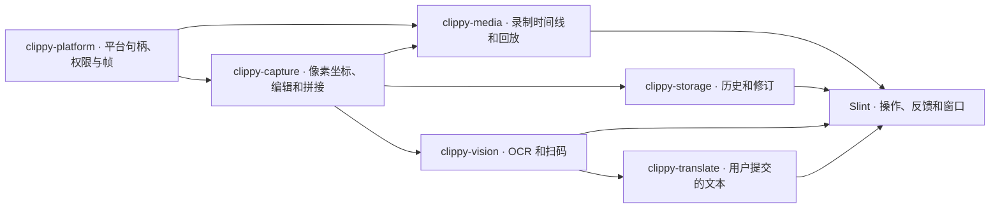

# Clippy v0.2.0 功能迁移收尾方案

需求 ID `SLINT-MIGRATION-CLOSURE-01`。核对基线为 2026-11-25 本地 `dev` 的 `9db24d4`。
本页落实既有迁移规格和原生实现计划。开发继续在当前 `dev` 串行推进，每阶段保留可单独验证和回退的提交。旧版按需维护，日常门禁以新版和共享 Rust 层为主。
[上位规格](../specs/2026-11-23-slint-ui-migration.md) · [原生实现计划](2026-11-24-slint-native-implementation-plan.md)

## Goal

在 Slint 1.19.0 上完成日常剪贴板、快速截图、贴图、自动长截图、区域录屏与库内回放、离线结构化 OCR、
图片翻译和旧版升级。以实际安装包证明这些流程可用，保持现有快照、数据和空闲内存合同。

## 当前进度与缺口

本地基线上有 Linux 完整门禁 11 项通过、深浅主题各 24 项 X11 交互检查、Openbox 设置拖动与查看器缩放证据。
GitHub `dev` 仍指向 #27 的合入提交 `abfdeb5`。之前的安装包、三平台 CI 和内存数字各自对应较早提交，
版本切换时要补齐同一发布 SHA 的证据。 [本轮界面验收](2026-11-23-slint-ui-migration-plan.md#整体界面对照与验收) · [远端 dev 合入提交](https://github.com/51hhh/Clippy/commit/abfdeb5c2dc9557dde07e0cb674f897d8416eb25)

| 功能 | 当前 Slint | 收尾内容 |
| --- | --- | --- |
| 托盘、快捷键、设置 | 按需窗口、单实例、三类快捷键、六主题、平台权限入口。设置里录制和保存快捷键 | 原生托盘和权限态实机验收。补中英文/自动语言、快捷键保存后重绑及失败回滚。完善 OCR 引擎状态、路径选择、清理与更新入口。 [设置调用](../../../apps/slint/src/app/settings.rs) · [旧设置](../../../apps/legacy-tauri/frontend/settings.html) |
| 剪贴板和自动粘贴 | Unicode、HTML、透明 PNG、检索、收藏、删除、敏感项保护。X11 已验证复制和焦点变化。Windows 使用序列号，macOS 使用 `changeCount`，X11 读取 XFixes 事件，应用循环间隔 250 ms | 核对 Wayland 原生应用间的读写和授权恢复。将能观察的变更改为事件唤醒。短时间多次复制、退出数据所有权及焦点失效要在安装包内验证。 [平台剪贴板](../../../crates/clippy-platform/src/clipboard.rs) · [剪贴板工作线程](../../../apps/slint/src/app/clipboard.rs) |
| 冻结截图 | X11 root、GNOME Mutter 原始帧、其他 Wayland 的 wayshot、Windows xcap/WGC 单帧、macOS xcap/CoreGraphics。选区使用单输出源像素 | 复测 v5 速度与 GNOME 瞬时菜单。补窗口速选、旋转和混合 DPI 验收。跨屏选区和合成是原生计划中的新增目标，先固定输出坐标尺度。保留系统截图导入和延时截图。 [平台采集](../../../crates/clippy-platform/src/capture.rs) · [GNOME v5 合同](../specs/2026-10-23-gnome-capture-fast-path-rollback.md) |
| 标注、查看器、贴图 | 截图层有五个内联工具。编辑器可做更多标注。查看器支持缩放拖动。贴图、修订、工作区分组和缩略图已接入 | 恢复高频内联笔、文字、马赛克等实际入口与撤销/重做。窗口速选和扫码结果交互按旧操作验证。贴图跨屏缩放、层级和重启位置恢复做原生验证。独立查看器持久化工程按现有修订合同接入。 [截图窗](../../../apps/slint/ui/capture.slint) · [编辑器控制](../../../apps/slint/src/app/editor.rs) · [贴图状态](../../../apps/slint/src/app/pins.rs) |
| 长截图 | 手动追加、撤销、拼接、取消已验证，完成后进入编辑器 | 接自动滚动、到边界判停、目标丢失撤销输入，以及完成后快捷复制、保存、贴图。复用旧版自动输入与共享拼接算法。 [现有控制器](../../../apps/slint/src/app/longshot.rs) · [旧版自动滚动](../../../apps/legacy-tauri/native/src/capture/longshot/auto_scroll.rs) |
| 区域录屏与回放 | VP9/WebM、暂停/继续、恢复与导出已接入。X11 有安全摆位浮窗。录屏库有首帧。回放与朗读调用 `ffplay` | 接 Win/macOS 连续帧、Wayland 授权流、跨平台录制控制和库内回放。Slint Linux/Windows 已有默认系统音或默认麦克风入口，需验证时钟、设备枚举与异常恢复。旧 QA 的混音和 macOS 音源需按能力接入。 [录屏入口](../../../apps/slint/src/app/recording.rs) · [媒体模块](../../../crates/clippy-media/src/recording/mod.rs) |
| OCR、扫码、图片翻译 | Tesseract TSV 有行框、置信度及段落。配置可用时调用旧增强引擎。打开图像文字窗后可选行、选段及翻译，合适的译文已有覆盖层，长译文留在侧栏 | 打包可分发的离线引擎、补可靠多栏/暗色/旋转排版。统一结果缓存和坐标，补快捷入口和多段按需翻译。扫码从结果文本扩展到共享模型已经提供的位置与逐项操作时，复用真实字段。 [OCR 接口](../../../crates/clippy-vision/src/lib.rs) · [译文回填](../../../apps/slint/src/app/vision.rs#L342) |
| 预览、工具与归档 | 图片、有限 HTML/Markdown、编解码工具、翻译历史、手动 tmux 捕获、统计、归档导入导出 | 复验旧版实际使用的代码高亮、复杂表格、链接和译文管理。按对照结果补齐入口。归档沿用现有校验合同和 SQLite schema。 [预览解析](../../../apps/slint/src/app/preview_document.rs) · [工具窗口](../../../apps/slint/src/app/tools.rs) · [归档入口](../../../apps/slint/src/app/settings.rs#L509) |
| 安装、更新与数据 | semver 分流已实现。Slint 有 QA 身份、安装器及草稿发版。首次正式启动会备份配置和数据库，Linux 早期已验证解包运行和备份恢复 | 真实安装器原位升级、旧 updater 取包验签、正式签名/公证策略、失败回滚以及新版自主更新。核对 QA 与生产身份、实际最低系统版本和无 WebView。 [升级备份](../../../apps/slint/src/app/upgrade.rs) · [发行草稿](../../../.github/workflows/release.yml#L813) |

## Requirements

- 普通截图性能以同机、同画面 v5 路径为对照。截图、滚动截图与录屏共享帧坐标和平台适配，分别按动作选择单帧或持续会话。
- 保留 SQLite/FTS、图片修订、长图拼接评分、VP9/Opus 录制与恢复数据格式。以现有解码像素、对照语料和时间线用例控制回归。
- 复制完成、目标窗口确认和输入授权有独立状态。Wayland 按实际 compositor 与 Portal 能力暴露功能，持久授权由用户和系统授予。
- 大图、编解码、媒体及 OCR 资源按操作启动，使用有界队列。Linux 固定真实桌面按既有口径连续测量五次空闲进程树总 PSS，每次小于 50 MiB。另记冷热启动、开窗/关窗、OCR、长截图、录屏及回放的峰值和释放。 [既有性能门槛](2026-11-24-slint-native-implementation-plan.md#性能数据和验收材料)
- `v0.2.0` 预发布及以上走 Slint，低版本 tag 走 Tauri。生产标识、数据目录和正式旧版升级能力继续按上位规格验收。

## 已定方向与需要重新选型的部分

### UI 渲染和空闲内存

Slint 1.19.0 和 Winit 保持。当前包固定 FemtoVG。旧 Release 在实际 GNOME 空托盘测到 18.11–18.61 MiB，
但旧 deb/X11 样本打开设置 113.10 MiB、关闭后 12 秒仍为 113.64 MiB。同一早期双 renderer 候选中，FemtoVG
开/关设置为 103.57/104.13 MiB，Skia 软件路径为 24.00/23.43 MiB。4K 虚拟 GNOME 的早期热态覆盖层 P95
为 Skia 161.0 ms、FemtoVG 289.6 ms。用这些结果确定调查优先级，用最新同 SHA 同机器实验决定正式 renderer。
Skia 的 CPU 渲染路径与 Slint 的独立 software renderer 是两套实现。 [历史测量](2026-11-24-slint-native-implementation-plan.md#当前进度) · [Slint Winit 渲染选项](https://docs.slint.dev/latest/docs/slint/guide/backends-and-renderers/backend_winit/)

优先检查关闭最后一个窗口后仍持有的 renderer 资源、字体缓存和纹理。FemtoVG 与 Skia 用同一 UI、屏幕、
主题和输入测启动到托盘、首开、关窗 12/60 秒与截图响应。另用 Windows/macOS 验证中文、透明贴图、
阴影及 DPI。正式安装包选用一个通过显示与打包验证的 renderer。资源保留超过预期时记录 CPU/GPU 占用、窗口存活和缓存归属。

### 截图到剪贴板和磁盘

优先沿用 GNOME v5 的 `gsd-media-keys → D-Bus → Mutter RecordArea → PipeWire`。v6 整舞台 PNG 在应用
收到请求前增加了同步工作，旧版已经回退。日历、快速设置、概览和托盘菜单需分别记录按键是否到达、首帧
是否有目标、覆盖层何时可以框选。对易收起菜单沿用延时冻结或系统截图，只有保持菜单且同机延迟达标的
Shell 内快照候选才进入快速入口。 [v5 回退决策](../specs/2026-10-23-gnome-capture-fast-path-rollback.md) · [系统截图 Portal](https://flatpak.github.io/xdg-desktop-portal/docs/doc-org.freedesktop.portal.Screenshot.html)

Windows 优先复用 vendored WGC 的现有帧池能力。单帧对照只改读回与对象生命周期。持续抓取在同一任务内
保留 D3D11 设备和帧池，验证显示源关闭和 DPI。macOS 14+ 对照 `SCScreenshotManager`，12.3–13 用
`SCStream` 获取首帧，持续任务用 `SCStream`。正式包仍标注 11.0，旧系统单帧与启动验证是兼容边界。
Linux X11 继续复用 XRandR/root。KDE/其他 Wayland 的单帧按实际协议能力跑通，持续采集选 ScreenCast Portal
授予的 PipeWire 流，第一版先用共享内存。DMA-BUF 在后续对照读回、同步和兼容收益。
[当前持续采集代码](../../../crates/clippy-platform/src/capture.rs#L122) · [Windows WGC](https://learn.microsoft.com/en-us/windows/apps/develop/media-authoring-processing/screen-capture) · [Apple ScreenCaptureKit](https://developer.apple.com/documentation/screencapturekit/capturing-screen-content-in-macos) · [Apple 单帧 API](https://developer.apple.com/documentation/screencapturekit/scscreenshotmanager?changes=_8) · [ScreenCast Portal](https://flatpak.github.io/xdg-desktop-portal/docs/doc-org.freedesktop.portal.ScreenCast.html)

保持现有后台 PNG 流式写入、同目录临时文件、同步与原子提交。先核算冻结像素到 Slint 的
`SharedPixelBuffer::clone_from_slice`、裁切与剪贴板监听再读回的实际内存和编码次数。标准 4K RGBA 单份约
31.6 MiB。优先减少全屏复制，只把需要 CPU 像素的区域读回。导出路径根据消费者格式编码。改压缩器或
存盘耐久性有实际收益和等像素证据后再定。 [截图缓冲和原子输出](../../../apps/slint/src/app/capture.rs)

### 剪贴板授权与输入

保留 arboard 已接好的各平台格式和私有数据规则。Windows 优先把读发生在 `WM_CLIPBOARDUPDATE`，继续用
序列号防止一次读取混入两代数据。X11 用 XFixes 事件唤醒原线程并保留有界 INCR，macOS 按
`NSPasteboard.changeCount` 做轻量观测。Wayland 的 data-control 读写和通知走同后端，XWayland 与前台
读写按真实能力呈现。Clipboard Portal 是已授权会话的扩展。 [Windows 通知](https://learn.microsoft.com/en-us/windows/win32/api/Winuser/nf-winuser-addclipboardformatlistener) · [Apple changeCount](https://developer.apple.com/documentation/appkit/nspasteboard/changecount) · [Wayland data-control 协议](https://github.com/wayland-mirror/wayland-protocols/blob/main/staging/ext-data-control/ext-data-control-v1.xml) · [Clipboard Portal](https://flatpak.github.io/xdg-desktop-portal/docs/doc-org.freedesktop.portal.Clipboard.html)

Wayland 先跑清除授权、恢复 token、拒绝后继续复制的实际场景。此前 GNOME 实测清除后曾无法再次弹出授权，
须用本次 SHA 复验后再决定是否给工作线程独立 D-Bus 连接。当前 RemoteDesktop 粘贴有 120 ms 等待并逐次
发送按键。等焦点交接和剪贴板写入可观测后，再把等待替换为状态同步。具备能力时比较同一授权会话的
`ConnectToEIS` 与 `Notify*`，每个会话选一种。平台无法可靠确认粘贴目标时，保留已复制结果并提示用户。
[当前 Portal 粘贴](../../../crates/clippy-platform/src/paste/portal.rs#L87) · [RemoteDesktop Portal](https://flatpak.github.io/xdg-desktop-portal/docs/doc-org.freedesktop.portal.RemoteDesktop.html)

### 长截图和媒体

继续用现有四向拼接、判歧义、撤销和图像预算。自动滚动以旧输入适配与取消合同为基础，用目标 ROI 的
更新及稳定帧判定逐步替换固定等待。单任务保持一条读帧会话。原生输入权限不足时保留手动追加。目标窗口
变化、用户夺回鼠标或授权撤回时结束新输入并回收会话。

录制保持 VP9/Opus/WebM 和可恢复分段。视频接口当前在区域抓取返回后打本机会话时间戳。接连续源时优先保留
原生采集时刻，并显式映射到共享会话时钟。音频时间戳验证既有 PipeWire/WASAPI 合同，补 macOS
ScreenCaptureKit 系统声与版本允许的麦克风。Linux 虚拟源旧样本没有交付 `SPA_META_Header`。查真实
设备与版本的协商结果，必要时把 graph 时钟推导作为单独提案，验证设备延迟、暂停/继续与长时漂移。
浮窗由已有安全区域/排除能力决定，Windows 比对实际 `WDA_EXCLUDEFROMCAPTURE` 支持与输出像素。
[Linux 音频合同](../specs/2026-09-22-recording-linux-audio.md) · [macOS 音频合同](../specs/2026-09-22-recording-macos-audio.md) · [Windows 浮窗排除](https://learn.microsoft.com/en-us/windows/win32/api/winuser/nf-winuser-setwindowdisplayaffinity)

先用 GStreamer `playbin + appsink` 验证按需嵌入 Slint 的有声播放、seek、结束反馈与释放，并核对三平台
运行库和插件闭包。轻量对照复用 libvpx/Opus 解码，验证可 seek 的 WebM 解复用、系统音频输出和时钟。
用最终文件、独立恢复分段及合并结果验证两条路径，按干净安装、首帧、seek 响应、同步和包体选一个。
控制器只向 Slint 交付有界帧和状态，换片或关闭时释放资源。硬编和容器切换单独评估。
[现有回放及缩略图](../../../apps/slint/src/app/recording.rs#L858) · [GStreamer playbin](https://gstreamer.freedesktop.org/documentation/playback/playbin.html) · [GStreamer appsink](https://gstreamer.freedesktop.org/documentation/app/appsink.html)

朗读音频也用干净安装验证。优先复用选定播放器的音频输出与取消路径，检查关闭文本工具后音频及时停止。
[现有朗读入口](../../../apps/slint/src/app/tools.rs#L186)

### OCR、排版与翻译

OCR 第一候选保持 **PP-OCRv6 small + Rust worker + ORT CPU**。仓库历史 UI 压力集里，small 的 Python
sidecar 冷 P95/峰值 RSS 为约 384 ms/191 MiB，medium+medium 约 1,065 ms/379 MiB，且原始 CER、空白
F1 和检测 Hmean 有回退。这些是固定旧语料和 Python 进程数据。新 Rust 端以同模型几何和文字对照重新测量。
[仓库 OCR 档位 A/B](../../reviews/2026-09-18-ocr-quality-baseline.md#pp-ocrv6-small--medium-分阶段-ab) · [PaddleOCR v6 官方模型](https://www.paddleocr.ai/latest/en/version3.x/algorithm/PP-OCRv6/PP-OCRv6.html)

先验证 `oar-ocr` 的 PP-OCRv6 预设能否复用检测、裁切与识别，保留 Clippy 的 `StructuredOcr`、源坐标、
敏感项规则和段落排序。在固定的本地模型、字典与最小特性组合上测试兼容性。差分通过后接入。出现难以消除的
差异时，移植既有 Python 管线的必要阶段直接用 `ort`。MNN 是 C++ 推理运行时，`mnn-rs` 提供 Rust 绑定，
可当同模型 A/B 候选，先过模型转换、动态宽度、算子和 Windows/macOS/Linux 包验证。RTen 作为纯 Rust
体积对照。medium、tiny 或其他模型档位只有在指定语料有稳定收益后再进入候选。
[oar-ocr PP-OCRv6 预设](https://github.com/GreatV/oar-ocr#ocr-pipeline) · [ort](https://github.com/pykeio/ort) · [MNN](https://github.com/alibaba/MNN) · [mnn-rs](https://github.com/wapznw/mnn-rs) · [RTen](https://github.com/robertknight/rten)

识别用一次有界像素输入，保留现有一件执行、两件排队。试图减少 RGBA→PNG→解码的额外转换时，记录真实
进程和内存开销。共用图像身份、模型版本与源像素坐标，四点框用于选中，行按栏分组，再按段布局译文。
优先测字体实际可用宽度、高度和换行，取代单纯按字符数判断覆盖条件。测试服务逐段验收，正式网络请求仅
提交用户明确选择的文字。现有 OpenAI-compatible 服务要求凭据。免 key 的自托管/公开接口按实际可用性与
授权作为可选服务。旧增强权重的来源和再分发单独纳入模型清单。 [OCR 并发合同](../../../crates/clippy-vision/src/runtime.rs) · [翻译服务枚举](../../../crates/clippy-translate/src/types.rs)

## 模块的职责

帧与选区由采集层确定来源、拓扑代次、逻辑/物理变换、stride、格式、色彩和时间。快照只读，持续帧由每次
操作的会话持有，以当前图或下一帧的用途限定数据流。Slint 消费模型和反馈。存储线程只持有 SQLite 请求，
图片编码和归档压缩通过后台工作完成。当前归档导出在 SQLite 回调里做 `write_new_archive`，适合移出并
测大归档期间的历史入库延迟。录屏首帧预览前会校验文件，可对长录屏采用绑定产物身份的私有缩略图缓存，
保留播放和导出的完整验证。 [存储工作线程](../../../crates/clippy-storage/src/service.rs) · [归档导出](../../../apps/slint/src/app/settings.rs#L528) · [首帧校验](../../../crates/clippy-media/src/recording/mux/webm_remux.rs#L248)

## 串行实施顺序

| 阶段 | 可直接开始的工作 | 阶段验收 |
| --- | --- | --- |
| 0 基线及包合同 | 固定 `9db24d4` 的合成数据、系统/显示器配置、旧 v5 和现有原生 Release。复用现有门禁和桌面脚本。提前在沙盒安装环境验证旧 updater 的期望资产和签名格式，列出所需平台。 | 数据、二进制 hash 和日志可复现。首次托盘、普通截图和设备权限基线单独可查。 |
| 1 剪贴板和快速截图 | 分两个小提交收敛剪贴板授权/焦点状态和快速冻结/提交。先实际跑通 GNOME Wayland、X11、Windows、macOS。补原生入口识别与可见反馈。 | Unicode、HTML、透明图外部入库再复制。焦点切换及授权拒绝时保留复制。v5 同条件 P95 持平或改善。已知图片选区复制与 PNG 解码像素一致。 |
| 2 采集会话与 renderer | 在平台层先迁 WGC 池、ScreenCaptureKit 和标准 Portal 读帧。沿用现有窗口后台。集中测 FemtoVG/Skia，并固定混合 DPI、旋转、热插拔及窗口速选的像素合同。 | 先取首帧再显示覆盖层。一条连续源可重复提供 ROI。静止时有符合合同的帧，断流/取消可回收。确定 renderer 和安装兼容范围。 |
| 3 自动长截图 | 从 X11 测试页面跑通自动步进，复用共享长图 session。随后迁 Windows/macOS 原生输入、Wayland 同源授权输入与流。接直接复制、保存、贴图。 | 四方向、固定页眉、低纹理、到页尾、撤销和切换目标。每次只建立一条源会话，输入取消后没有延迟事件，输出与拼接金图一致。 |
| 4 录屏与回放 | 用阶段 2 的帧源替换重复抓图，补窗口排除、音轨设备和按需播放器。在可播放的本地产物上先原型比选，固定一个播放器后端。 | 无声和实际可用音轨录制、暂停、继续、强杀恢复、导出、正常回放、seek、关闭释放。每平台至少一份 30 分钟有声证据与音画漂移记录。 |
| 5 离线 OCR 和图片翻译 | 固定 PP-OCRv6 small 的参照输入，首个包验证无需用户安装 Python。用 `StructuredOcr` 接三处入口和同一段落框。用本地服务验证首次与多段译文。 | CER、框 Hmean、阅读顺序和空白 F1 按现有语料判定。模型缺失、取消、切图和敏感项覆盖。三平台冷/热延迟、峰值、退出回落。高 DPI、旋转下译文与对应段落对齐。 |
| 6 日常操作、UI 和输出 | 根据矩阵补齐旧入口。内联高频标注与查看器复用编辑模型，贴图位置/层级按平台处理，补语言、原生文件选择、快捷键动态保存和数据管理。将归档压缩移出 SQLite 回调。 | 复用现有双主题对照与 X11 自动测试。新入口用真实动作验收。归档的图像修订可重新编辑，大小图和长视频均能释放。 |
| 7 从 QA 到正式更新 | 固定候选 SHA，生成四架构 QA 和对应正式安装器草稿。完成实机升级、签名、还原、依赖和进程树检查，再确定是否需要末代 v0.1.x 更新桥。按实际签名及安装结果发布。 | 同一 SHA 的 Linux/Windows/macOS CI、各安装包、人工 QA、五次 PSS 与备份回滚均有证据。旧版稳定更新入口保持正确版本路线。 |

每个候选使用固定输入记录原始问题、替代方案、收益和回退点。连续两次候选无指标或测试推进时记录阻塞，
先继续其他独立任务。涉及 macOS 最低版本、既有性能与数据约束的变更，先出提案再实施。

## 实施记录

### 阶段 0 · Linux 基线

- 隔离 X11 下，`9db24d4` 的完整 v0.2 本地门禁为 11 项通过。固定的 QA Debug 二进制 SHA-256 为
  `84765efe738a495e44cfcb2fd91b397ccf999382f1a9561674174c7d781de48a`。
  本机 v0.1.21 v5 二进制为 `66dfcd3e13377e0fc4d6e2f4102eafeddc12501b66ba0686be6b377e0cc8e20f`。
- Ubuntu GNOME 50.1、1280×800 虚拟显示器、FemtoVG 默认路径。通过同一个 D-Bus 截图入口采样，首个
  全屏窗口映射作为终点。Slint 单次冷样本 556.2 ms，20 次热态 P50/P95 为 112.2/133.5 ms。
  Tauri v5 同口径为 312.4 ms 和 273.3/281.8 ms。实体按键、首个可框选帧和完整启动另验。
- 在独立 X11 会话用本机 v0.1.21 和 `475c62c` 的生产 deb 解包二进制演练数据升级。通过外部复制入库、
  新版读取、SQLite 完整性检查、配置一致及备份还原。该结果覆盖解包运行与数据迁移。
- 核对旧 updater 的 Linux x64 AppImage、Windows x64 NSIS EXE、macOS 两架构 `.app.tar.gz` 资产命名，
  及四个平台同名加 `.sig` 的签名文件。用一次性密钥为早期 Slint AppImage 生成签名和现有格式
  `latest.json`，通过验签、声明版本变化及单字节篡改测试。生产密钥、客户端实际取包安装和同 SHA 三平台验收待阶段 7。
  [包资产合同](../../../scripts/generate-updater-manifest.mjs) · [数据升级测试](../../../scripts/qa/slint-linux-upgrade.py)

基准日志保存在本地 `target/test-artifacts/slint-migration-closure/`，完整门禁原始报告位于
`target/test-artifacts/slint-full-parity/complete-ci.log`。

### 阶段 1 · Wayland 粘贴授权

- 隔离 GNOME 50.1 复现了拒绝授权、清除、再申请后无对话框。平台粘贴模块改用当前授权工作线程自己的
  D-Bus 连接，已授权会话内的粘贴继续复用该会话。
- 在真实 RemoteDesktop Portal 上复测了拒绝后重新打开对话框、勾选记住后连续两次重启、撤回后拒绝
  自动粘贴、撤回后再次授权。用平台层回归报告记录结果，安装包设置入口、目标应用焦点和完整剪贴板往返仍待验收。
  [Portal 工作线程](../../../crates/clippy-platform/src/paste/portal.rs)

## Acceptance Criteria

- [ ] Linux 的 GNOME Wayland、X11、KDE/其他受支持 Wayland，以及 Windows 10/11、macOS Intel/Apple Silicon，
  各自用真实安装的同 SHA 包覆盖托盘、快捷键、剪贴板、设置、截图、贴图、长截图、OCR/翻译及可用录屏能力。
  每行记录自动回归、真实系统测试、平台限制和证据路径。
- [ ] 1080p/4K 冷热比较从按键到覆盖层可交互与从确认到成功复制/落盘。核对 v5 的 P95、菜单保留率、编码
  次数和输出像素。各平台核对多屏缩放及旋转。长截图回归现有输出评分、内存预算和任务取消。
- [ ] OCR 固定模型、语料与硬件，分别记录真实几何、文字、段落顺序、首张/热态 P95、峰值与退出回落。
  验证已授权翻译服务、段落点击、跨比例显示、取消和较长译文的侧栏承接。
- [ ] 录屏所有已声明的音源用实际设备测试，记录 30 分钟时钟/漂移、设备拔出、关闭播放、残留进程和分段恢复，
  比对导出文件与有效原件。干净安装展示随包可用的 OCR、回放与权限状态。
- [ ] 最新 `./scripts/ci-local.sh` 完整通过。Ubuntu `Check (ubuntu-22.04)`、Windows
  `Native Check (windows-latest)`、macOS `Native Check (macos-latest)` 在同一发布 SHA 成功。
  使用 `scripts/qa/measure-slint-idle.py` 复测真实桌面的五次 60 秒进程树总 PSS。确认正式运行进程和包内依赖
  符合 Slint 发行合同。 [门禁脚本](../../../scripts/ci-local.sh) · [内存脚本](../../../scripts/qa/measure-slint-idle.py) · [平台人工 QA](../../native-qa.md)
- [ ] 从最新版稳定 Tauri 实际安装升级，复查数据、设置、快捷键、贴图、密钥引用和应用身份。模拟失败后恢复备份，
  校验旧安装器消费的资产格式、签名和更新清单。核对 v0.1.x 后续维护发版。
  [Tauri updater 合同](https://v2.tauri.app/plugin/updater/) · [Linux 升级测试入口](../../../scripts/qa/slint-linux-upgrade.py)

## Out of Scope

独立维护事项包括 v0.1.x 新功能、SQLite schema 升级、协作同步协议及更新服务换代。
公式结构识别、复杂背景擦除、通用跨平台零拷贝和新硬编格式属于各自有基准的后续功能提案。
