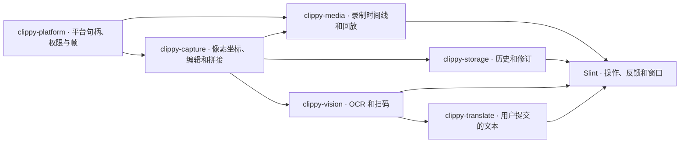

# Clippy v0.2.0 功能迁移收尾方案

需求 ID `SLINT-MIGRATION-CLOSURE-01`。核对基线为 2026-11-25 本地 `dev` 的 `9db24d4`。
本页落实既有迁移规格和原生实现计划。开发继续在当前 `dev` 串行推进，每阶段保留可单独验证和回退的提交。旧版按需维护，日常门禁以新版和共享 Rust 层为主。
[上位规格](../specs/2026-11-23-slint-ui-migration.md) · [原生实现计划](2026-11-24-slint-native-implementation-plan.md)

## Goal

在 Slint 1.19.0 上完成日常剪贴板、快速截图、贴图、自动长截图、区域录屏与库内回放、离线结构化 OCR、
图片翻译和旧版升级。以实际安装包证明这些流程可用，保持现有快照、数据和空闲内存合同。

## 当前进度与缺口

本地基线上有 Linux 完整门禁 11 项通过、深浅主题各 24 项 X11 交互检查、Openbox 设置拖动与查看器缩放证据。
GitHub `dev` 仍指向 #27 的合入提交 `abfdeb5`。之前的安装包、三平台 CI 和内存数字各自对应较早提交，
版本切换时要补齐同一发布 SHA 的证据。 [本轮界面验收](2026-11-23-slint-ui-migration-plan.md#整体界面对照与验收) · [远端 dev 合入提交](https://github.com/51hhh/Clippy/commit/abfdeb5c2dc9557dde07e0cb674f897d8416eb25)

| 功能 | 当前 Slint | 收尾内容 |
| --- | --- | --- |
| 托盘、快捷键、设置 | 按需窗口、单实例、三类快捷键、六主题、平台权限入口。设置里录制和保存快捷键 | 原生托盘和权限态实机验收。补中英文/自动语言、快捷键保存后重绑及失败回滚。完善 OCR 引擎状态、路径选择、清理与更新入口。 [设置调用](../../../apps/slint/src/app/settings.rs) · [旧设置](../../../apps/legacy-tauri/frontend/settings.html) |
| 剪贴板和自动粘贴 | Unicode、HTML、透明 PNG、检索、收藏、删除、敏感项保护。X11 已验证复制和焦点变化。Windows 使用序列号，macOS 使用 `changeCount`，X11 读取 XFixes 事件，应用循环间隔 250 ms | 核对 Wayland 原生应用间的读写和授权恢复。将能观察的变更改为事件唤醒。短时间多次复制、退出数据所有权及焦点失效要在安装包内验证。 [平台剪贴板](../../../crates/clippy-platform/src/clipboard.rs) · [剪贴板工作线程](../../../apps/slint/src/app/clipboard.rs) |
| 冻结截图 | X11 root、GNOME Mutter 原始帧、其他 Wayland 的 wayshot、Windows xcap/WGC 单帧、macOS xcap/CoreGraphics。选区使用单输出源像素 | 复测 v5 速度与 GNOME 瞬时菜单。补窗口速选、旋转和混合 DPI 验收。跨屏选区和合成是原生计划中的新增目标，先固定输出坐标尺度。保留系统截图导入和延时截图。 [平台采集](../../../crates/clippy-platform/src/capture.rs) · [GNOME v5 合同](../specs/2026-10-23-gnome-capture-fast-path-rollback.md) |
| 标注、查看器、贴图 | 截图层有五个内联工具。编辑器可做更多标注。查看器支持缩放拖动。贴图、修订、工作区分组和缩略图已接入 | 恢复高频内联笔、文字、马赛克等实际入口与撤销/重做。窗口速选和扫码结果交互按旧操作验证。贴图跨屏缩放、层级和重启位置恢复做原生验证。独立查看器持久化工程按现有修订合同接入。 [截图窗](../../../apps/slint/ui/capture.slint) · [编辑器控制](../../../apps/slint/src/app/editor.rs) · [贴图状态](../../../apps/slint/src/app/pins.rs) |
| 长截图 | 手动追加、撤销、拼接、取消已验证，完成后进入编辑器 | 接自动滚动、到边界判停、目标丢失撤销输入，以及完成后快捷复制、保存、贴图。复用旧版自动输入与共享拼接算法。 [现有控制器](../../../apps/slint/src/app/longshot.rs) · [旧版自动滚动](../../../apps/legacy-tauri/native/src/capture/longshot/auto_scroll.rs) |
| 区域录屏与回放 | VP9/WebM、暂停/继续、恢复与导出已接入。X11 有安全摆位浮窗。录屏库有首帧。回放与朗读调用 `ffplay` | 接 Win/macOS 连续帧、Wayland 授权流、跨平台录制控制和库内回放。Slint Linux/Windows 已有默认系统音或默认麦克风入口，需验证时钟、设备枚举与异常恢复。旧 QA 的混音和 macOS 音源需按能力接入。 [录屏入口](../../../apps/slint/src/app/recording.rs) · [媒体模块](../../../crates/clippy-media/src/recording/mod.rs) |
| OCR、扫码、图片翻译 | Tesseract TSV 有行框、置信度及段落。配置可用时调用旧增强引擎。打开图像文字窗后可选行、选段及翻译，合适的译文已有覆盖层，长译文留在侧栏 | 打包可分发的离线引擎、补可靠多栏/暗色/旋转排版。统一结果缓存和坐标，补快捷入口和多段按需翻译。扫码从结果文本扩展到共享模型已经提供的位置与逐项操作时，复用真实字段。 [OCR 接口](../../../crates/clippy-vision/src/lib.rs) · [译文回填](../../../apps/slint/src/app/vision.rs#L342) |
| 预览、工具与归档 | 图片、有限 HTML/Markdown、编解码工具、翻译历史、手动 tmux 捕获、统计、归档导入导出 | 复验旧版实际使用的代码高亮、复杂表格、链接和译文管理。按对照结果补齐入口。归档沿用现有校验合同和 SQLite schema。 [预览解析](../../../apps/slint/src/app/preview_document.rs) · [工具窗口](../../../apps/slint/src/app/tools.rs) · [归档入口](../../../apps/slint/src/app/settings.rs#L509) |
| 安装、更新与数据 | semver 分流已实现。Slint 有 QA 身份、安装器及草稿发版。首次正式启动会备份配置和数据库，Linux 早期已验证解包运行和备份恢复 | 真实安装器原位升级、旧 updater 取包验签、正式签名/公证策略、失败回滚以及新版自主更新。核对 QA 与生产身份、实际最低系统版本和无 WebView。 [升级备份](../../../apps/slint/src/app/upgrade.rs) · [发行草稿](../../../.github/workflows/release.yml#L813) |

## Requirements

- 普通截图性能以同机、同画面 v5 路径为对照。截图、滚动截图与录屏共享帧坐标和平台适配，分别按动作选择单帧或持续会话。
- 保留 SQLite/FTS、图片修订、长图拼接评分、VP9/Opus 录制与恢复数据格式。以现有解码像素、对照语料和时间线用例控制回归。
- 复制完成、目标窗口确认和输入授权有独立状态。Wayland 按实际 compositor 与 Portal 能力暴露功能，持久授权由用户和系统授予。
- 大图、编解码、媒体及 OCR 资源按操作启动，使用有界队列。Linux 固定真实桌面按既有口径连续测量五次空闲进程树总 PSS，每次小于 50 MiB。另记冷热启动、开窗/关窗、OCR、长截图、录屏及回放的峰值和释放。 [既有性能门槛](2026-11-24-slint-native-implementation-plan.md#性能数据和验收材料)
- `v0.2.0` 预发布及以上走 Slint，低版本 tag 走 Tauri。生产标识、数据目录和正式旧版升级能力继续按上位规格验收。

## 已定方向与需要重新选型的部分

### UI 渲染和空闲内存

Slint 1.19.0 和 Winit 保持。当前包固定 FemtoVG。旧 Release 在实际 GNOME 空托盘测到 18.11–18.61 MiB，
但旧 deb/X11 样本打开设置 113.10 MiB、关闭后 12 秒仍为 113.64 MiB。同一早期双 renderer 候选中，FemtoVG
开/关设置为 103.57/104.13 MiB，Skia 软件路径为 24.00/23.43 MiB。4K 虚拟 GNOME 的早期热态覆盖层 P95
为 Skia 161.0 ms、FemtoVG 289.6 ms。用这些结果确定调查优先级，用最新同 SHA 同机器实验决定正式 renderer。
Skia 的 CPU 渲染路径与 Slint 的独立 software renderer 是两套实现。 [历史测量](2026-11-24-slint-native-implementation-plan.md#当前进度) · [Slint Winit 渲染选项](https://docs.slint.dev/latest/docs/slint/guide/backends-and-renderers/backend_winit/)

优先检查关闭最后一个窗口后仍持有的 renderer 资源、字体缓存和纹理。FemtoVG 与 Skia 用同一 UI、屏幕、
主题和输入测启动到托盘、首开、关窗 12/60 秒与截图响应。另用 Windows/macOS 验证中文、透明贴图、
阴影及 DPI。正式安装包选用一个通过显示与打包验证的 renderer。资源保留超过预期时记录 CPU/GPU 占用、窗口存活和缓存归属。

### 截图到剪贴板和磁盘

优先沿用 GNOME v5 的 `gsd-media-keys → D-Bus → Mutter RecordArea → PipeWire`。v6 整舞台 PNG 在应用
收到请求前增加了同步工作，旧版已经回退。日历、快速设置、概览和托盘菜单需分别记录按键是否到达、首帧
是否有目标、覆盖层何时可以框选。对易收起菜单沿用延时冻结或系统截图，只有保持菜单且同机延迟达标的
Shell 内快照候选才进入快速入口。 [v5 回退决策](../specs/2026-10-23-gnome-capture-fast-path-rollback.md) · [系统截图 Portal](https://flatpak.github.io/xdg-desktop-portal/docs/doc-org.freedesktop.portal.Screenshot.html)

Windows 优先复用 vendored WGC 的现有帧池能力。单帧对照只改读回与对象生命周期。持续抓取在同一任务内
保留 D3D11 设备和帧池，验证显示源关闭和 DPI。macOS 14+ 对照 `SCScreenshotManager`，12.3–13 用
`SCStream` 获取首帧，持续任务用 `SCStream`。正式包仍标注 11.0，旧系统单帧与启动验证是兼容边界。
Linux X11 继续复用 XRandR/root。KDE/其他 Wayland 的单帧按实际协议能力跑通，持续采集选 ScreenCast Portal
授予的 PipeWire 流，第一版先用共享内存。DMA-BUF 在后续对照读回、同步和兼容收益。
[当前持续采集代码](../../../crates/clippy-platform/src/capture.rs#L122) · [Windows WGC](https://learn.microsoft.com/en-us/windows/apps/develop/media-authoring-processing/screen-capture) · [Apple ScreenCaptureKit](https://developer.apple.com/documentation/screencapturekit/capturing-screen-content-in-macos) · [Apple 单帧 API](https://developer.apple.com/documentation/screencapturekit/scscreenshotmanager?changes=_8) · [ScreenCast Portal](https://flatpak.github.io/xdg-desktop-portal/docs/doc-org.freedesktop.portal.ScreenCast.html)

保持现有后台 PNG 流式写入、同目录临时文件、同步与原子提交。先核算冻结像素到 Slint 的
`SharedPixelBuffer::clone_from_slice`、裁切与剪贴板监听再读回的实际内存和编码次数。标准 4K RGBA 单份约
31.6 MiB。优先减少全屏复制，只把需要 CPU 像素的区域读回。导出路径根据消费者格式编码。改压缩器或
存盘耐久性有实际收益和等像素证据后再定。 [截图缓冲和原子输出](../../../apps/slint/src/app/capture.rs)

### 剪贴板授权与输入

保留 arboard 已接好的各平台格式和私有数据规则。Windows 优先把读发生在 `WM_CLIPBOARDUPDATE`，继续用
序列号防止一次读取混入两代数据。X11 用 XFixes 事件唤醒原线程并保留有界 INCR，macOS 按
`NSPasteboard.changeCount` 做轻量观测。Wayland 的 data-control 读写和通知走同后端，XWayland 与前台
读写按真实能力呈现。Clipboard Portal 是已授权会话的扩展。 [Windows 通知](https://learn.microsoft.com/en-us/windows/win32/api/Winuser/nf-winuser-addclipboardformatlistener) · [Apple changeCount](https://developer.apple.com/documentation/appkit/nspasteboard/changecount) · [Wayland data-control 协议](https://github.com/wayland-mirror/wayland-protocols/blob/main/staging/ext-data-control/ext-data-control-v1.xml) · [Clipboard Portal](https://flatpak.github.io/xdg-desktop-portal/docs/doc-org.freedesktop.portal.Clipboard.html)

Wayland 先跑清除授权、恢复 token、拒绝后继续复制的实际场景。此前 GNOME 实测清除后曾无法再次弹出授权，
须用本次 SHA 复验后再决定是否给工作线程独立 D-Bus 连接。当前 RemoteDesktop 粘贴有 120 ms 等待并逐次
发送按键。等焦点交接和剪贴板写入可观测后，再把等待替换为状态同步。具备能力时比较同一授权会话的
`ConnectToEIS` 与 `Notify*`，每个会话选一种。平台无法可靠确认粘贴目标时，保留已复制结果并提示用户。
[当前 Portal 粘贴](../../../crates/clippy-platform/src/paste/portal.rs#L87) · [RemoteDesktop Portal](https://flatpak.github.io/xdg-desktop-portal/docs/doc-org.freedesktop.portal.RemoteDesktop.html)

### 长截图和媒体

继续用现有四向拼接、判歧义、撤销和图像预算。自动滚动以旧输入适配与取消合同为基础，用目标 ROI 的
更新及稳定帧判定逐步替换固定等待。单任务保持一条读帧会话。原生输入权限不足时保留手动追加。目标窗口
变化、用户夺回鼠标或授权撤回时结束新输入并回收会话。

录制保持 VP9/Opus/WebM 和可恢复分段。视频接口当前在区域抓取返回后打本机会话时间戳。接连续源时优先保留
原生采集时刻，并显式映射到共享会话时钟。音频时间戳验证既有 PipeWire/WASAPI 合同，补 macOS
ScreenCaptureKit 系统声与版本允许的麦克风。Linux 虚拟源旧样本没有交付 `SPA_META_Header`。查真实
设备与版本的协商结果，必要时把 graph 时钟推导作为单独提案，验证设备延迟、暂停/继续与长时漂移。
浮窗由已有安全区域/排除能力决定，Windows 比对实际 `WDA_EXCLUDEFROMCAPTURE` 支持与输出像素。
[Linux 音频合同](../specs/2026-09-22-recording-linux-audio.md) · [macOS 音频合同](../specs/2026-09-22-recording-macos-audio.md) · [Windows 浮窗排除](https://learn.microsoft.com/en-us/windows/win32/api/winuser/nf-winuser-setwindowdisplayaffinity)

先用 GStreamer `playbin + appsink` 验证按需嵌入 Slint 的有声播放、seek、结束反馈与释放，并核对三平台
运行库和插件闭包。轻量对照复用 libvpx/Opus 解码，验证可 seek 的 WebM 解复用、系统音频输出和时钟。
用最终文件、独立恢复分段及合并结果验证两条路径，按干净安装、首帧、seek 响应、同步和包体选一个。
控制器只向 Slint 交付有界帧和状态，换片或关闭时释放资源。硬编和容器切换单独评估。
[现有回放及缩略图](../../../apps/slint/src/app/recording.rs#L858) · [GStreamer playbin](https://gstreamer.freedesktop.org/documentation/playback/playbin.html) · [GStreamer appsink](https://gstreamer.freedesktop.org/documentation/app/appsink.html)

朗读音频也用干净安装验证。优先复用选定播放器的音频输出与取消路径，检查关闭文本工具后音频及时停止。
[现有朗读入口](../../../apps/slint/src/app/tools.rs#L186)

### OCR、排版与翻译

OCR 第一候选保持 **PP-OCRv6 small + Rust worker + ORT CPU**。仓库历史 UI 压力集里，small 的 Python
sidecar 冷 P95/峰值 RSS 为约 384 ms/191 MiB，medium+medium 约 1,065 ms/379 MiB，且原始 CER、空白
F1 和检测 Hmean 有回退。这些是固定旧语料和 Python 进程数据。新 Rust 端以同模型几何和文字对照重新测量。
[仓库 OCR 档位 A/B](../../reviews/2026-09-18-ocr-quality-baseline.md#pp-ocrv6-small--medium-分阶段-ab) · [PaddleOCR v6 官方模型](https://www.paddleocr.ai/latest/en/version3.x/algorithm/PP-OCRv6/PP-OCRv6.html)

先验证 `oar-ocr` 的 PP-OCRv6 预设能否复用检测、裁切与识别，保留 Clippy 的 `StructuredOcr`、源坐标、
敏感项规则和段落排序。在固定的本地模型、字典与最小特性组合上测试兼容性。差分通过后接入。出现难以消除的
差异时，移植既有 Python 管线的必要阶段直接用 `ort`。MNN 是 C++ 推理运行时，`mnn-rs` 提供 Rust 绑定，
可当同模型 A/B 候选，先过模型转换、动态宽度、算子和 Windows/macOS/Linux 包验证。RTen 作为纯 Rust
体积对照。medium、tiny 或其他模型档位只有在指定语料有稳定收益后再进入候选。
[oar-ocr PP-OCRv6 预设](https://github.com/GreatV/oar-ocr#ocr-pipeline) · [ort](https://github.com/pykeio/ort) · [MNN](https://github.com/alibaba/MNN) · [mnn-rs](https://github.com/wapznw/mnn-rs) · [RTen](https://github.com/robertknight/rten)

识别用一次有界像素输入，保留现有一件执行、两件排队。试图减少 RGBA→PNG→解码的额外转换时，记录真实
进程和内存开销。共用图像身份、模型版本与源像素坐标，四点框用于选中，行按栏分组，再按段布局译文。
优先测字体实际可用宽度、高度和换行，取代单纯按字符数判断覆盖条件。测试服务逐段验收，正式网络请求仅
提交用户明确选择的文字。现有 OpenAI-compatible 服务要求凭据。免 key 的自托管/公开接口按实际可用性与
授权作为可选服务。旧增强权重的来源和再分发单独纳入模型清单。 [OCR 并发合同](../../../crates/clippy-vision/src/runtime.rs) · [翻译服务枚举](../../../crates/clippy-translate/src/types.rs)

## 模块的职责

帧与选区由采集层确定来源、拓扑代次、逻辑/物理变换、stride、格式、色彩和时间。快照只读，持续帧由每次
操作的会话持有，以当前图或下一帧的用途限定数据流。Slint 消费模型和反馈。存储线程只持有 SQLite 请求，
图片编码和归档压缩通过后台工作完成。当前归档导出在 SQLite 回调里做 `write_new_archive`，适合移出并
测大归档期间的历史入库延迟。录屏首帧预览前会校验文件，可对长录屏采用绑定产物身份的私有缩略图缓存，
保留播放和导出的完整验证。 [存储工作线程](../../../crates/clippy-storage/src/service.rs) · [归档导出](../../../apps/slint/src/app/settings.rs#L528) · [首帧校验](../../../crates/clippy-media/src/recording/mux/webm_remux.rs#L248)

## 串行实施顺序

| 阶段 | 可直接开始的工作 | 阶段验收 |
| --- | --- | --- |
| 0 基线及包合同 | 固定 `9db24d4` 的合成数据、系统/显示器配置、旧 v5 和现有原生 Release。复用现有门禁和桌面脚本。提前在沙盒安装环境验证旧 updater 的期望资产和签名格式，列出所需平台。 | 数据、二进制 hash 和日志可复现。首次托盘、普通截图和设备权限基线单独可查。 |
| 1 剪贴板和快速截图 | 分两个小提交收敛剪贴板授权/焦点状态和快速冻结/提交。先实际跑通 GNOME Wayland、X11、Windows、macOS。补原生入口识别与可见反馈。 | Unicode、HTML、透明图外部入库再复制。焦点切换及授权拒绝时保留复制。v5 同条件 P95 持平或改善。已知图片选区复制与 PNG 解码像素一致。 |
| 2 采集会话与 renderer | 在平台层先迁 WGC 池、ScreenCaptureKit 和标准 Portal 读帧。沿用现有窗口后台。集中测 FemtoVG/Skia，并固定混合 DPI、旋转、热插拔及窗口速选的像素合同。 | 先取首帧再显示覆盖层。一条连续源可重复提供 ROI。静止时有符合合同的帧，断流/取消可回收。确定 renderer 和安装兼容范围。 |
| 3 自动长截图 | 从 X11 测试页面跑通自动步进，复用共享长图 session。随后迁 Windows/macOS 原生输入、Wayland 同源授权输入与流。接直接复制、保存、贴图。 | 四方向、固定页眉、低纹理、到页尾、撤销和切换目标。每次只建立一条源会话，输入取消后没有延迟事件，输出与拼接金图一致。 |
| 4 录屏与回放 | 用阶段 2 的帧源替换重复抓图，补窗口排除、音轨设备和按需播放器。在可播放的本地产物上先原型比选，固定一个播放器后端。 | 无声和实际可用音轨录制、暂停、继续、强杀恢复、导出、正常回放、seek、关闭释放。每平台至少一份 30 分钟有声证据与音画漂移记录。 |
| 5 离线 OCR 和图片翻译 | 固定 PP-OCRv6 small 的参照输入，首个包验证无需用户安装 Python。用 `StructuredOcr` 接三处入口和同一段落框。用本地服务验证首次与多段译文。 | CER、框 Hmean、阅读顺序和空白 F1 按现有语料判定。模型缺失、取消、切图和敏感项覆盖。三平台冷/热延迟、峰值、退出回落。高 DPI、旋转下译文与对应段落对齐。 |
| 6 日常操作、UI 和输出 | 根据矩阵补齐旧入口。内联高频标注与查看器复用编辑模型，贴图位置/层级按平台处理，补语言、原生文件选择、快捷键动态保存和数据管理。将归档压缩移出 SQLite 回调。 | 复用现有双主题对照与 X11 自动测试。新入口用真实动作验收。归档的图像修订可重新编辑，大小图和长视频均能释放。 |
| 7 从 QA 到正式更新 | 固定候选 SHA，生成四架构 QA 和对应正式安装器草稿。完成实机升级、签名、还原、依赖和进程树检查，再确定是否需要末代 v0.1.x 更新桥。按实际签名及安装结果发布。 | 同一 SHA 的 Linux/Windows/macOS CI、各安装包、人工 QA、五次 PSS 与备份回滚均有证据。旧版稳定更新入口保持正确版本路线。 |

每个候选使用固定输入记录原始问题、替代方案、收益和回退点。连续两次候选无指标或测试推进时记录阻塞，
先继续其他独立任务。涉及 macOS 最低版本、既有性能与数据约束的变更，先出提案再实施。

### 阶段 2 · GNOME 持续采集选区

**Goal** 让长截图与录屏的单次 Mutter 会话直接接收 1× 屏幕上的选区像素，减少每帧从 PipeWire 读回的字节。

**Requirements** 选区按冻结帧的像素尺寸计算，传入 Mutter 前加上屏幕逻辑原点。逻辑尺寸与冻结物理尺寸
不同时沿用全屏流里的源像素裁切。实际流的尺寸须与会话预期一致，避免在几何变化后接入错位画面。

**Acceptance Criteria** 在隔离 GNOME 4K 用相同输入对照区域输出，检查选区输出像素、同会话连续读取、
静止画面、区域外变化和回收。单测覆盖负原点、反向框选、缩放输出的裁切方式。普通截图运行既有像素回归。

**Out of Scope** 分数缩放直接取局部流、非 GNOME Portal 和其他平台原生持续采集另按阶段 2 验收。

### 阶段 2 · Windows WGC 持续采集

**Goal** Windows 长截图和区域录屏在同一任务内复用一个 WGC 会话，每次读取只从 GPU 拷贝冻结选区。

**Requirements** 用冻结帧的源像素确定显示器与选区。每个任务持有自己的 D3D11 设备和帧池，空闲时只保留
最新的原生帧，停止时先释放待取帧再关闭会话。静止画面可重复交付已校验帧，显示器关闭或帧尺寸变化时报告
错误。Slint 会话沿用请求隐藏光标的约定，旧版 `VideoRecorder` 保留其包含光标的合同。

**Acceptance Criteria** 离线验证新帧覆盖、关闭唤醒、尺寸拒绝和待取帧释放，交叉检查 Windows 调用链。
Windows 真机需分别验证框选输出像素、静止帧、暂停继续、录制时另截一张图、显示器模式变化与关闭后重开，
并记录从申请到首帧及持续读取延迟。

**Out of Scope** Windows 快速截图的单帧路径、采集时间戳到录屏时钟的映射、音轨和 macOS 持续采集。

### 阶段 2 · macOS ScreenCaptureKit 持续采集

**Goal** macOS 长截图和区域录屏在同一任务内复用一个选区流，把读回与颜色转换推迟到应用请求帧时。

**Requirements** macOS 12.3 起按需加载 ScreenCaptureKit，屏幕录制权限错误通过原有流程报告。
11–12.2 继续使用已有 CoreGraphics 路径，正式包最低版本保持 11.0。在冻结图的源像素上确定选区，
以显示器本地逻辑点设定流的源范围，输出保持选区原始像素宽高。只保留最新画面，静止时允许复用。
首帧、启动与停止等待有上限，显示器变更、流结束或像素不匹配时报告错误。QA 和正式包都提供屏幕录制用途说明。

**Acceptance Criteria** 自动测试覆盖 Retina 与非整数比例投影、BGRA 行尾填充、静止、失败和待取帧释放。
检查两个 macOS 架构及 Linux 完整门禁。Mac 真机用最小版本和较新系统验证包启动、拒绝/授予权限、
Retina 与旋转的源像素、静止和连续帧、切换显示模式和退出重开，并记录首帧与持续读取延迟。

**Out of Scope** 单次快速截图的后端选型、录屏控制窗排除、音轨、帧时间戳和自动滚动。

### 阶段 2 · 非 GNOME Wayland 持续采集

**Goal** 使用已有冻结截图框选的 Wayland 桌面，在长截图与区域录屏期间复用一条 ScreenCast Portal
授权的显示器流，只将选区像素转换为应用帧。

**Requirements** 任务通过系统选择一台显示器。选中的流必须符合冻结屏幕的逻辑位置和尺寸，并在 PipeWire
协商后验证原始像素尺寸。单屏允许 Portal 缺少几何字段，多屏须能唯一匹配。授权和关闭使用任务自己的
D-Bus 连接，取消与拒绝不启动采集，关停释放 Portal 会话。Portal 缺失、没有显示器源，或输出需要
转换方向时沿用现有 Wayland 连续抓图。静止时复用最近的合规画面，断流和尺寸变化不得交付旧帧。

**Acceptance Criteria** 用独立 Sway、xdg-desktop-portal-wlr 和 PipeWire 验证同一次授权的首帧、多个
ROI、静止帧、拒绝、任务取消和重新打开。拒绝错屏并检查有填充的共享内存行，跑 GNOME 原生取帧及
Linux 完整门禁回归。

**Out of Scope** 无法提供冻结帧的合成器需要独立实现单次截图入口。自动滚动、DMA-BUF GPU 读回、
持久授权、录屏控制窗排除和多屏合成留在后续任务。

### 阶段 2 · 非 GNOME Wayland 首帧框选

**Goal** 快捷键、托盘及延时截图在缺少直接冻结协议的 Wayland 桌面也能进入框选，长截图和录屏
接着使用同一个系统授权。

**Requirements** 根据 Wayland registry 判断现有直接协议是否可用。缺少协议时通过 ScreenCast Portal
选择一台输出，核对显示器身份、逻辑范围及协商的原始尺寸，完成首帧后再显示覆盖层。
框选期间归还后续缓冲，暂停像素转换。快速启停实测会使部分 wlr 后端断流，因此保持已授权连接可用。
取消、复制、保存或进入编辑器时释放会话；持续采集在覆盖层关闭后清除待处理的旧帧，
等待选区首帧后只转换选区。保留 GNOME v5 和支持直接协议的桌面原有快路径。

**Acceptance Criteria** 在原生 KDE 或隔离的无直接冻结协议会话，用同一场景验证首帧像素、
剪贴板、框选保存、取消，以及一次授权后连续追加和录制。验证 Portal 拒绝后重新截图、快速交接、错屏和
分辨率变化时的会话关闭行为。继续跑保有直接协议的 Sway、GNOME 和完整 X11 门禁。

KDE 的首帧验收要求选区与未打开选屏器时的底图逐像素一致。若首帧仍含选屏窗，比较 Portal 返回时间、
PipeWire 帧头和输出像素，确认最早可用帧；静止画面和选择器取消均需保持有界等待。

**Out of Scope** 旋转流及 DMA-BUF 格式需另做像素验证。整屏批量直存、多显示器合成及授权记忆
沿用各自现有计划。

#### 阶段 2 · 框选后的持续帧时序

**Goal** 使同一授权流交付给录屏的第一帧反映框选层消失后的真实桌面，长截图使用同样的选区交接规则。

**Requirements** 先对照窗口关闭、PipeWire 帧头和输出像素确定时钟与采集边界。只在能够验证时序的
交接中使用源时间戳过滤旧帧，继续在复用会话中转换选区像素。窗口、流或缓冲不合规时沿用有界等待和错误反馈。

**Acceptance Criteria** 覆盖层显示时更新底层测试窗口，从框选启动录屏后逐像素核对解码第 0 帧。
同一夹具复测静止桌面、快速确认、取消与普通抓图，确认每次只授权一次。继续执行底层显示契约、直接 Sway、
GNOME 与 Linux 完整门禁。

**Out of Scope** 录屏媒体的时间基、音画同步和录屏控制窗排除继续在阶段 4 验收。

### 阶段 3 · X11 自动长截图

**Goal** 从长截图控制窗选一个方向，自动滚动已框选的应用窗口，直至到达边界、用户停止或目标变化。

**Requirements** 原生输入绑定选区中心对应的 X11 窗口。首次输入前定位鼠标，每次发送单个滚轮步进前核对
目标窗口和指针。输入结束时只有指针仍在原锚点才复位。用户移动指针或目标被覆盖后停止后续输入，保留已拼接
结果。复用同一个选区读取器和 `LongshotSession`。根据选区出现的新像素和稳定状态推进，停在无新增区域或
拼接质量无法确认的位置。自动执行期间要能停止，同时保持截取区域不含控制窗。

X11 控制窗隐藏后由窗口服务器确认已撤下，再开始发输入。运行期间可通过移动指针或托盘停止；主动撤销会
阻止迟到的滚轮和还原指针。选区单步观察仍以 500 毫秒为上限，提交前沿用现有拼接质量和预算，核对结果方向。

**Acceptance Criteria** 用确定性滚动页验证上下左右、固定页眉、页尾停止、撤销和取消。对照长图的实际
尺寸及 PNG 像素，核对停止、指针移开和另一窗口覆盖后没有新滚轮事件。低纹理或位移不明确时保留已有长图。
在同一次任务中核对只打开一个采集源，确认手动追加、完成编辑、复制、保存和贴图仍可使用。

**Out of Scope** Windows、macOS 和 Wayland 的输入授权在 X11 行为通过后接入同一控制器。拼接评分和
图像预算继续使用现有合同。

## 实施记录

### 阶段 0 · Linux 基线

- 隔离 X11 下，`9db24d4` 的完整 v0.2 本地门禁为 11 项通过。固定的 QA Debug 二进制 SHA-256 为
  `84765efe738a495e44cfcb2fd91b397ccf999382f1a9561674174c7d781de48a`。
  本机 v0.1.21 v5 二进制为 `66dfcd3e13377e0fc4d6e2f4102eafeddc12501b66ba0686be6b377e0cc8e20f`。
- Ubuntu GNOME 50.1、1280×800 虚拟显示器、FemtoVG 默认路径。通过同一个 D-Bus 截图入口采样，首个
  全屏窗口映射作为终点。Slint 单次冷样本 556.2 ms，20 次热态 P50/P95 为 112.2/133.5 ms。
  Tauri v5 同口径为 312.4 ms 和 273.3/281.8 ms。实体按键、首个可框选帧和完整启动另验。
- 在独立 X11 会话用本机 v0.1.21 和 `475c62c` 的生产 deb 解包二进制演练数据升级。通过外部复制入库、
  新版读取、SQLite 完整性检查、配置一致及备份还原。该结果覆盖解包运行与数据迁移。
- 核对旧 updater 的 Linux x64 AppImage、Windows x64 NSIS EXE、macOS 两架构 `.app.tar.gz` 资产命名，
  及四个平台同名加 `.sig` 的签名文件。用一次性密钥为早期 Slint AppImage 生成签名和现有格式
  `latest.json`，通过验签、声明版本变化及单字节篡改测试。生产密钥、客户端实际取包安装和同 SHA 三平台验收待阶段 7。
  [包资产合同](../../../scripts/generate-updater-manifest.mjs) · [数据升级测试](../../../scripts/qa/slint-linux-upgrade.py)

基准日志保存在本地 `target/test-artifacts/slint-migration-closure/`，完整门禁原始报告位于
`target/test-artifacts/slint-full-parity/complete-ci.log`。

### 阶段 1 · Wayland 粘贴授权

- 隔离 GNOME 50.1 复现了拒绝授权、清除、再申请后无对话框。平台粘贴模块改用当前授权工作线程自己的
  D-Bus 连接，已授权会话内的粘贴继续复用该会话。
- 在真实 RemoteDesktop Portal 上复测了拒绝后重新打开对话框、勾选记住后连续两次重启、撤回后拒绝
  自动粘贴、撤回后再次授权。用平台层回归报告记录结果，安装包设置入口、目标应用焦点和完整剪贴板往返仍待验收。
  [Portal 工作线程](../../../crates/clippy-platform/src/paste/portal.rs)

### 阶段 1 · 快速截图缓冲

- Slint 覆盖层保留一个共享源缓冲，提交后裁切线程只读这一份缓冲。复制、落盘、编辑和滚动截图使用同一套
  源像素映射，录屏读取同一选区尺寸。单测验证原采集缓冲释放、Slint 图像与裁切共享源缓冲及 RGBA 像素。
- 在 3840×2160 虚拟 GNOME 用相同点位取样，每组 1 次冷态、20 次热态。将缓冲转换放在采集线程的候选
  得到覆盖层 PSS 中位数 430.2 MiB、热态 P95 329.3 ms，原路径同轮为 376.3 MiB、316.5 ms。
  同轮旧版 v5 热态 P95 为 742.7 ms。保留原 UI 转换位置，将采集像素在转换完成后立即释放。
- 采用的候选在同一个虚拟会话按候选、基线、候选交错测试。覆盖层 PSS 中位数分别为
  376.9、402.8、404.2 MiB，热态映射 P95 分别为 294.9、292.7、345.3 ms。每块 4K 输出少一份
  31.6 MiB 的源像素常驻，整进程 PSS 和延迟尚无稳定改善。阶段 2 继续用同条件对照 renderer。
  [共享缓冲与选区裁切](../../../apps/slint/src/app/capture.rs)
- 新版完整 Linux 门禁 11 项通过，0 项失败、0 项跳过。X11 桌面回归验证剪贴板焦点变化后继续保留复制内容，
  快捷键和托盘触发截图，带标注选区复制与 PNG 像素一致，以及长截图和区域录屏输出。原始输出见
  `target/test-artifacts/slint-migration-closure/stage1-ci.log`。
- `54948f5` 的 QA Debug 在 1280×800 虚拟 GNOME 用托盘直接保存入口，分别抓到展开的日历、快速设置和
  概览。每组关闭前后比较 PNG，目标区域变化分别为 197,500、73,246、334,173 像素，关闭后的同区域
  都恢复原像素。实体全局快捷键触发时的菜单状态、真实应用托盘弹窗、多屏和实体显示器仍待验收。

### 阶段 2 · 渲染内存基线

- `54948f5` 的 FemtoVG QA Debug 二进制 SHA-256 为
  `e919577e7a6008e5246a0937d5f3abfba75aab53985275dec29195e6fb75d505`。
  一个隔离 X11 样本中，托盘就绪后 PSS 为 24.39 MiB，打开设置后为 109.55 MiB，
  关窗 12 秒和 60 秒均为 127.32 MiB，进程数为 1。相对托盘基线，堆多 46.39 MiB，
  LLVM 映射多 28.92 MiB，Mesa Gallium 映射多 4.69 MiB。
- 用这组数据定位 FemtoVG/Mesa 的关窗资源。相同提交下仍需复测 Release 与 Skia、实体硬件加速环境，
  50 MiB 发布验收继续使用指定桌面的五轮 60 秒托盘样本。

### 阶段 2 · GNOME 持续采集结果

- 长截图与录屏把冻结帧尺寸带进持续采集。1× GNOME 由 Mutter 直接给出选区，缩放输出按冻结像素裁切。
  流尺寸与冻结时的预期不一致时报告错误。X11 和 GNOME 复用绝对选区坐标的计算。
- GNOME 50.1 的隔离 3840×2160 显示器上，持续采集的 `RecordArea` 从 `(0, 0, 3840, 2160)` 改为
  `(480, 270, 480, 270)`。原始 RGBA 每帧从 31.64 MiB 降至 0.49 MiB。相同输入每组 20 次区域更新，
  取帧 P50/P95 从 24.2/37.5 ms 降至 0.89/1.42 ms。独立采集探针的进程 PSS 中位数从 259.6 MiB 降至
  10.4 MiB。探针同时核对静止帧、区域外变化、正常退出和断流报错。日志见
  `target/test-artifacts/slint-stage2/roi-repeat.log`。
- 同一虚拟输出分别设为 2× 和旋转 90°，持续帧与独立冻结帧裁切像素逐点一致。负原点和反向框选过单测。
  默认新版 `./scripts/ci-local.sh` 11 项通过。共享平台 crate 的 Windows GNU 交叉检查通过，真机和
  多屏热插拔仍待验收。
- 虚拟 GNOME 的 Slint 实际入口生成了可解码的 240×150 VP9 区域录屏，关闭长截图和停止录屏均发出
  会话关闭调用。长截图的虚拟鼠标首轮选区与预设起点有偏差，复测未稳定走到控制窗。平台读帧像素对照
  与完整 X11 交互已通过，GNOME 首轮框选和真实设备交互继续验收。

### 阶段 2 · Release 渲染器实测

以 `b2c5269` 的功能源码为基线，在独立构建目录启用两个渲染器。Slint 1.19.0 QA Release 的 SHA-256 为
`39b21ad2365bea6947d6d8cf51215f211ac2386828ae5705d1a67a0bd5d94db3`。同一个二进制分别用
`SLINT_BACKEND=winit-femtovg` 和 `winit-skia-software` 启动。Skia 0.157.0 的预构建归档与
libvpx 缓存均经过 SHA-256 校验，双渲染器构建中 bindgen 0.73.2 使用 prettyplease 0.3.0。
[Winit 渲染器入口](https://docs.slint.dev/latest/docs/slint/guide/backends-and-renderers/backend_winit/) · [Skia 预构建归档](https://github.com/rust-skia/skia-binaries/releases/expanded_assets/0.157.0)

| 同机隔离样本 | FemtoVG | Skia Software |
| --- | ---: | ---: |
| X11 托盘就绪 PSS | 16.13 MiB | 16.14 MiB |
| X11 打开设置 PSS | 128.45 MiB | 28.78 MiB |
| X11 关设置窗 60 秒 PSS | 129.27 MiB | 28.07 MiB |
| GNOME 1080p 冷态映射 P50 | 518.8 ms | 109.5 ms |
| GNOME 1080p 热态映射 P95 | 139.0 ms | 96.5 ms |
| GNOME 4K 冷态映射 P50 | 633.5 ms | 209.6 ms |
| GNOME 4K 热态映射 P95 | 268.8 ms | 168.3 ms |

内存对照每种渲染器一轮。每组延迟含五次独立冷启动和二十次热采样，起点为 D-Bus 截图请求，终点为
合成器映射全屏覆盖层。两种渲染器各通过 24 项 X11 交互，含截图、标注、透明图片、长截图和录屏。
双渲染器本机 QA deb 解包后用 Skia 再跑同样的 24 项，二进制哈希一致。该包在本机工具链引入
`GLIBC_2.43`，Ubuntu 22.04 需用 Jammy 环境重建并验收。日志集中在 `target/test-artifacts/slint-stage2/`。

Skia Software 进入 Linux 渲染器候选验证。发布选型还需要原生硬件加速、Jammy、Windows 和 macOS 的
显示与包验证，并在指定真实桌面完成五轮 60 秒的托盘 PSS 验收。

### 阶段 2 · Windows WGC 接入结果

- Slint 的长截图和区域录屏经过共享区域读取器打开一个 WGC 会话。回调把最新原生帧留在容量为一的缓冲中，
  实际读取时才按冻结选区做 GPU 到 CPU 的拷贝。首帧等候上限为 3 秒，已有画面的静止等待为 16 ms。
  帧尺寸变化、显示器关闭或读回错误会终止取帧，正常退出释放待取帧并关闭会话和帧池。
- 新版默认 Linux 门禁 11 项通过。Windows GNU 交叉检查覆盖 Slint 入口、平台 crate 和 vendored xcap，
  Slint 入口检查停用默认录屏编码特性。Windows 测试二进制在隔离 Wine 中完成 15 项帧交接、尺寸、
  初始化回滚和关闭测试。真实抓帧探针能枚举虚拟显示器，创建 WGC 对象时 Wine 返回 `0x80040111`。
- Windows 真机继续验证 10/11 的画面、旋转和热插拔、暂停继续、录制时另截一张图及实测延迟。
  本轮原始证据见 `target/test-artifacts/slint-stage2-wgc/`。
  [WGC 区域读帧](../../../apps/legacy-tauri/native/vendor/xcap/src/windows/wgc_region_reader.rs) ·
  [Microsoft WGC 显示器接入](https://learn.microsoft.com/en-us/windows/win32/api/windows.graphics.capture.interop/nf-windows-graphics-capture-interop-igraphicscaptureiteminterop-createformonitor)

### 阶段 2 · macOS 持续采集接入结果

- macOS 12.3 起，长截图与区域录屏经共享区域读取器创建一个 ScreenCaptureKit 流。流按选区配置像素尺寸，
  回调只保留最新的 IOSurface，需要画面时才映射并转为 RGBA。静止画面可重复交付，空白、挂起和流停止清除
  旧画面。枚举、启动与等待首帧共享 5 秒，停止回调等候上限为 2 秒。
- macOS 11–12.2 仍走 CoreGraphics。QA 和正式安装包共用屏幕录制用途说明，正式打包校验实际最低版本及
  Mach-O 对 ScreenCaptureKit 的链接情况。打包脚本的 Intel 和 Apple Silicon 配置及生成的 plist 已通过离线验证。
- `MACOSX_DEPLOYMENT_TARGET=11.0` 下，`clippy-platform` 的 Intel 和 Apple Silicon 交叉 clippy
  均通过 `--all-targets -- -D warnings`。Linux 首轮在既有音轨测试与 X11 搜索复制用例上失败，完整复跑为
  11 项通过、0 失败、0 跳过，覆盖 4 个新增选区、像素与帧交接用例。原始证据见
  `target/test-artifacts/slint-stage2-macos/`。
- 动态加载及原生 IOSurface 读回用例已加入平台测试，待 Mac runner 执行。真实安装、TCC 权限、Retina 和旋转像素、
  拔屏重开与采集延迟留在实机矩阵。
  [macOS 区域流](../../../crates/clippy-platform/src/capture/macos.rs) ·
  [Apple ScreenCaptureKit 帧处理](https://developer.apple.com/documentation/screencapturekit/capturing-screen-content-in-macos) ·
  [Apple ScreenCaptureKit 队列与延迟](https://developer.apple.com/videos/play/wwdc2022/10155/)

### 阶段 2 · 非 GNOME Wayland 持续采集结果

- 长截图和区域录屏经共享区域读取器打开一条由 ScreenCast Portal 授权的流。PipeWire 在任务线程中处理
  画面，只转换选区并保留最新一帧。Portal 缺失和 180° 旋转在隔离 Sway 中走原有抓图路径，用户拒绝和
  错屏会结束当前任务。
- Sway 1.11、wlr Portal 0.8.1 与 PipeWire 1.6.2 上，1280×720 输出的 320×180 选区像素与冻结图一致。
  合成画面变化后首次读取返回新像素，单次读取已到达帧用时 0.1 ms，静止帧等待一个 40 ms 更新窗。
  测试覆盖同一流多次读取、拒绝、取消后迟到响应、同尺寸错屏、1.25× 缩放、改分辨率、断开重开及
  用户选择超过 5 秒。实际 Slint 界面用原生虚拟指针验证长截图追加、取消和托盘停止待授权录屏，
  随后生成可解码的 240×150 VP9 成品。
- 该 wlr 组合的自动映射权限为 `PROT_NONE`，早期探针在读首帧时崩溃。现有 Portal 路径按 PipeWire
  提供的 fd 和范围做只读映射，并检查文件长度。GNOME 4K 独立用例复核 480×270 像素、静止帧及会话退出。
- Linux 本地完整门禁在指定 `CARGO_TARGET_DIR` 上 11 项通过、0 失败、0 跳过。默认工作盘首跑因空间
  不足未完成。平台层 Windows GNU 交叉 check 及 macOS 两架构交叉 clippy 通过。
- 保留 KDE 等缺少直接冻结协议的合成器入口验收。Portal 仅授权整屏，选区裁切在应用内进行，GPU 格式和
  旋转流元数据另走专项验证。原始证据见 `target/test-artifacts/slint-stage2-portal/`。
  [授权](../../../crates/clippy-platform/src/capture/screencast.rs) ·
  [持续接收](../../../crates/clippy-platform/src/capture/screencast_stream.rs) ·
  [ScreenCast Portal 规范](https://flatpak.github.io/xdg-desktop-portal/docs/doc-org.freedesktop.portal.ScreenCast.html) ·
  [PipeWire 1.6.2 映射实现](https://github.com/PipeWire/pipewire/blob/1.6.2/src/pipewire/stream.c#L936-L982)

### 阶段 2 · Wayland Portal 首帧实现与待验项

- 不具备直接冻结协议时先由 Portal 选择显示器。冻结后只归还后续缓冲，持续任务接续同一条流。
  隔离 Sway 通过安全上下文隐藏 screencopy 和 xdg-output，覆盖单屏几何识别、拒绝后重试、取消回收、
  240×150 PNG 和剪贴板逐像素一致、长截图接续。该夹具的剪贴板由独立 Xvfb 提供。
- 额外的显示契约探针验证了授权后源窗口更新、显示模式变化后拒绝交接，以及缺少逻辑几何的同尺寸双屏拒绝。
  虚拟 GNOME 4K 继续得到与冻结图一致的 480×270 选区，直接冻结的 Sway 回归验证了既有持续采集路径。
- 窗口销毁通知和 Wayland 同连接 roundtrip 单独使用时，Sway 的录屏第 0 帧仍可能有旧选框。追加帧头
  追踪发现，关闭前采集的帧可以在恢复后才到达，另有干净帧在恢复命令之前已采集。现以系统授权返回和
  覆盖层销毁分别作为冻结、持续采集的时间边界，原有 GNOME 和直接冻结路径沿用既有入口。
- 隔离 Sway 在底层测试表面提交换色后再确认，核对静止、换色及快速确认的 8 次录屏。每次只授权一次，
  解码第 0 帧和后续画面逐像素符合阈值，停止后释放会话。测试也覆盖拒绝重试、静态截图复制与保存、
  长截图复用源和取消。原始证据见 `target/test-artifacts/slint-stage2-kde/`。
- 嵌套 KWin 6.6.7 在隔离 Wayland/OpenGL 会话中能选屏并交付 MemFd 画面。未校验时间戳的首张 PNG
  包含刚关闭的 KDE 系统选择器。追加源帧检查后，9 张有效像素帧的 PTS 均为 0，无法判定对应时刻。
  此情况仅得到错误反馈和会话释放。KDE 截图和持续任务待在原生输出上复测时间戳、选屏窗关闭动画及像素。
  [KWin 帧头来源](https://github.com/KDE/kwin/blob/v6.6.4/src/plugins/screencast/screencaststream.cpp#L636-L645)
- 去掉临时追踪后，完整 Linux 本地门禁为 11 项通过、0 失败、0 跳过。相同源码也通过了直接冻结的
  Sway 回归、4K 虚拟 GNOME 的 480×270 选区像素对照，以及输出模式变化和同尺寸错屏拒绝。
  Windows GNU 的 Slint QA 入口在关闭默认录屏编解码特性时交叉检查通过，Apple Silicon 平台层交叉
  clippy 通过。Windows、macOS 的截图仍需在目标系统取得原生画面。

### 阶段 3 · X11 输入基线

- 在独立 Xvfb 中使用有固定页眉的确定性滚动页。原生输入在四个方向各收到目标滚轮事件，绘制的选区像素
  与对应页位置一致，到页尾后画面保持原位。第二个同进程窗口覆盖选区时，从根窗口坐标查到的原生窗口 ID
  随之改变，关闭后恢复。该基线覆盖输入和目标识别，Slint 自动步进和最终长图留在本阶段接入验收。
  测试日志见 `target/test-artifacts/slint-stage3-x11/scroll-target-baseline.log`。

### 阶段 3 · X11 自动滚动和直接输出

- 框选后的长截图保持一个选区读取器和拼接会话。X11 后端确认控制窗已隐藏，向锁定窗口发送单个滚轮
  步进，再按画面稳定情况追加。托盘停止、用户移动指针或换窗后保留已拼接结果。退出会撤销输入许可。
  直接复制、原子保存和贴图共用当前拼接像素，撤销及进入编辑器仍可用。
- 隔离 Xvfb 的 GTK 测试页验证十个自动滚动和输出场景。向上、向下输出 320×312，向左输出 392×240，
  向右撤销一次后输出 368×240，PNG 和逐像素对照图一致。向下用例保留固定页眉，低纹理用例保持首帧，
  换窗后新旧窗口都没有收到后续输入。已验证停止后取消、用户接管指针、自然结束复位和滚动中退出。
- 新版完整 Linux 门禁 11 项通过、0 失败、0 跳过。直接冻结 Sway 和 Portal 方式的手动长截图回归通过。
  Windows GNU 的 QA 入口交叉检查未启用录屏编解码，macOS Apple Silicon 的平台层交叉检查通过。
  自动滚动的 Windows、macOS 和 Wayland 后端及原生验收留在本阶段后续，尚无同一 SHA 的三平台 CI。
  日志见 `target/test-artifacts/slint-stage3-x11/`。

## Acceptance Criteria

- [ ] Linux 的 GNOME Wayland、X11、KDE/其他受支持 Wayland，以及 Windows 10/11、macOS Intel/Apple Silicon，
  各自用真实安装的同 SHA 包覆盖托盘、快捷键、剪贴板、设置、截图、贴图、长截图、OCR/翻译及可用录屏能力。
  每行记录自动回归、真实系统测试、平台限制和证据路径。
- [ ] 1080p/4K 冷热比较从按键到覆盖层可交互与从确认到成功复制/落盘。核对 v5 的 P95、菜单保留率、编码
  次数和输出像素。各平台核对多屏缩放及旋转。长截图回归现有输出评分、内存预算和任务取消。
- [ ] OCR 固定模型、语料与硬件，分别记录真实几何、文字、段落顺序、首张/热态 P95、峰值与退出回落。
  验证已授权翻译服务、段落点击、跨比例显示、取消和较长译文的侧栏承接。
- [ ] 录屏所有已声明的音源用实际设备测试，记录 30 分钟时钟/漂移、设备拔出、关闭播放、残留进程和分段恢复，
  比对导出文件与有效原件。干净安装展示随包可用的 OCR、回放与权限状态。
- [ ] 最新 `./scripts/ci-local.sh` 完整通过。Ubuntu `Check (ubuntu-22.04)`、Windows
  `Native Check (windows-latest)`、macOS `Native Check (macos-latest)` 在同一发布 SHA 成功。
  使用 `scripts/qa/measure-slint-idle.py` 复测真实桌面的五次 60 秒进程树总 PSS。确认正式运行进程和包内依赖
  符合 Slint 发行合同。 [门禁脚本](../../../scripts/ci-local.sh) · [内存脚本](../../../scripts/qa/measure-slint-idle.py) · [平台人工 QA](../../native-qa.md)
- [ ] 从最新版稳定 Tauri 实际安装升级，复查数据、设置、快捷键、贴图、密钥引用和应用身份。模拟失败后恢复备份，
  校验旧安装器消费的资产格式、签名和更新清单。核对 v0.1.x 后续维护发版。
  [Tauri updater 合同](https://v2.tauri.app/plugin/updater/) · [Linux 升级测试入口](../../../scripts/qa/slint-linux-upgrade.py)

## Out of Scope

独立维护事项包括 v0.1.x 新功能、SQLite schema 升级、协作同步协议及更新服务换代。
公式结构识别、复杂背景擦除、通用跨平台零拷贝和新硬编格式属于各自有基准的后续功能提案。
