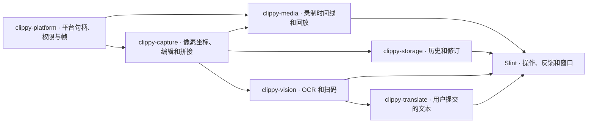

# Clippy v0.2.0 功能迁移收尾方案

需求 ID `SLINT-MIGRATION-CLOSURE-01`。核对基线为 2026-11-25 本地 `dev` 的 `9db24d4`。
本页落实既有迁移规格和原生实现计划。开发继续在当前 `dev` 串行推进，每阶段保留可单独验证和回退的提交。旧版按需维护，日常门禁以新版和共享 Rust 层为主。
[上位规格](../specs/2026-11-23-slint-ui-migration.md) · [原生实现计划](2026-11-24-slint-native-implementation-plan.md)

## Goal

在 Slint 1.19.0 上完成日常剪贴板、快速截图、贴图、自动长截图、区域录屏与库内回放、离线结构化 OCR、
图片翻译和旧版升级。以实际安装包证明这些流程可用，保持现有快照、数据和空闲内存合同。

## 当前进度与缺口

本地基线上有 Linux 完整门禁 11 项通过、深浅主题各 24 项 X11 交互检查、Openbox 设置拖动与查看器缩放证据。
GitHub `dev` 仍指向 #27 的合入提交 `abfdeb5`。之前的安装包、三平台 CI 和内存数字各自对应较早提交，
版本切换时要补齐同一发布 SHA 的证据。 [本轮界面验收](2026-11-23-slint-ui-migration-plan.md#整体界面对照与验收) · [远端 dev 合入提交](https://github.com/51hhh/Clippy/commit/abfdeb5c2dc9557dde07e0cb674f897d8416eb25)

| 功能 | 当前 Slint | 收尾内容 |
| --- | --- | --- |
| 托盘、快捷键、设置 | 按需窗口、单实例、三类快捷键、六主题、平台权限入口。设置支持录制、即时改键、失败回滚、原生文件选择和 OCR 诊断，Portal 管理的键位同步到界面。跟随系统、简体中文和英文已接入 | 原生托盘、快捷键、系统配置入口、语言和权限态实机验收。补清理与更新入口。 [设置调用](../../../apps/slint/src/app/settings.rs) · [旧设置](../../../apps/legacy-tauri/frontend/settings.html) |
| 剪贴板和自动粘贴 | Unicode、HTML、透明 PNG、检索、收藏、删除、敏感项保护。X11 已验证复制和焦点变化。Windows 使用序列号，macOS 使用 `changeCount`，X11 读取 XFixes 事件，应用循环间隔 250 ms | 核对 Wayland 原生应用间的读写和授权恢复。将能观察的变更改为事件唤醒。短时间多次复制、退出数据所有权及焦点失效要在安装包内验证。 [平台剪贴板](../../../crates/clippy-platform/src/clipboard.rs) · [剪贴板工作线程](../../../apps/slint/src/app/clipboard.rs) |
| 冻结截图 | X11 root、GNOME Mutter 原始帧、其他 Wayland 的 wayshot、Windows xcap/WGC 单帧、macOS xcap/CoreGraphics。选区使用单输出源像素 | 复测 v5 速度与 GNOME 瞬时菜单。补窗口速选、旋转和混合 DPI 验收。跨屏选区和合成是原生计划中的新增目标，先固定输出坐标尺度。保留系统截图导入和延时截图。 [平台采集](../../../crates/clippy-platform/src/capture.rs) · [GNOME v5 合同](../specs/2026-10-23-gnome-capture-fast-path-rollback.md) |
| 标注、查看器、贴图 | 截图层有五个内联工具。编辑器可做更多标注。查看器支持缩放拖动。贴图、修订、工作区分组和缩略图已接入 | 恢复高频内联笔、文字、马赛克等实际入口与撤销/重做。窗口速选和扫码结果交互按旧操作验证。贴图跨屏缩放、层级和重启位置恢复做原生验证。独立查看器持久化工程按现有修订合同接入。 [截图窗](../../../apps/slint/ui/capture.slint) · [编辑器控制](../../../apps/slint/src/app/editor.rs) · [贴图状态](../../../apps/slint/src/app/pins.rs) |
| 长截图 | 手动追加、撤销、拼接、取消已验证，完成后进入编辑器 | 接自动滚动、到边界判停、目标丢失撤销输入，以及完成后快捷复制、保存、贴图。复用旧版自动输入与共享拼接算法。 [现有控制器](../../../apps/slint/src/app/longshot.rs) · [旧版自动滚动](../../../apps/legacy-tauri/native/src/capture/longshot/auto_scroll.rs) |
| 区域录屏与回放 | VP9/WebM、暂停/继续、恢复与导出已接入。X11 有安全摆位浮窗。Wayland、WGC、ScreenCaptureKit 已接入原生帧时间。Slint Linux/Windows 支持选择系统音源或麦克风，macOS 13 起可选系统声。GStreamer 与轻量播放器已通过 Linux 隔离桌面的短片回归 | 根据长时同步、三平台设备与安装包验证确定正式回放与朗读后端。补跨平台浮窗排除、双源混音和 macOS 麦克风。设备移除和长时录音继续按平台验收。 [录屏入口](../../../apps/slint/src/app/recording.rs) · [媒体模块](../../../crates/clippy-media/src/recording/mod.rs) |
| OCR、扫码、图片翻译 | Tesseract TSV 有行框、置信度及段落。配置可用时调用旧增强引擎。打开图像文字窗后可选行、选段及翻译，合适的译文已有覆盖层，长译文留在侧栏 | 打包可分发的离线引擎、补可靠多栏/暗色/旋转排版。统一结果缓存和坐标，补快捷入口和多段按需翻译。扫码从结果文本扩展到共享模型已经提供的位置与逐项操作时，复用真实字段。 [OCR 接口](../../../crates/clippy-vision/src/lib.rs) · [译文回填](../../../apps/slint/src/app/vision.rs#L342) |
| 预览、工具与归档 | 图片、有限 HTML/Markdown、编解码工具、翻译历史、手动 tmux 捕获、统计、归档导入导出 | 复验旧版实际使用的代码高亮、复杂表格、链接和译文管理。按对照结果补齐入口。归档沿用现有校验合同和 SQLite schema。 [预览解析](../../../apps/slint/src/app/preview_document.rs) · [工具窗口](../../../apps/slint/src/app/tools.rs) · [归档入口](../../../apps/slint/src/app/settings.rs#L509) |
| 安装、更新与数据 | semver 分流已实现。Slint 有 QA 身份、安装器及草稿发版。首次正式启动会备份配置和数据库，Linux 早期已验证解包运行和备份恢复 | 真实安装器原位升级、旧 updater 取包验签、正式签名/公证策略、失败回滚以及新版自主更新。核对 QA 与生产身份、实际最低系统版本和无 WebView。 [升级备份](../../../apps/slint/src/app/upgrade.rs) · [发行草稿](../../../.github/workflows/release.yml#L813) |

## Requirements

- 普通截图性能以同机、同画面 v5 路径为对照。截图、滚动截图与录屏共享帧坐标和平台适配，分别按动作选择单帧或持续会话。
- 保留 SQLite/FTS、图片修订、长图拼接评分、VP9/Opus 录制与恢复数据格式。以现有解码像素、对照语料和时间线用例控制回归。
- 复制完成、目标窗口确认和输入授权有独立状态。Wayland 按实际 compositor 与 Portal 能力暴露功能，持久授权由用户和系统授予。
- 大图、编解码、媒体及 OCR 资源按操作启动，使用有界队列。Linux 固定真实桌面按既有口径连续测量五次空闲进程树总 PSS，每次小于 50 MiB。另记冷热启动、开窗/关窗、OCR、长截图、录屏及回放的峰值和释放。 [既有性能门槛](2026-11-24-slint-native-implementation-plan.md#性能数据和验收材料)
- `v0.2.0` 预发布及以上走 Slint，低版本 tag 走 Tauri。生产标识、数据目录和正式旧版升级能力继续按上位规格验收。

## 已定方向与需要重新选型的部分

### UI 渲染和空闲内存

Slint 1.19.0 和 Winit 保持。当前包固定 FemtoVG。旧 Release 在实际 GNOME 空托盘测到 18.11–18.61 MiB，
但旧 deb/X11 样本打开设置 113.10 MiB、关闭后 12 秒仍为 113.64 MiB。同一早期双 renderer 候选中，FemtoVG
开/关设置为 103.57/104.13 MiB，Skia 软件路径为 24.00/23.43 MiB。4K 虚拟 GNOME 的早期热态覆盖层 P95
为 Skia 161.0 ms、FemtoVG 289.6 ms。用这些结果确定调查优先级，用最新同 SHA 同机器实验决定正式 renderer。
Skia 的 CPU 渲染路径与 Slint 的独立 software renderer 是两套实现。 [历史测量](2026-11-24-slint-native-implementation-plan.md#当前进度) · [Slint Winit 渲染选项](https://docs.slint.dev/latest/docs/slint/guide/backends-and-renderers/backend_winit/)

优先检查关闭最后一个窗口后仍持有的 renderer 资源、字体缓存和纹理。FemtoVG 与 Skia 用同一 UI、屏幕、
主题和输入测启动到托盘、首开、关窗 12/60 秒与截图响应。另用 Windows/macOS 验证中文、透明贴图、
阴影及 DPI。正式安装包选用一个通过显示与打包验证的 renderer。资源保留超过预期时记录 CPU/GPU 占用、窗口存活和缓存归属。

### 截图到剪贴板和磁盘

优先沿用 GNOME v5 的 `gsd-media-keys → D-Bus → Mutter RecordArea → PipeWire`。v6 整舞台 PNG 在应用
收到请求前增加了同步工作，旧版已经回退。日历、快速设置、概览和托盘菜单需分别记录按键是否到达、首帧
是否有目标、覆盖层何时可以框选。对易收起菜单沿用延时冻结或系统截图，只有保持菜单且同机延迟达标的
Shell 内快照候选才进入快速入口。 [v5 回退决策](../specs/2026-10-23-gnome-capture-fast-path-rollback.md) · [系统截图 Portal](https://flatpak.github.io/xdg-desktop-portal/docs/doc-org.freedesktop.portal.Screenshot.html)

Windows 优先复用 vendored WGC 的现有帧池能力。单帧对照只改读回与对象生命周期。持续抓取在同一任务内
保留 D3D11 设备和帧池，验证显示源关闭和 DPI。macOS 14+ 对照 `SCScreenshotManager`，12.3–13 用
`SCStream` 获取首帧，持续任务用 `SCStream`。正式包仍标注 11.0，旧系统单帧与启动验证是兼容边界。
Linux X11 继续复用 XRandR/root。KDE/其他 Wayland 的单帧按实际协议能力跑通，持续采集选 ScreenCast Portal
授予的 PipeWire 流，第一版先用共享内存。DMA-BUF 在后续对照读回、同步和兼容收益。
[当前持续采集代码](../../../crates/clippy-platform/src/capture.rs#L122) · [Windows WGC](https://learn.microsoft.com/en-us/windows/apps/develop/media-authoring-processing/screen-capture) · [Apple ScreenCaptureKit](https://developer.apple.com/documentation/screencapturekit/capturing-screen-content-in-macos) · [Apple 单帧 API](https://developer.apple.com/documentation/screencapturekit/scscreenshotmanager?changes=_8) · [ScreenCast Portal](https://flatpak.github.io/xdg-desktop-portal/docs/doc-org.freedesktop.portal.ScreenCast.html)

保持现有后台 PNG 流式写入、同目录临时文件、同步与原子提交。先核算冻结像素到 Slint 的
`SharedPixelBuffer::clone_from_slice`、裁切与剪贴板监听再读回的实际内存和编码次数。标准 4K RGBA 单份约
31.6 MiB。优先减少全屏复制，只把需要 CPU 像素的区域读回。导出路径根据消费者格式编码。改压缩器或
存盘耐久性有实际收益和等像素证据后再定。 [截图缓冲和原子输出](../../../apps/slint/src/app/capture.rs)

### 剪贴板授权与输入

保留 arboard 已接好的各平台格式和私有数据规则。Windows 优先把读发生在 `WM_CLIPBOARDUPDATE`，继续用
序列号防止一次读取混入两代数据。X11 用 XFixes 事件唤醒原线程并保留有界 INCR，macOS 按
`NSPasteboard.changeCount` 做轻量观测。Wayland 的 data-control 读写和通知走同后端，XWayland 与前台
读写按真实能力呈现。Clipboard Portal 是已授权会话的扩展。 [Windows 通知](https://learn.microsoft.com/en-us/windows/win32/api/Winuser/nf-winuser-addclipboardformatlistener) · [Apple changeCount](https://developer.apple.com/documentation/appkit/nspasteboard/changecount) · [Wayland data-control 协议](https://github.com/wayland-mirror/wayland-protocols/blob/main/staging/ext-data-control/ext-data-control-v1.xml) · [Clipboard Portal](https://flatpak.github.io/xdg-desktop-portal/docs/doc-org.freedesktop.portal.Clipboard.html)

Wayland 先跑清除授权、恢复 token、拒绝后继续复制的实际场景。此前 GNOME 实测清除后曾无法再次弹出授权，
须用本次 SHA 复验后再决定是否给工作线程独立 D-Bus 连接。当前 RemoteDesktop 粘贴有 120 ms 等待并逐次
发送按键。等焦点交接和剪贴板写入可观测后，再把等待替换为状态同步。具备能力时比较同一授权会话的
`ConnectToEIS` 与 `Notify*`，每个会话选一种。平台无法可靠确认粘贴目标时，保留已复制结果并提示用户。
[当前 Portal 粘贴](../../../crates/clippy-platform/src/paste/portal.rs#L87) · [RemoteDesktop Portal](https://flatpak.github.io/xdg-desktop-portal/docs/doc-org.freedesktop.portal.RemoteDesktop.html)

### 长截图和媒体

继续用现有四向拼接、判歧义、撤销和图像预算。自动滚动以旧输入适配与取消合同为基础，用目标 ROI 的
更新及稳定帧判定逐步替换固定等待。单任务保持一条读帧会话。原生输入权限不足时保留手动追加。目标窗口
变化、用户夺回鼠标或授权撤回时结束新输入并回收会话。

录制保持 VP9/Opus/WebM 和可恢复分段。视频接口当前在区域抓取返回后打本机会话时间戳。接连续源时优先保留
原生采集时刻，并显式映射到共享会话时钟。音频时间戳验证既有 PipeWire/WASAPI 合同，补 macOS
ScreenCaptureKit 系统声与版本允许的麦克风。Linux 虚拟源旧样本没有交付 `SPA_META_Header`。查真实
设备与版本的协商结果，必要时把 graph 时钟推导作为单独提案，验证设备延迟、暂停/继续与长时漂移。
浮窗由已有安全区域/排除能力决定，Windows 比对实际 `WDA_EXCLUDEFROMCAPTURE` 支持与输出像素。
[Linux 音频合同](../specs/2026-09-22-recording-linux-audio.md) · [macOS 音频合同](../specs/2026-09-22-recording-macos-audio.md) · [Windows 浮窗排除](https://learn.microsoft.com/en-us/windows/win32/api/winuser/nf-winuser-setwindowdisplayaffinity)

先用 GStreamer `playbin + appsink` 验证按需嵌入 Slint 的有声播放、seek、结束反馈与释放，并核对三平台
运行库和插件闭包。轻量对照复用 libvpx/Opus 解码，验证可 seek 的 WebM 解复用、系统音频输出和时钟。
用最终文件、独立恢复分段及合并结果验证两条路径，按干净安装、首帧、seek 响应、同步和包体选一个。
控制器只向 Slint 交付有界帧和状态，换片或关闭时释放资源。硬编和容器切换单独评估。
[现有回放及缩略图](../../../apps/slint/src/app/recording.rs#L858) · [GStreamer playbin](https://gstreamer.freedesktop.org/documentation/playback/playbin.html) · [GStreamer appsink](https://gstreamer.freedesktop.org/documentation/app/appsink.html)

朗读音频也用干净安装验证。优先复用选定播放器的音频输出与取消路径，检查关闭文本工具后音频及时停止。
[现有朗读入口](../../../apps/slint/src/app/tools.rs#L186)

### OCR、排版与翻译

OCR 第一候选保持 **PP-OCRv6 small + Rust worker + ORT CPU**。仓库历史 UI 压力集里，small 的 Python
sidecar 冷 P95/峰值 RSS 为约 384 ms/191 MiB，medium+medium 约 1,065 ms/379 MiB，且原始 CER、空白
F1 和检测 Hmean 有回退。这些是固定旧语料和 Python 进程数据。新 Rust 端以同模型几何和文字对照重新测量。
[仓库 OCR 档位 A/B](../../reviews/2026-09-18-ocr-quality-baseline.md#pp-ocrv6-small--medium-分阶段-ab) · [PaddleOCR v6 官方模型](https://www.paddleocr.ai/latest/en/version3.x/algorithm/PP-OCRv6/PP-OCRv6.html)

先验证 `oar-ocr` 的 PP-OCRv6 预设能否复用检测、裁切与识别，保留 Clippy 的 `StructuredOcr`、源坐标、
敏感项规则和段落排序。在固定的本地模型、字典与最小特性组合上测试兼容性。差分通过后接入。出现难以消除的
差异时，移植既有 Python 管线的必要阶段直接用 `ort`。MNN 是 C++ 推理运行时，`mnn-rs` 提供 Rust 绑定，
可当同模型 A/B 候选，先过模型转换、动态宽度、算子和 Windows/macOS/Linux 包验证。RTen 作为纯 Rust
体积对照。medium、tiny 或其他模型档位只有在指定语料有稳定收益后再进入候选。
[oar-ocr PP-OCRv6 预设](https://github.com/GreatV/oar-ocr#ocr-pipeline) · [ort](https://github.com/pykeio/ort) · [MNN](https://github.com/alibaba/MNN) · [mnn-rs](https://github.com/wapznw/mnn-rs) · [RTen](https://github.com/robertknight/rten)

识别用一次有界像素输入，保留现有一件执行、两件排队。试图减少 RGBA→PNG→解码的额外转换时，记录真实
进程和内存开销。共用图像身份、模型版本与源像素坐标，四点框用于选中，行按栏分组，再按段布局译文。
优先测字体实际可用宽度、高度和换行，取代单纯按字符数判断覆盖条件。测试服务逐段验收，正式网络请求仅
提交用户明确选择的文字。现有 OpenAI-compatible 服务要求凭据。免 key 的自托管/公开接口按实际可用性与
授权作为可选服务。旧增强权重的来源和再分发单独纳入模型清单。 [OCR 并发合同](../../../crates/clippy-vision/src/runtime.rs) · [翻译服务枚举](../../../crates/clippy-translate/src/types.rs)

## 模块的职责

帧与选区由采集层确定来源、拓扑代次、逻辑/物理变换、stride、格式、色彩和时间。快照只读，持续帧由每次
操作的会话持有，以当前图或下一帧的用途限定数据流。Slint 消费模型和反馈。存储线程只持有 SQLite 请求，
图片编码和 ZIP 组装与写入通过后台工作完成。归档导出在 SQLite 工作线程生成一致性快照，再由单独线程执行
`write_new_archive`。录屏首帧预览前会校验文件，可对长录屏采用绑定产物身份的私有缩略图缓存，
保留播放和导出的完整验证。 [存储工作线程](../../../crates/clippy-storage/src/service.rs) · [归档导出](../../../apps/slint/src/app/settings.rs#L528) · [首帧校验](../../../crates/clippy-media/src/recording/mux/webm_remux.rs#L248)

## 串行实施顺序

| 阶段 | 可直接开始的工作 | 阶段验收 |
| --- | --- | --- |
| 0 基线及包合同 | 固定 `9db24d4` 的合成数据、系统/显示器配置、旧 v5 和现有原生 Release。复用现有门禁和桌面脚本。提前在沙盒安装环境验证旧 updater 的期望资产和签名格式，列出所需平台。 | 数据、二进制 hash 和日志可复现。首次托盘、普通截图和设备权限基线单独可查。 |
| 1 剪贴板和快速截图 | 分两个小提交收敛剪贴板授权/焦点状态和快速冻结/提交。先实际跑通 GNOME Wayland、X11、Windows、macOS。补原生入口识别与可见反馈。 | Unicode、HTML、透明图外部入库再复制。焦点切换及授权拒绝时保留复制。v5 同条件 P95 持平或改善。已知图片选区复制与 PNG 解码像素一致。 |
| 2 采集会话与 renderer | 在平台层先迁 WGC 池、ScreenCaptureKit 和标准 Portal 读帧。沿用现有窗口后台。集中测 FemtoVG/Skia，并固定混合 DPI、旋转、热插拔及窗口速选的像素合同。 | 先取首帧再显示覆盖层。一条连续源可重复提供 ROI。静止时有符合合同的帧，断流/取消可回收。确定 renderer 和安装兼容范围。 |
| 3 自动长截图 | 从 X11 测试页面跑通自动步进，复用共享长图 session。随后迁 Windows/macOS 原生输入、Wayland 同源授权输入与流。接直接复制、保存、贴图。 | 四方向、固定页眉、低纹理、到页尾、撤销和切换目标。每次只建立一条源会话，输入取消后没有延迟事件，输出与拼接金图一致。 |
| 4 录屏与回放 | 用阶段 2 的帧源替换重复抓图，补窗口排除、音轨设备和按需播放器。在可播放的本地产物上先原型比选，固定一个播放器后端。 | 无声和实际可用音轨录制、暂停、继续、强杀恢复、导出、正常回放、seek、关闭释放。每平台至少一份 30 分钟有声证据与音画漂移记录。 |
| 5 离线 OCR 和图片翻译 | 固定 PP-OCRv6 small 的参照输入，首个包验证无需用户安装 Python。用 `StructuredOcr` 接三处入口和同一段落框。用本地服务验证首次与多段译文。 | CER、框 Hmean、阅读顺序和空白 F1 按现有语料判定。模型缺失、取消、切图和敏感项覆盖。三平台冷/热延迟、峰值、退出回落。高 DPI、旋转下译文与对应段落对齐。 |
| 6 日常操作、UI 和输出 | 根据矩阵补齐旧入口。内联高频标注与查看器复用编辑模型，贴图位置/层级按平台处理，补语言、原生文件选择、快捷键动态保存和数据管理。将 ZIP 组装与写入移出 SQLite 回调。 | 复用现有双主题对照与 X11 自动测试。新入口用真实动作验收。归档的图像修订可重新编辑，大小图和长视频均能释放。 |
| 7 从 QA 到正式更新 | 固定候选 SHA，生成四架构 QA 和对应正式安装器草稿。完成实机升级、签名、还原、依赖和进程树检查，再确定是否需要末代 v0.1.x 更新桥。按实际签名及安装结果发布。 | 同一 SHA 的 Linux/Windows/macOS CI、各安装包、人工 QA、五次 PSS 与备份回滚均有证据。旧版稳定更新入口保持正确版本路线。 |

每个候选使用固定输入记录原始问题、替代方案、收益和回退点。连续两次候选无指标或测试推进时记录阻塞，
先继续其他独立任务。涉及 macOS 最低版本、既有性能与数据约束的变更，先出提案再实施。

### 阶段 2 · GNOME 持续采集选区

**Goal** 让长截图与录屏的单次 Mutter 会话直接接收 1× 屏幕上的选区像素，减少每帧从 PipeWire 读回的字节。

**Requirements** 选区按冻结帧的像素尺寸计算，传入 Mutter 前加上屏幕逻辑原点。逻辑尺寸与冻结物理尺寸
不同时沿用全屏流里的源像素裁切。实际流的尺寸须与会话预期一致，避免在几何变化后接入错位画面。

**Acceptance Criteria** 在隔离 GNOME 4K 用相同输入对照区域输出，检查选区输出像素、同会话连续读取、
静止画面、区域外变化和回收。单测覆盖负原点、反向框选、缩放输出的裁切方式。普通截图运行既有像素回归。

**Out of Scope** 分数缩放直接取局部流、非 GNOME Portal 和其他平台原生持续采集另按阶段 2 验收。

### 阶段 2 · Windows WGC 持续采集

**Goal** Windows 长截图和区域录屏在同一任务内复用一个 WGC 会话，每次读取只从 GPU 拷贝冻结选区。

**Requirements** 用冻结帧的源像素确定显示器与选区。每个任务持有自己的 D3D11 设备和帧池，空闲时只保留
最新的原生帧，停止时先释放待取帧再关闭会话。静止画面可重复交付已校验帧，显示器关闭或帧尺寸变化时报告
错误。Slint 会话沿用请求隐藏光标的约定，旧版 `VideoRecorder` 保留其包含光标的合同。

**Acceptance Criteria** 离线验证新帧覆盖、关闭唤醒、尺寸拒绝和待取帧释放，交叉检查 Windows 调用链。
Windows 真机需分别验证框选输出像素、静止帧、暂停继续、录制时另截一张图、显示器模式变化与关闭后重开，
并记录从申请到首帧及持续读取延迟。

**Out of Scope** Windows 快速截图的单帧路径、采集时间戳到录屏时钟的映射、音轨和 macOS 持续采集。

### 阶段 2 · macOS ScreenCaptureKit 持续采集

**Goal** macOS 长截图和区域录屏在同一任务内复用一个选区流，把读回与颜色转换推迟到应用请求帧时。

**Requirements** macOS 12.3 起按需加载 ScreenCaptureKit，屏幕录制权限错误通过原有流程报告。
11–12.2 继续使用已有 CoreGraphics 路径，正式包最低版本保持 11.0。在冻结图的源像素上确定选区，
以显示器本地逻辑点设定流的源范围，输出保持选区原始像素宽高。只保留最新画面，静止时允许复用。
首帧、启动与停止等待有上限，显示器变更、流结束或像素不匹配时报告错误。QA 和正式包都提供屏幕录制用途说明。

**Acceptance Criteria** 自动测试覆盖 Retina 与非整数比例投影、BGRA 行尾填充、静止、失败和待取帧释放。
检查两个 macOS 架构及 Linux 完整门禁。Mac 真机用最小版本和较新系统验证包启动、拒绝/授予权限、
Retina 与旋转的源像素、静止和连续帧、切换显示模式和退出重开，并记录首帧与持续读取延迟。

**Out of Scope** 单次快速截图的后端选型、录屏控制窗排除、音轨、帧时间戳和自动滚动。

### 阶段 2 · 非 GNOME Wayland 持续采集

**Goal** 使用已有冻结截图框选的 Wayland 桌面，在长截图与区域录屏期间复用一条 ScreenCast Portal
授权的显示器流，只将选区像素转换为应用帧。

**Requirements** 任务通过系统选择一台显示器。选中的流必须符合冻结屏幕的逻辑位置和尺寸，并在 PipeWire
协商后验证原始像素尺寸。单屏允许 Portal 缺少几何字段，多屏须能唯一匹配。授权和关闭使用任务自己的
D-Bus 连接，取消与拒绝不启动采集，关停释放 Portal 会话。Portal 缺失、没有显示器源，或输出需要
转换方向时沿用现有 Wayland 连续抓图。静止时复用最近的合规画面，断流和尺寸变化不得交付旧帧。

**Acceptance Criteria** 用独立 Sway、xdg-desktop-portal-wlr 和 PipeWire 验证同一次授权的首帧、多个
ROI、静止帧、拒绝、任务取消和重新打开。拒绝错屏并检查有填充的共享内存行，跑 GNOME 原生取帧及
Linux 完整门禁回归。

**Out of Scope** 无法提供冻结帧的合成器需要独立实现单次截图入口。自动滚动、DMA-BUF GPU 读回、
持久授权、录屏控制窗排除和多屏合成留在后续任务。

### 阶段 2 · 非 GNOME Wayland 首帧框选

**Goal** 快捷键、托盘及延时截图在缺少直接冻结协议的 Wayland 桌面也能进入框选，长截图和录屏
接着使用同一个系统授权。

**Requirements** 根据 Wayland registry 判断现有直接协议是否可用。缺少协议时通过 ScreenCast Portal
选择一台输出，核对显示器身份、逻辑范围及协商的原始尺寸，完成首帧后再显示覆盖层。
框选期间归还后续缓冲，暂停像素转换。快速启停实测会使部分 wlr 后端断流，因此保持已授权连接可用。
取消、复制、保存或进入编辑器时释放会话；持续采集在覆盖层关闭后清除待处理的旧帧，
等待选区首帧后只转换选区。保留 GNOME v5 和支持直接协议的桌面原有快路径。

**Acceptance Criteria** 在原生 KDE 或隔离的无直接冻结协议会话，用同一场景验证首帧像素、
剪贴板、框选保存、取消，以及一次授权后连续追加和录制。验证 Portal 拒绝后重新截图、快速交接、错屏和
分辨率变化时的会话关闭行为。继续跑保有直接协议的 Sway、GNOME 和完整 X11 门禁。

KDE 的首帧验收要求选区与未打开选屏器时的底图逐像素一致。若首帧仍含选屏窗，比较 Portal 返回时间、
PipeWire 帧头和输出像素，确认最早可用帧；静止画面和选择器取消均需保持有界等待。

KDE 在连接首帧流前读取 KWin 的窗口关闭特效状态，并维持既有的授权时间戳检查。默认动画、
双倍动画和无动画分别检查同一块横跨系统选屏器边缘的 PNG。选择器取消应释放会话。

**Out of Scope** 旋转流及 DMA-BUF 格式需另做像素验证。整屏批量直存、多显示器合成及授权记忆
沿用各自现有计划。

#### 阶段 2 · 框选后的持续帧时序

**Goal** 使同一授权流交付给录屏的第一帧反映框选层消失后的真实桌面，长截图使用同样的选区交接规则。

**Requirements** 先对照窗口关闭、PipeWire 帧头和输出像素确定时钟与采集边界。只在能够验证时序的
交接中使用源时间戳过滤旧帧，继续在复用会话中转换选区像素。窗口、流或缓冲不合规时沿用有界等待和错误反馈。

Portal 框选确认后先提交透明帧，等待 Wayland 的帧回调推进后再销毁覆盖层。确认超时需要结束
这次交接，释放所持授权流。按现有时序检查录屏和长截图的首帧，覆盖不同的窗口动画速度。

**Acceptance Criteria** 覆盖层显示时更新底层测试窗口，从框选启动录屏后逐像素核对解码第 0 帧。
同一夹具复测静止桌面、快速确认、取消与普通抓图，确认每次只授权一次。继续执行底层显示契约、直接 Sway、
GNOME 与 Linux 完整门禁。

**Out of Scope** 录屏媒体的时间基、音画同步和录屏控制窗排除继续在阶段 4 验收。

### 阶段 3 · X11 自动长截图

**Goal** 从长截图控制窗选一个方向，自动滚动已框选的应用窗口，直至到达边界、用户停止或目标变化。

**Requirements** 原生输入绑定选区中心对应的 X11 窗口。首次输入前定位鼠标，每次发送单个滚轮步进前核对
目标窗口和指针。输入结束时只有指针仍在原锚点才复位。用户移动指针或目标被覆盖后停止后续输入，保留已拼接
结果。复用同一个选区读取器和 `LongshotSession`。根据选区出现的新像素和稳定状态推进，停在无新增区域或
拼接质量无法确认的位置。自动执行期间要能停止，同时保持截取区域不含控制窗。

X11 控制窗隐藏后由窗口服务器确认已撤下，再开始发输入。运行期间可通过移动指针或托盘停止；主动撤销会
阻止迟到的滚轮和还原指针。选区单步观察仍以 500 毫秒为上限，提交前沿用现有拼接质量和预算，核对结果方向。

**Acceptance Criteria** 用确定性滚动页验证上下左右、固定页眉、页尾停止、撤销和取消。对照长图的实际
尺寸及 PNG 像素，核对停止、指针移开和另一窗口覆盖后没有新滚轮事件。低纹理或位移不明确时保留已有长图。
在同一次任务中核对只打开一个采集源，确认手动追加、完成编辑、复制、保存和贴图仍可使用。

**Out of Scope** Windows、macOS 和 Wayland 的输入授权在 X11 行为通过后接入同一控制器。拼接评分和
图像预算继续使用现有合同。

### 阶段 3 · Windows 和 macOS 自动滚动输入

**Goal** 让 Windows 和 macOS 共用现有自动长截图控制器、稳定帧判断、停止许可和输出动作，并保持各自原生的
目标窗口和指针坐标合同。

**Requirements** Windows 从当前采集显示器的物理原点和选区像素计算锚点，复核顶层窗口、进程完整性和
前台目标后发送滚轮。macOS 用 CGDisplayBounds 的逻辑尺寸将冻结选区转换为全局点，按窗口顺序及 PID
核对目标，并在输入前核对系统辅助功能权限。控制窗隐藏确认使用各平台的原生窗口标识。保留单步截止时间、
停用后撤销输入、用户接管时保留指针、权限不足时保留手动追加的合同。

同型号屏幕可使用同一显示器名称，读取器和滚动后端同时匹配冻结时的原点。长截图控制窗隐藏后只请求一次
目标激活，在共享截止时间内等前台切换。运行中前台变化会结束本轮输入。macOS 在发滚轮和提交帧时核对
窗口队列，等画面稳定期间只检查指针和前台，减少反复枚举窗口。

**Acceptance Criteria** Windows 10/11 验证负原点和混合 DPI，macOS 验证 Retina、辅助功能拒绝与恢复。
四向输出、页尾、切换前台目标、移动指针、托盘停止和退出均需用真实窗口复测。平台交叉编译只验编译路径。

**Out of Scope** Wayland 的输入授权和显示器绑定继续按现有 RemoteDesktop/ScreenCast 规格接入。
 [Windows 和 macOS 原生输入合同](../specs/2026-09-22-longshot-native-auto-scroll.md)

### 阶段 3 · Wayland 同源授权与自动滚动

**Goal** 在原生 Wayland 的长截图控制窗中授权单屏画面和指针滚动，继续使用公用拼接与输出。

**Requirements** 先探测两种 Portal 的实际能力，由用户显式打开授权界面。传入当前控制窗的
xdg-foreign parent，不保存恢复令牌。释放旧读取器后才启动组合会话，绑定正确显示器和冻结像素。控制窗
撤下后以新帧重新核对已提交的画面，每次滚动前都核对同一选区，指针坐标和单个离散步进由后端计算。
拒绝、选错屏、目标变化或授权关闭时保留画布，可继续手动追加，必要时由再次点击追加发起单独的画面授权。

**Acceptance Criteria** 隔离 GNOME 对实际 Portal 验证单一组合授权、页尾停止、逐像素输出、拒绝、
取消与目标变化。Sway 无 RemoteDesktop 时保留手动追加。端到端核对授权生命周期、无迟到输入和可复制或
保存的画布，并记录 KDE、多屏、混合 DPI 与实体 Wayland 环境的待验边界。

**Out of Scope** 键盘授权、持久授予远程控制、普通截图入口的授权行为，以及变更现有拼接阈值。
沿用 [Wayland 长截图规格 `PX-LS-WAYLAND-AUTO-01`](../specs/2026-09-23-longshot-wayland-auto-scroll.md)。

### 阶段 4 · 录屏帧时钟与库内播放

**Goal** 让区域录屏沿用原生采集时刻和会话时钟，并在 Slint 录屏库中播放、定位及关闭媒体。

**Requirements** 把源时间和像素一并送过已有取帧边界。先核对 PipeWire 屏幕帧的单调时间，按现有会话时钟
校准，随后接 WGC 和 ScreenCaptureKit 原生源。继续使用原有同步截图采样时钟。暂停后恢复时过滤旧帧，
静止画面、采集前沿和分段封尾共同验证。先用同一批 WebM 对照 GStreamer 和复用现有 VP9/Opus 的候选，
再根据干净安装、首帧、定位、同步、资源和插件闭包决定播放器。 [共享会话时钟](../specs/2026-09-22-recording-shared-clock.md)

**Acceptance Criteria** 在画面切换的已知源上对照源时间、输出时间与首帧像素，验证缓存帧、静止、
暂停、继续、停止和带音轨的长时录屏。分别播放最终文件、独立分段和恢复合并产物，核对定位、结束回调
及关闭后的资源回收，并在干净的三平台安装中复测。

**Out of Scope** 更换 WebM、编码格式与既有音画同步门槛。真实设备和四架构发布包继续按阶段验收。

#### 阶段 4 · 原生视频帧和静止分段

**Goal** 把 PipeWire 视频源的有效 PTS 送到共享录屏时钟，静止时继续写入可独立恢复的 VP9 分段。

**Requirements** 原生时间与 Rust 单调时钟一次校准。同步抓取和缺少原生 PTS 的帧保留取帧观测时刻。
继续使用同一读取器输出最新画面，静止时只交付已确认的采集时间下界，由已有 CFR 编码器重复之前的画面。
已推进的下界和继续录制边界之前的迟到帧丢弃。真实帧、下界和停止保持入队顺序，沿用现有三帧、PCM 和包预算。

**Acceptance Criteria** 固定画面跨过至少一个分段周期后，在停止前取得可解码分段。更新画面并暂停/继续，核对
源时间、输出时序和颜色，复测 Sway 授权框选后的第一帧和隔离 GNOME 的区域录屏。X11 现有回归继续通过。

**Out of Scope** Windows WGC 和 macOS ScreenCaptureKit 的时钟适配随后接入同一帧约定。媒体容器与音频设备合同保持。

#### 阶段 4 · Windows 和 macOS 原生帧时钟

**Goal** 将 WGC 和 ScreenCaptureKit 的区域帧时间送入同一录屏时钟，复用静止推进和续录边界。

**Requirements** 在启动持续源前分别校准 QPC 与 Core Media 主机时钟。WGC 取 `SystemRelativeTime`，
ScreenCaptureKit 取 `SCStreamFrameInfoDisplayTime`。原生时间缺失或超出本地有效区间时采用回调观测值。
录屏只取新帧，长截图仍能读最近画面。保留 macOS 11.0 部署目标和较旧系统的 CoreGraphics 读帧。
[WGC 视频帧时间](https://learn.microsoft.com/en-us/uwp/api/windows.graphics.capture.direct3d11captureframe.systemrelativetime)
· [ScreenCaptureKit 帧信息](https://developer.apple.com/documentation/screencapturekit/scstreamframeinfo/displaytime)
· [Core Media 主机时钟](https://developer.apple.com/documentation/coremedia/cmclockgethosttimeclock%28%29)

**Acceptance Criteria** 检查 QPC 和 Core Media 单位换算、时间范围及现有 Linux 门禁，验证 Windows Slint
入口和两个 macOS 架构的平台层。目标系统补静止分段、恢复前旧像素拒绝、原生时钟和真实有声音画对照。

**Out of Scope** 音源选择、录制浮窗排除与播放器保持本阶段的独立验收。

#### 阶段 4 · Linux 和 Windows 录屏设备选择

**Goal** 录屏库能为下一次录制选择明确的 PipeWire 系统输出、WASAPI 回环输出或麦克风设备。

**Requirements** 复用平台设备枚举，打开录屏库或手动刷新时只启动一次后台查询。按设备身份保持选择，
同时保留无声与跟随系统默认。显示名有长度上限，同名项可区分，原生 ID 留在 Rust 状态。
显式设备启动前消失或录制中断开时报告错误，不自动切换到另一设备。录制开始时固定本次选择。
[录屏设备约定](../specs/2026-09-23-recording-audio-devices.md)

**Acceptance Criteria** 设备刷新、同名、过期选择、默认项和禁用音频构建通过测试。用隔离 PipeWire
验证明确目标进入实际会话，目标缺失时不会录到默认音源，并在 Windows 继续实机核对。

**Out of Scope** macOS 音源、双源混音、跨重启偏好、热切换及听感和长时漂移验收另行实施。

#### 阶段 4 · Slint macOS 系统声

**Goal** 在 macOS 13 起可选系统声，同既有区域录像一起编码为可恢复的 VP9/Opus WebM。

**Requirements** 只在明确选择系统声后打开音频，使用冻结时选定的显示器。复用动态 ScreenCaptureKit、采集时钟
和共享音频 worker。独立音频输出不请求第二份视频画面，暂停关闭音频流，恢复丢弃上一段缓存，正常停止提交已到达
的尾部。系统声请求 48 kHz 双声道并排除 Clippy 自身声音。将原生 PCM PTS 通过流同步时钟转到视频使用的主机时钟，
回调交付有界 PCM。保留 macOS 11.0 最低部署目标。
[Apple 音频采集](https://developer.apple.com/documentation/screencapturekit/scstreamconfiguration/capturesaudio) ·
[Apple 流同步时钟](https://developer.apple.com/documentation/screencapturekit/scstream/synchronizationclock)

**Acceptance Criteria** 系统声选项遵循实际 13.0 运行时能力。验证交错和分平面 PCM、队列上限、起录及恢复时刻、
停止尾部和 100 毫秒拆分合同。同一 SHA 三平台门禁，macOS 13+ 实机核对权限、自产声音排除、静音、暂停恢复与长时漂移。

**Out of Scope** 本次接线只覆盖系统声。麦克风、混音和浮窗排除仍由本阶段后续验收。

#### 阶段 4 · 共享 macOS 麦克风重采样

**Goal** 把已验证的麦克风 PCM 校验和重采样迁到共享媒体层，供 Slint 的 ScreenCaptureKit 麦克风输出复用。

**Requirements** 复用固定的 Rubato 5.0.0 带限 sinc。保持原有 8–192 kHz、mono/stereo Float32 PCM、48 kHz
双声道输出、100 毫秒拆块和正常停录封尾。保留旧版 QA 的 feature 入口和依赖、许可合同。Slint 后续接线继续用
系统声已接入的原生主机 PTS，按设备能力显示麦克风。
[既有重采样合同](../specs/2026-09-23-recording-macos-resampler.md) ·
[Apple 麦克风输出示例](https://developer.apple.com/documentation/screencapturekit/capturing-screen-content-in-macos)

**Acceptance Criteria** 迁移后在共享层执行现有 13 项格式、时间线、滤波和封尾测试，并核对供应链锁定。
默认新版构建继续只依赖实际使用的媒体能力。

**Out of Scope** 抽离阶段保留现有用户入口。macOS 15 权限、设备选择、双源混音和长录作为后续接线与实机验收项。

#### 阶段 4 · GStreamer 库内播放候选

**Goal** 在录屏库验证原件、独立分段和恢复文件的原生嵌入播放、暂停、定位和关闭。

**Requirements** 以可选构建特性接入 `playbin`、单帧 `appsink` 和系统音频输出。点击播放后在媒体线程校验本地产物并启动解码；窗口只取最新画面和播放状态。VP9 沿用录制使用的 BT.709 色彩矩阵。重复定位合并为最新请求，回到列表、关闭窗口和开始录像时停止播放并释放管线。

**Acceptance Criteria** 在录屏库中用三份对照文件核对首帧、暂停后定位的画面和声音、结束反馈及关闭后的音频流回收。运行候选和默认构建的本地检查。按同一判据评估复用现有 VP9/Opus 的候选，并核对三平台安装包的运行库和插件。

**Out of Scope** 正式播放器选型、改写既有录屏格式和原生音频采集时钟。

#### 阶段 4 · 轻量 WebM 播放候选

**Goal** 复用现有 VP9 和 Opus 解码器，按录屏文件自己的索引定位，并为录屏库提供逐帧视频和系统音频输出。

**Requirements** 沿用录屏清单校验，选中一个产物后在同一文件句柄完成哈希和后续读取。通过 `SeekHead` 读取 `Cues`，定位时只解码选中关键帧和随后需要的帧；音频从预读边界之前开始解码，按采样序号裁掉 pre-skip、定位前的 PCM 和尾填充。复用现有纳秒时间基、BT.709 映射、大小上限和录屏库控件。保持视频待取帧和音频输出有界。

**Acceptance Criteria** 用同一批原件、独立分段和恢复文件核对向前及向后定位、首帧像素、PCM 数量和结束边界。索引指向受限文件内的真实 cluster，尾部定位与回退可复测。接入系统音频后，在同一桌面对比两种候选的首帧、定位、长时同步、关闭释放和运行依赖。

**Out of Scope** 通用 Matroska 导入、录屏格式改写、正式播放器切换和采集时间戳合同变更。

#### 阶段 4 · 轻量候选的库内播放

**Goal** 在 Linux QA 构建中从录屏库播放轻量 VP9/Opus 候选，用与 GStreamer 相同的入口和样本验证。

**Requirements** 在媒体线程解码并以八个 Opus 包的容量保存待播 PCM。系统回调和解码线程单向交换立体声样本，画面按已提交的采样序号和设备预测的播放延迟推进。暂停、重定位和关窗时释放本次音频流，继续播放从相应位置重新预读。沿用原有录屏库控件、有界画面交付和产物校验。系统默认输出是日常入口，QA 可显式指定隔离设备。

**Acceptance Criteria** 用有声原件、独立分段和恢复文件验证首帧、暂停、正反定位、继续、播放结束和取消。实际监听系统输出，验证暂停和关窗后旧流回收。另跑无声录像、设备缺失、队列上限和时钟边界。用同源码的两个 QA 构建记录延迟、PSS 和动态库，再验证跨平台及长时同步。

**Out of Scope** 正式播放器切换、macOS 部署目标变更、音频采集时间戳变更。

#### 阶段 5 · 按需离线识别进程

**Goal** 让 Slint 的全尺寸识字窗和历史预览共用可运行的 PP-OCRv6 small 候选，进程退出后归还模型内存。

**Requirements** 在明确配置资源目录的 QA 构建中按需启动独立 worker。Rust/ORT 依赖与主应用分开构建，固定 det、rec 和字典的摘要。按源图尺寸和已有 32 Mi 像素上限直传 RGBA，复用单次执行、两项排队、相同输入合并和 60 秒识别预算。连续请求复用模型，停用 10 秒后回收进程。关闭窗口或切换预览只取消相应消费者，最后一个消费者离开时先回收子进程再释放执行许可。返回真实四点框、行文字和行置信度。

**Acceptance Criteria** 从真实 Slint 入口验证源图坐标、复制和两张不同图片连续识别，核对子进程 PID 复用及退出。复现运行中取消、模型缺失、失效资源、空闲退出和应用退出。记录进程树热态 PSS 与回落，重复实际识别后检查队列预算。使用固定模型和语料继续验证布局与翻译。

**Out of Scope** 此步保留逐行选择能力。段落归组、多栏与旋转质量、正式安装包的资源分发与默认引擎选择继续按阶段 5 验收。

#### 阶段 5 · 文字方向、空格和阅读顺序

**Goal** 提高离线识别的旋转、英文空格和多栏阅读质量，维持源图选框以及资源按需释放。

**Requirements** 固定 PP-OCRv6 small 的检测模型、通用识别模型、字典和线程参数。用同一个图像管线比较候选，保留
原图四点框与已批准的方向分数、像素、行数和并发边界。英文空格候选只能补匹配位置的空白，保留通用模型的非空白字符
和已有空白。按画面布局分清阅读顺序与段落，行仍可单独选择、复制和翻译。

**Acceptance Criteria** 仓库四向语料的四行文字全部正确，源框均在原图内并命中真值。同机使用其余固定语料核对空白
F1、非空白 CER、多栏顺序、耗时及进程峰值。单图空白补全不能更改标点或符号。段落通过跨列、跨行与独立块夹具，
并验证点击、翻译及源图映射。

**Out of Scope** 本步保持平台安装包和模型分发合同的既有要求。公式结构、其他模型档位和复杂背景去除不加入本步。

#### 阶段 5 · 随包离线识别资源

**Goal** 新安装的 Slint 包从自身资源目录启动 OCR，不需要设置 bundle 环境变量或安装 Python。

**Requirements** 把模型、字典、worker、匹配的 CPU 运行库和许可放入同一版本的安装包。用摘要固定公开资产，在
干净构建环境生成 worker。按每个安装器的资源目录定位文件，保留按需启动、关闭回收和已批准的最低系统版本。

**Acceptance Criteria** 检查包内路径、运行库架构、实际系统 ABI、资产摘要和许可证。在 Linux x64、Windows x64、
macOS Intel 和 Apple Silicon 的干净安装上验证冷启动不加载 OCR，打开图像后可离线返回行框和段落，关闭后回收。
Linux 增加 deb 与 AppImage 资源加载对照，macOS 核对 worker 和运行库的签名及最低部署目标。

**Out of Scope** 正式 updater 签名切换和旧版更新桥仍在阶段 7 验收。

### 阶段 6 · 截图标注撤销与重做

**Goal** 在冻结截图覆盖层恢复标注撤销与重做。用户可留在选区内反复修改，再复制、保存或进入编辑器。

**Requirements** 每个选区保留完成的标注和可重做的标注。添加新标注会截断重做记录，清空或更换选区时同时
释放两份记录。保留现有标注数与像素预算，复制、保存和进入编辑器继续使用同一套源坐标与共享编辑模型。

**Acceptance Criteria** 在隔离桌面点工具栏撤销和重做，用 Ctrl+Z、Ctrl+Shift+Z 和 Ctrl+Y 验证快捷键。
macOS 核对 Cmd 组合键。检查撤销后新增标注无法恢复旧记录，重做后的标注在选区可见，剪贴板、PNG 和编辑器
输出像素一致，进入编辑器后仍可编辑。

**Out of Scope** 此步处理当前内联标注的历史。画笔、文字、马赛克及窗口速选继续按阶段 6 补齐。

#### 阶段 6 · 截图内联画笔、文字与马赛克

**Goal** 框选后留在截图覆盖层完成画笔、单行文字和区域马赛克，再沿用复制、保存或进入编辑器的操作。

**Requirements** 自由画笔记录源选区坐标，沿用编辑器的采样上限。文字先点击定位再输入，Enter 确认，Esc
返回选区，复制和保存可确认当前输入。三种工具进入同一份标注历史并复用共享编辑格式。马赛克使用共有的源像素
网格和预乘平均，拖拽时只画边框，松开后在工作线程生成小图。每个选区同时只处理一次预览，从冻结缓冲读原像素。

**Acceptance Criteria** 用真实鼠标画折线、输入文字、拖出马赛克，检查三者的位置和撤销、重做、取消。校验
马赛克预览与输出的格子颜色和边缘采样，剪贴板、PNG 与重新打开的编辑器输出像素一致。已有截图、长图及录屏
入口继续通过 Linux 完整门禁，并记录 4K 马赛克的编辑响应。

**Out of Scope** 接下来的独立步骤处理窗口速选及其混合 DPI 验收。

#### 阶段 6 · 冻结截图窗口速选

**Goal** 截图时悬停显示光标下的最上层窗口，单击锁定该窗口在当前显示器上的区域，再用现有操作复制、
保存、标注、长截图或录屏。

**Requirements** 冻结帧先交付覆盖层，后台读取当前窗口快照。X11 使用窗口管理器堆叠和可见边框，
GNOME Wayland 读取已启用的 Clippy Shell 扩展，Windows 使用 DWM 可见矩形，macOS 使用同一批
Core Graphics 窗口字典。用每块冻结帧自身的坐标变换裁剪窗口交集。点击时锁定当时的候选和源像素边界，
拖拽仍走自由框选，空白处单击选择该显示器。窗口列表只属于发起它的覆盖层。

**Acceptance Criteria** 自动测试覆盖负原点、两块不同缩放的输出、遮挡顺序和精确源像素边界。隔离桌面
验证重叠窗口、空白点击、手动拖拽以及取消重开。GNOME 使用真实扩展载荷核对位置。Windows/macOS 在
各自的混合 DPI 实机继续验收；缺少窗口坐标能力的 Wayland 会话可继续自由框选。

**Out of Scope** 跨屏合成、Shell 扩展安装入口及最终发布矩阵按各自步骤验收。

#### 阶段 6 · 跨屏框选与静态图像合成

**Goal** 从一块显示器拖到另一块时，在各屏同时看到同一个桌面选区。松开后可以复制、存 PNG，
或把合成图送入现有图片编辑器。

**Requirements** 继续显示各自冻结帧。拖拽按起点覆盖层的坐标变换同步到冻结时的桌面布局，只传选区矩形。
每屏预览裁在自己的可见范围，工具栏放在松手所在的屏上。取证时分别检查 X11 和 Windows 的物理桌面坐标，
以及 GNOME、其他直接采集 Wayland 和 macOS 的逻辑桌面坐标。Wayland 沿用按下时由合成器建立的指针抓取。
[Wayland 输入与坐标合同](https://wayland.freedesktop.org/docs/book/Protocol.html#input)

确认后才在后台分配选区画布。统一像素密度取参与合成屏幕中的最大值，每块输出映射到同一个像素网格，
低密度区域按最近邻采样，屏幕间空隙透明。密度相同且像素对齐时直接复制行。继续遵循现有截图及编辑器
的像素预算。跨屏工具栏提供复制、保存、编辑和取消；回到单屏后仍可用单屏标注、长截图和录屏。

**Acceptance Criteria** 单测覆盖负原点、混合密度、旋转后的画面尺寸、布局空隙、正反方向和超预算。
在双屏桌面验证按住鼠标跨屏预览、松开后点第二屏工具栏、回到单屏、取消重开。复制和 PNG 用已知底图
逐像素校验，编辑器的画布应显示同一合成结果。记录隔离桌面以及 Windows/macOS 原生实机各自的验收结果。

**Out of Scope** 跨屏长截图和跨屏录屏仍需要各自的多源持续采集设计。单输出 Portal 授权按其选择器范围处理，
多输出授权属于单独的会话合同。显示器热插拔和目标系统的混合 DPI 继续纳入平台验收。

#### 阶段 6 · GNOME 窗口速选扩展管理

**Goal** GNOME Wayland 用户能从 Screenshot 设置安装和启用内嵌扩展，查看何时可以窗口速选，并可停用或移除
当前用户安装的 Clippy 扩展。

**Requirements** 继续使用仓库唯一的 v5 扩展及原有 UUID。安装按用户目录交付离线文件，已有私有令牌直接沿用。
首次安装时保留其他扩展的启用设置，登记当前 UUID 并说明下次登录生效。GNOME 已识别的扩展通过 Shell 启用或
停用。安装、升级和移除只在用户点击后执行。较新协议、其他路径管理的扩展和不受支持的 Shell 版本显示各自状态。
窗口速选与设置页使用同一个已鉴权的窗口列表调用。状态读取和写入在设置页按需执行。
[GNOME 扩展启停实现](https://github.com/GNOME/gnome-shell/blob/50.1/js/ui/extensionSystem.js) ·
[用户级扩展目录](https://teams.pages.gitlab.gnome.org/Websites/help.gnome.org/system-admin-guide/extensions.html)

**Acceptance Criteria** 在隔离的真实 GNOME Wayland D-Bus 会话，从空目录经设置安装，检查文件、权限和列出的
UUID。重启隔离 Shell 后，从设置看到可用并实际悬停、选择及保存窗口。停用、再次启用和移除均走实际按钮。
单测覆盖未知文件保留、只修改目标 UUID、沿用旧令牌和识别更高版本。多平台构建和普通截图继续通过现有门禁。

**Out of Scope** 系统 UI 的冻结和全局截图快捷键依旧按 v5 采集计划单独验收。扩展的贴图摆位能力按贴图任务接入。

#### 阶段 6 · 保存后立即应用全局快捷键

**Goal** 用户保存剪贴板、贴图和截图快捷键后，当场使用新按键。保存失败时仍可用原来的按键。

**Requirements** X11、Windows 和 macOS 继续使用已有的原生管理器。在提交新配置前先尝试新增按键，保留仍被任一
动作使用的注册。平台注册或配置原子写入失败时撤销本次改动，设置保留旧配置，允许用户修正草稿重试。GNOME
Wayland 在原 v5 路径上更新自己的 GSettings 条目并保留其他条目。其余 Wayland 由现有 Global Shortcuts Portal
会话管理实体键位，按会话版本接入桌面的配置入口和状态。
[Global Shortcuts Portal](https://flatpak.github.io/xdg-desktop-portal/docs/doc-org.freedesktop.portal.GlobalShortcuts.html)

GNOME 在原有快捷键线程中处理本次保存，先核对可枚举的系统和自定义快捷键。互换时保留原物理键并更新动作命令，
普通改键由媒体键服务监听 GSettings 变更。写入失败时恢复本次改动的条目，配置及其他写入在当前保存结束后继续。
Shell 内直接注册的键没有公开枚举或逐键确认接口，物理按键触发仍以真实桌面回归为准。
[GNOME 变更处理](https://github.com/GNOME/gnome-settings-daemon/blob/50.0/plugins/media-keys/gsd-media-keys-manager.c#L773-L805) ·
[Shell 注册接口](https://github.com/GNOME/gnome-shell/blob/50.1/js/ui/shellDBus.js#L186-L214)

非 GNOME Wayland 的设置显示 Portal 回报的实际键位和未分配状态。Portal 2 使用当前会话打开系统快捷键设置，
Portal 1 提示从桌面设置修改。配置页响应同一会话的键位变更，保存主题、截图路径等设置时保留已有的首选键位。
验收覆盖取消授权、识别版本、配置当前会话、更新分配和关闭会话。
[Portal 版本与变更通知](https://flatpak.github.io/xdg-desktop-portal/docs/doc-org.freedesktop.portal.GlobalShortcuts.html)

**Acceptance Criteria** 录制和手填都使用同一保存流程。验证不重启即可触发新按键，旧按键停止触发，并支持两个
动作交换按键。同一应用的重复按键、其他应用占用、写入失败均保留旧配置及可用按键。修复输入后可直接重试。
用隔离 X11 和 GNOME 实测，Windows/macOS 与非 GNOME Portal 在对应原生桌面验收。

**Out of Scope** 新增全局动作、改变快捷键默认值及替换 v5 截图入口。

#### 阶段 6 · 设置原生文件选择

**Goal** 从设置用系统选择器打开截图目录、OCR 清单和备份。支持没有可用选择器的桌面继续手填路径。

**Requirements** Linux 使用 XDG FileChooser Portal，Windows 和 macOS 使用原生面板。只在用户发起操作时
启动选择，不新增 GTK 或 WebView 运行依赖。目录和清单回填当前草稿，仍由截图设置的保存按钮提交。归档使用
原有 `.clippy.zip` 导入导出合同和禁止覆盖规则。取消时保留草稿，关闭设置后忽略旧窗口的选择结果。

**Acceptance Criteria** 从设置实际选择目录和 JSON 文件，核对保存前后配置及截图落盘位置。导出后再导入
同一份 ZIP，核对数据。测试取消、关窗后迟到响应、重复请求、未安装 Portal 和同名文件。Linux 用真实 Portal
验证，Windows 和 macOS 另做原生窗口及打包验收。

**Out of Scope** 录屏导出选择器、归档格式和系统持久文件授权机制。

#### 阶段 6 · 归档写入与剪贴板入库

**Goal** 大备份写入期间，剪贴板仍能入库并读取历史。

**Requirements** SQLite 工作线程只取一次归档快照，交给按需启动的单个写入线程。归档格式、敏感项保护、
摘要校验和原子禁止覆盖规则照旧。正常退出等待已发起的归档结束。失败由原设置入口反馈并允许重试。

**Acceptance Criteria** 在隔离桌面暂停归档写入，另一个应用复制新文本。在恢复写入前核对新文本已进入
SQLite，恢复后核对 ZIP 可读且仍由原快照生成。验证已存在目标文件保留、失败后重试和正常退出等待收尾。

**Out of Scope** 调整持久化格式、替换 ZIP 实现或降低同步落盘要求。

#### 阶段 6 · 设置 OCR 状态与诊断

**Goal** 在截图设置看到已保存配置选择的 OCR 引擎、缺失或损坏的资源，以及该如何恢复。

**Requirements** 进入截图页、保存和手动重查时按需检测。结果与识别时的引擎选择一致，区分停用、内置
PP-OCRv6、增强清单、Tesseract 及不可用。内置模型复用 worker 的清单和有界摘要校验。检查在后台执行，
最多一个正在运行的请求和一个最新请求。取消或关闭设置不提交配置，旧窗口的结果不能更新新窗口。检查不加载
推理运行时、不启动 worker 或 Python。判断系统 Tesseract 时复用现有的有界版本探测。

**Acceptance Criteria** 用实际打包布局验证内置模型、缺失及坏摘要。测试增强配置成功、增强配置失效时的
Tesseract 状态、停用及清除自定义路径后恢复内置引擎。真实设置窗口验证重新检查、保存前后及快速关窗重开，
并观察哈希校验不启动识别进程。重建独立 OCR worker，并以真实模型复测识别输出。

**Out of Scope** 从系统安装 OCR 工具、替换模型或改变识别和降级策略。

#### 阶段 6 · 界面语言

**Goal** 新版可跟随系统语言，也可显式选择简体中文或英文，接续旧版用户的语言设置。

**Requirements** 复用 `AppConfig.language` 的 `auto`、`zh-CN` 和 `en`。启动按保存值选择语言，点击保存后
当场更新原生界面和托盘，保存失败时保留当前语言。静态界面用 Slint 自带的编译翻译，Rust 生成的界面文本
共用同一词表。剪贴板内容、快捷键、路径、翻译语言代码与屏幕来源等数据按原含义处理。

**Acceptance Criteria** 真实桌面验证中文系统跟随、显式英文优先、简体中文切换与重启恢复。在设置页核对
失败保存与重试。检查托盘、剪贴板和操作面板、截图标注、贴图、录屏、OCR 和文本工具的主要入口、键盘操作、
中文字体及布局。记录 Linux 实际窗口和 Windows/macOS 检查的范围。

**Out of Scope** 翻译后端的源/目标语言设置、系统自身提供的对话框与第三方诊断文本。

## 实施记录

### 阶段 0 · Linux 基线

- 隔离 X11 下，`9db24d4` 的完整 v0.2 本地门禁为 11 项通过。固定的 QA Debug 二进制 SHA-256 为
  `84765efe738a495e44cfcb2fd91b397ccf999382f1a9561674174c7d781de48a`。
  本机 v0.1.21 v5 二进制为 `66dfcd3e13377e0fc4d6e2f4102eafeddc12501b66ba0686be6b377e0cc8e20f`。
- Ubuntu GNOME 50.1、1280×800 虚拟显示器、FemtoVG 默认路径。通过同一个 D-Bus 截图入口采样，首个
  全屏窗口映射作为终点。Slint 单次冷样本 556.2 ms，20 次热态 P50/P95 为 112.2/133.5 ms。
  Tauri v5 同口径为 312.4 ms 和 273.3/281.8 ms。实体按键、首个可框选帧和完整启动另验。
- 在独立 X11 会话用本机 v0.1.21 和 `475c62c` 的生产 deb 解包二进制演练数据升级。通过外部复制入库、
  新版读取、SQLite 完整性检查、配置一致及备份还原。该结果覆盖解包运行与数据迁移。
- 核对旧 updater 的 Linux x64 AppImage、Windows x64 NSIS EXE、macOS 两架构 `.app.tar.gz` 资产命名，
  及四个平台同名加 `.sig` 的签名文件。用一次性密钥为早期 Slint AppImage 生成签名和现有格式
  `latest.json`，通过验签、声明版本变化及单字节篡改测试。生产密钥、客户端实际取包安装和同 SHA 三平台验收待阶段 7。
  [包资产合同](../../../scripts/generate-updater-manifest.mjs) · [数据升级测试](../../../scripts/qa/slint-linux-upgrade.py)

基准日志保存在本地 `target/test-artifacts/slint-migration-closure/`，完整门禁原始报告位于
`target/test-artifacts/slint-full-parity/complete-ci.log`。

### 阶段 1 · Wayland 粘贴授权

- 隔离 GNOME 50.1 复现了拒绝授权、清除、再申请后无对话框。平台粘贴模块改用当前授权工作线程自己的
  D-Bus 连接，已授权会话内的粘贴继续复用该会话。
- 在真实 RemoteDesktop Portal 上复测了拒绝后重新打开对话框、勾选记住后连续两次重启、撤回后拒绝
  自动粘贴、撤回后再次授权。用平台层回归报告记录结果，安装包设置入口、目标应用焦点和完整剪贴板往返仍待验收。
  [Portal 工作线程](../../../crates/clippy-platform/src/paste/portal.rs)

### 阶段 1 · 快速截图缓冲

- Slint 覆盖层保留一个共享源缓冲，提交后裁切线程只读这一份缓冲。复制、落盘、编辑和滚动截图使用同一套
  源像素映射，录屏读取同一选区尺寸。单测验证原采集缓冲释放、Slint 图像与裁切共享源缓冲及 RGBA 像素。
- 在 3840×2160 虚拟 GNOME 用相同点位取样，每组 1 次冷态、20 次热态。将缓冲转换放在采集线程的候选
  得到覆盖层 PSS 中位数 430.2 MiB、热态 P95 329.3 ms，原路径同轮为 376.3 MiB、316.5 ms。
  同轮旧版 v5 热态 P95 为 742.7 ms。保留原 UI 转换位置，将采集像素在转换完成后立即释放。
- 采用的候选在同一个虚拟会话按候选、基线、候选交错测试。覆盖层 PSS 中位数分别为
  376.9、402.8、404.2 MiB，热态映射 P95 分别为 294.9、292.7、345.3 ms。每块 4K 输出少一份
  31.6 MiB 的源像素常驻，整进程 PSS 和延迟尚无稳定改善。阶段 2 继续用同条件对照 renderer。
  [共享缓冲与选区裁切](../../../apps/slint/src/app/capture.rs)
- 新版完整 Linux 门禁 11 项通过，0 项失败、0 项跳过。X11 桌面回归验证剪贴板焦点变化后继续保留复制内容，
  快捷键和托盘触发截图，带标注选区复制与 PNG 像素一致，以及长截图和区域录屏输出。原始输出见
  `target/test-artifacts/slint-migration-closure/stage1-ci.log`。
- `54948f5` 的 QA Debug 在 1280×800 虚拟 GNOME 用托盘直接保存入口，分别抓到展开的日历、快速设置和
  概览。每组关闭前后比较 PNG，目标区域变化分别为 197,500、73,246、334,173 像素，关闭后的同区域
  都恢复原像素。实体全局快捷键触发时的菜单状态、真实应用托盘弹窗、多屏和实体显示器仍待验收。

### 阶段 2 · 渲染内存基线

- `54948f5` 的 FemtoVG QA Debug 二进制 SHA-256 为
  `e919577e7a6008e5246a0937d5f3abfba75aab53985275dec29195e6fb75d505`。
  一个隔离 X11 样本中，托盘就绪后 PSS 为 24.39 MiB，打开设置后为 109.55 MiB，
  关窗 12 秒和 60 秒均为 127.32 MiB，进程数为 1。相对托盘基线，堆多 46.39 MiB，
  LLVM 映射多 28.92 MiB，Mesa Gallium 映射多 4.69 MiB。
- 用这组数据定位 FemtoVG/Mesa 的关窗资源。相同提交下仍需复测 Release 与 Skia、实体硬件加速环境，
  50 MiB 发布验收继续使用指定桌面的五轮 60 秒托盘样本。

### 阶段 2 · GNOME 持续采集结果

- 长截图与录屏把冻结帧尺寸带进持续采集。1× GNOME 由 Mutter 直接给出选区，缩放输出按冻结像素裁切。
  流尺寸与冻结时的预期不一致时报告错误。X11 和 GNOME 复用绝对选区坐标的计算。
- GNOME 50.1 的隔离 3840×2160 显示器上，持续采集的 `RecordArea` 从 `(0, 0, 3840, 2160)` 改为
  `(480, 270, 480, 270)`。原始 RGBA 每帧从 31.64 MiB 降至 0.49 MiB。相同输入每组 20 次区域更新，
  取帧 P50/P95 从 24.2/37.5 ms 降至 0.89/1.42 ms。独立采集探针的进程 PSS 中位数从 259.6 MiB 降至
  10.4 MiB。探针同时核对静止帧、区域外变化、正常退出和断流报错。日志见
  `target/test-artifacts/slint-stage2/roi-repeat.log`。
- 同一虚拟输出分别设为 2× 和旋转 90°，持续帧与独立冻结帧裁切像素逐点一致。负原点和反向框选过单测。
  默认新版 `./scripts/ci-local.sh` 11 项通过。共享平台 crate 的 Windows GNU 交叉检查通过，真机和
  多屏热插拔仍待验收。
- 虚拟 GNOME 的 Slint 实际入口生成了可解码的 240×150 VP9 区域录屏，关闭长截图和停止录屏均发出
  会话关闭调用。长截图的虚拟鼠标首轮选区与预设起点有偏差，复测未稳定走到控制窗。平台读帧像素对照
  与完整 X11 交互已通过，GNOME 首轮框选和真实设备交互继续验收。

### 阶段 2 · Release 渲染器实测

以 `b2c5269` 的功能源码为基线，在独立构建目录启用两个渲染器。Slint 1.19.0 QA Release 的 SHA-256 为
`39b21ad2365bea6947d6d8cf51215f211ac2386828ae5705d1a67a0bd5d94db3`。同一个二进制分别用
`SLINT_BACKEND=winit-femtovg` 和 `winit-skia-software` 启动。Skia 0.157.0 的预构建归档与
libvpx 缓存均经过 SHA-256 校验，双渲染器构建中 bindgen 0.73.2 使用 prettyplease 0.3.0。
[Winit 渲染器入口](https://docs.slint.dev/latest/docs/slint/guide/backends-and-renderers/backend_winit/) · [Skia 预构建归档](https://github.com/rust-skia/skia-binaries/releases/expanded_assets/0.157.0)

| 同机隔离样本 | FemtoVG | Skia Software |
| --- | ---: | ---: |
| X11 托盘就绪 PSS | 16.13 MiB | 16.14 MiB |
| X11 打开设置 PSS | 128.45 MiB | 28.78 MiB |
| X11 关设置窗 60 秒 PSS | 129.27 MiB | 28.07 MiB |
| GNOME 1080p 冷态映射 P50 | 518.8 ms | 109.5 ms |
| GNOME 1080p 热态映射 P95 | 139.0 ms | 96.5 ms |
| GNOME 4K 冷态映射 P50 | 633.5 ms | 209.6 ms |
| GNOME 4K 热态映射 P95 | 268.8 ms | 168.3 ms |

内存对照每种渲染器一轮。每组延迟含五次独立冷启动和二十次热采样，起点为 D-Bus 截图请求，终点为
合成器映射全屏覆盖层。两种渲染器各通过 24 项 X11 交互，含截图、标注、透明图片、长截图和录屏。
双渲染器本机 QA deb 解包后用 Skia 再跑同样的 24 项，二进制哈希一致。该包在本机工具链引入
`GLIBC_2.43`，Ubuntu 22.04 需用 Jammy 环境重建并验收。日志集中在 `target/test-artifacts/slint-stage2/`。

Skia Software 进入 Linux 渲染器候选验证。发布选型还需要原生硬件加速、Jammy、Windows 和 macOS 的
显示与包验证，并在指定真实桌面完成五轮 60 秒的托盘 PSS 验收。

### 阶段 2 · Windows WGC 接入结果

- Slint 的长截图和区域录屏经过共享区域读取器打开一个 WGC 会话。回调把最新原生帧留在容量为一的缓冲中，
  实际读取时才按冻结选区做 GPU 到 CPU 的拷贝。首帧等候上限为 3 秒，已有画面的静止等待为 16 ms。
  帧尺寸变化、显示器关闭或读回错误会终止取帧，正常退出释放待取帧并关闭会话和帧池。
- 新版默认 Linux 门禁 11 项通过。Windows GNU 交叉检查覆盖 Slint 入口、平台 crate 和 vendored xcap，
  Slint 入口检查停用默认录屏编码特性。Windows 测试二进制在隔离 Wine 中完成 15 项帧交接、尺寸、
  初始化回滚和关闭测试。真实抓帧探针能枚举虚拟显示器，创建 WGC 对象时 Wine 返回 `0x80040111`。
- Windows 真机继续验证 10/11 的画面、旋转和热插拔、暂停继续、录制时另截一张图及实测延迟。
  本轮原始证据见 `target/test-artifacts/slint-stage2-wgc/`。
  [WGC 区域读帧](../../../apps/legacy-tauri/native/vendor/xcap/src/windows/wgc_region_reader.rs) ·
  [Microsoft WGC 显示器接入](https://learn.microsoft.com/en-us/windows/win32/api/windows.graphics.capture.interop/nf-windows-graphics-capture-interop-igraphicscaptureiteminterop-createformonitor)

### 阶段 2 · macOS 持续采集接入结果

- macOS 12.3 起，长截图与区域录屏经共享区域读取器创建一个 ScreenCaptureKit 流。流按选区配置像素尺寸，
  回调只保留最新的 IOSurface，需要画面时才映射并转为 RGBA。静止画面可重复交付，空白、挂起和流停止清除
  旧画面。枚举、启动与等待首帧共享 5 秒，停止回调等候上限为 2 秒。
- macOS 11–12.2 仍走 CoreGraphics。QA 和正式安装包共用屏幕录制用途说明，正式打包校验实际最低版本及
  Mach-O 对 ScreenCaptureKit 的链接情况。打包脚本的 Intel 和 Apple Silicon 配置及生成的 plist 已通过离线验证。
- `MACOSX_DEPLOYMENT_TARGET=11.0` 下，`clippy-platform` 的 Intel 和 Apple Silicon 交叉 clippy
  均通过 `--all-targets -- -D warnings`。Linux 首轮在既有音轨测试与 X11 搜索复制用例上失败，完整复跑为
  11 项通过、0 失败、0 跳过，覆盖 4 个新增选区、像素与帧交接用例。原始证据见
  `target/test-artifacts/slint-stage2-macos/`。
- 动态加载及原生 IOSurface 读回用例已加入平台测试，待 Mac runner 执行。真实安装、TCC 权限、Retina 和旋转像素、
  拔屏重开与采集延迟留在实机矩阵。
  [macOS 区域流](../../../crates/clippy-platform/src/capture/macos.rs) ·
  [Apple ScreenCaptureKit 帧处理](https://developer.apple.com/documentation/screencapturekit/capturing-screen-content-in-macos) ·
  [Apple ScreenCaptureKit 队列与延迟](https://developer.apple.com/videos/play/wwdc2022/10155/)

### 阶段 2 · 非 GNOME Wayland 持续采集结果

- 长截图和区域录屏经共享区域读取器打开一条由 ScreenCast Portal 授权的流。PipeWire 在任务线程中处理
  画面，只转换选区并保留最新一帧。Portal 缺失和 180° 旋转在隔离 Sway 中走原有抓图路径，用户拒绝和
  错屏会结束当前任务。
- Sway 1.11、wlr Portal 0.8.1 与 PipeWire 1.6.2 上，1280×720 输出的 320×180 选区像素与冻结图一致。
  合成画面变化后首次读取返回新像素，单次读取已到达帧用时 0.1 ms，静止帧等待一个 40 ms 更新窗。
  测试覆盖同一流多次读取、拒绝、取消后迟到响应、同尺寸错屏、1.25× 缩放、改分辨率、断开重开及
  用户选择超过 5 秒。实际 Slint 界面用原生虚拟指针验证长截图追加、取消和托盘停止待授权录屏，
  随后生成可解码的 240×150 VP9 成品。
- 该 wlr 组合的自动映射权限为 `PROT_NONE`，早期探针在读首帧时崩溃。现有 Portal 路径按 PipeWire
  提供的 fd 和范围做只读映射，并检查文件长度。GNOME 4K 独立用例复核 480×270 像素、静止帧及会话退出。
- Linux 本地完整门禁在指定 `CARGO_TARGET_DIR` 上 11 项通过、0 失败、0 跳过。默认工作盘首跑因空间
  不足未完成。平台层 Windows GNU 交叉 check 及 macOS 两架构交叉 clippy 通过。
- 保留 KDE 等缺少直接冻结协议的合成器入口验收。Portal 仅授权整屏，选区裁切在应用内进行，GPU 格式和
  旋转流元数据另走专项验证。原始证据见 `target/test-artifacts/slint-stage2-portal/`。
  [授权](../../../crates/clippy-platform/src/capture/screencast.rs) ·
  [持续接收](../../../crates/clippy-platform/src/capture/screencast_stream.rs) ·
  [ScreenCast Portal 规范](https://flatpak.github.io/xdg-desktop-portal/docs/doc-org.freedesktop.portal.ScreenCast.html) ·
  [PipeWire 1.6.2 映射实现](https://github.com/PipeWire/pipewire/blob/1.6.2/src/pipewire/stream.c#L936-L982)

### 阶段 2 · Wayland Portal 首帧实现与待验项

- 不具备直接冻结协议时先由 Portal 选择显示器。冻结后只归还后续缓冲，持续任务接续同一条流。
  隔离 Sway 通过安全上下文隐藏 screencopy 和 xdg-output，覆盖单屏几何识别、拒绝后重试、取消回收、
  240×150 PNG 和剪贴板逐像素一致、长截图接续。该夹具的剪贴板由独立 Xvfb 提供。
- 额外的显示契约探针验证了授权后源窗口更新、显示模式变化后拒绝交接，以及缺少逻辑几何的同尺寸双屏拒绝。
  虚拟 GNOME 4K 继续得到与冻结图一致的 480×270 选区，直接冻结的 Sway 回归验证了既有持续采集路径。
- 窗口销毁通知和 Wayland 同连接 roundtrip 单独使用时，Sway 的录屏第 0 帧仍可能有旧选框。追加帧头
  追踪发现，关闭前采集的帧可以在恢复后才到达，另有干净帧在恢复命令之前已采集。现以系统授权返回和
  覆盖层销毁分别作为冻结、持续采集的时间边界，原有 GNOME 和直接冻结路径沿用既有入口。
- 隔离 Sway 在底层测试表面提交换色后再确认，核对静止、换色及快速确认的 8 次录屏。每次只授权一次，
  解码第 0 帧和后续画面逐像素符合阈值，停止后释放会话。测试也覆盖拒绝重试、静态截图复制与保存、
  长截图复用源和取消。原始证据见 `target/test-artifacts/slint-stage2-kde/`。
- 嵌套 KWin 6.6.7 在隔离 Wayland/OpenGL 会话中能选屏并交付 MemFd 画面。未校验时间戳的首张 PNG
  包含刚关闭的 KDE 系统选择器。追加源帧检查后，9 张有效像素帧的 PTS 均为 0，无法判定对应时刻。
  此情况仅得到错误反馈和会话释放。KDE 截图和持续任务待在原生输出上复测时间戳、选屏窗关闭动画及像素。
  [KWin 帧头来源](https://github.com/KDE/kwin/blob/v6.6.4/src/plugins/screencast/screencaststream.cpp#L636-L645)
- 去掉临时追踪后，完整 Linux 本地门禁为 11 项通过、0 失败、0 跳过。相同源码也通过了直接冻结的
  Sway 回归、4K 虚拟 GNOME 的 480×270 选区像素对照，以及输出模式变化和同尺寸错屏拒绝。
  Windows GNU 的 Slint QA 入口在关闭默认录屏编解码特性时交叉检查通过，Apple Silicon 平台层交叉
  clippy 通过。Windows、macOS 的截图仍需在目标系统取得原生画面。

#### 阶段 2 · 独立 KWin 输出复现选屏器与选区残影

- KWin 6.6.7 使用独立的 `Virtual-0` 1280×720 输出和 OpenGL。实际 Slint QA 在系统选屏器授权一次后
  显示覆盖层，保存的 240×150 PNG 中有 7,350 个像素偏离纯色底图。选区横跨原选屏器边缘，PNG
  仍可见白色选屏器。保存后 PipeWire 流已释放。该次现象发生在现有源时间戳检查通过后。
- 同一路径的独立采集探针观察授权响应、PipeWire 帧头和三个源像素位置。首帧 PTS 晚于响应约
  48.3 毫秒，仍包含选屏器。三个位置首次同时恢复底色的帧 PTS 晚于响应约 215.0 毫秒，到达约
  227.4 毫秒。KWin 的输出采集时钟取该输出最近一次呈现时刻。
  [KWin 输出时钟](https://github.com/KDE/kwin/blob/v6.6.4/src/plugins/screencast/outputscreencastsource.cpp#L98-L101)
- 在测试进程内把连接 PipeWire 推迟 250 毫秒，默认动画时一次 PNG 与底图逐像素一致。只在隔离配置把
  动画时长设为两倍后，用相同等待仍有 4,500 个偏离像素。默认动画的换色录屏完成并释放了同一会话，
  15 个解码帧中的第 0 和第 1 帧仍含 Slint 选区边框，其余 13 帧在既定像素阈值内。
- 探针验证了固定等待对动画速度敏感，选屏器和应用覆盖层各有一次合成边界。下一候选需验证能观测到前者
  消失的接口，并单独对照应用覆盖层结束绘制后是否仍会进入录屏。保留静止、换色、快速确认与单次授权的
  像素验收，KDE 真机结果仍待补。
- 原始证据位于 `target/test-artifacts/slint-stage2-kde/` 的 `kde-virtual-clock-pixels.log`、
  `kde-virtual-frame-timing.log`、`kde-virtual-connect-delay250-final.log` 和
  `kde-virtual-connect-delay250-slow.log`。对应 PNG 为 `kde-virtual-chooser-in-frame.png`、
  `kde-virtual-delay250-default.png`、`kde-virtual-delay250-slow.png`、
  `kde-virtual-recording-first.png` 和 `kde-virtual-recording-second.png`。

#### 阶段 2 · KDE 选屏器与 Wayland 覆盖层交接修复

- 独立 KWin 6.6.7 输出在授权响应后约 206 毫秒结束默认的 `scale` 动画，双倍动画约 396 毫秒。
  KDE 路径连续两次确认 `activeEffects` 中没有窗口关闭特效，再连接 PipeWire。持续任务接续时先提交透明覆盖层，
  等合成器处理该帧再销毁覆盖层。采集按销毁时间丢弃旧帧，交接超时会结束任务并释放会话。
  [KWin Effects 接口](https://github.com/KDE/kwin/blob/v6.6.4/src/org.kde.kwin.Effects.xml#L2-L5)
- 默认、双倍和关闭动画三组都导出了逐像素一致的 240×150 PNG。每组从第 0 帧起对照 16 帧 VP9，均在颜色误差
  阈值内，每项操作各授权一次。另从独立 Wayland 客户端读取等像素 PNG，手动长截图追加 48 像素并导出
  240×198 等像素 PNG，取消后确认原会话关闭。系统选屏器取消后可重新授权。
- 隔离 Sway 复测了直接冻结和 Portal 两条路径。Portal 的 8 轮录屏均从第 0 帧通过像素对照。隔离 GNOME
  复测了 v5 路径的两份精确窗口截图。完整 Linux 本地门禁 11 通过、0 失败、0 跳过。Windows GNU Slint QA
  交叉检查和 macOS 双架构平台层交叉 Clippy 通过。实体 KDE、多屏混合 DPI 和同一 SHA 原生 CI 待验收。
- QA 二进制 SHA-256 为 `8928dfbb1a6edbaa000e4c4c5bbf9d56c4bee981ceb1b0f9050a3a51677639b5`。
  证据位于 `target/test-artifacts/slint-stage2-kde/`，包括 `kde-effects-{default,slow}.log`、
  `kde-boundaries-{default,slow,disabled,cancel}.log`、`kde-boundaries-native-workflow-final.log`、
  `sway-{portal,direct}-boundaries-final.log`、`gnome-boundaries.log` 和 `ci-local-boundaries.log`。

### 阶段 3 · X11 输入基线

- 在独立 Xvfb 中使用有固定页眉的确定性滚动页。原生输入在四个方向各收到目标滚轮事件，绘制的选区像素
  与对应页位置一致，到页尾后画面保持原位。第二个同进程窗口覆盖选区时，从根窗口坐标查到的原生窗口 ID
  随之改变，关闭后恢复。该基线覆盖输入和目标识别，Slint 自动步进和最终长图留在本阶段接入验收。
  测试日志见 `target/test-artifacts/slint-stage3-x11/scroll-target-baseline.log`。

### 阶段 3 · X11 自动滚动和直接输出

- 框选后的长截图保持一个选区读取器和拼接会话。X11 后端确认控制窗已隐藏，向锁定窗口发送单个滚轮
  步进，再按画面稳定情况追加。托盘停止、用户移动指针或换窗后保留已拼接结果。退出会撤销输入许可。
  直接复制、原子保存和贴图共用当前拼接像素，撤销及进入编辑器仍可用。
- 隔离 Xvfb 的 GTK 测试页验证十个自动滚动和输出场景。向上、向下输出 320×312，向左输出 392×240，
  向右撤销一次后输出 368×240，PNG 和逐像素对照图一致。向下用例保留固定页眉，低纹理用例保持首帧，
  换窗后新旧窗口都没有收到后续输入。已验证停止后取消、用户接管指针、自然结束复位和滚动中退出。
- 新版完整 Linux 门禁 11 项通过、0 失败、0 跳过。直接冻结 Sway 和 Portal 方式的手动长截图回归通过。
  Windows GNU 的 QA 入口交叉检查未启用录屏编解码，macOS Apple Silicon 的平台层交叉检查通过。
  日志见 `target/test-artifacts/slint-stage3-x11/`。

### 阶段 3 · Windows 和 macOS 自动滚动接入结果

- 采集和输入共同匹配选区冻结时的输出名称及原点。Windows 使用物理像素，macOS 使用对应 `CGDisplayBounds`
  的逻辑点。原生控制窗隐藏与激活目标共享 500 毫秒起步期限，窗口变化或用户接管指针停止输入并保留拼接结果。
- 隔离 Wine 验证了实际目标窗收到上下左右四个独立滚轮事件、控制窗确实隐藏和指针复位。前台窗口切换或用户
  移动鼠标后无额外事件。Windows GNU 的 Slint QA 入口通过交叉检查，使用关闭默认录屏编解码的配置。
- macOS Intel 和 Apple Silicon 平台层通过 `--all-targets` 交叉 clippy，最低目标为 11.0。Slint 整应用
  Apple Silicon 交叉检查停在 `ring` 的 C 构建，Linux 环境缺 Apple SDK。真实 Retina、权限、多屏及
  Windows 10/11 的 WGC、混合 DPI 与更高完整性窗口继续在原生安装包上核对。
- 完整 Linux 本地门禁 11 项通过、0 失败、0 跳过，再次覆盖 X11 的十项自动滚动和精确输出。
  当前结果未覆盖同一 SHA 的原生 CI。日志见 `target/test-artifacts/slint-stage3-native/`。

### 阶段 3 · Wayland 组合能力基线

- 隔离 GNOME 的 RemoteDesktop v2 与 ScreenCast v5 接受同一未启动 session 上的 Pointer 和单 Monitor
  选择，随后成功关闭 session。隔离 Sway 的 wlr Portal 提供 Monitor，RemoteDesktop 接口缺失。
  原始日志见 `target/test-artifacts/slint-stage3-wayland/`。

### 阶段 3 · Wayland 自动滚动接入结果

- 控制窗显式请求当前任务的单显示器取帧和指针权限。关闭旧读取器后启动组合会话，对照冻结的显示器名称、
  逻辑位置及尺寸和协商像素。GNOME 与其他 Wayland 共享 Winit 控制窗销毁确认。使用关闭后带时间戳的
  区域帧核对最后一次提交的画面，指针定位后再次比较，再发一格滚轮。PipeWire 只转换并保留最新选区。
- 1280×800 隔离 GNOME 用系统对话框授权。上下左右每次收到四个预期滚轮事件，到页尾自动停止。
  纵向 PNG 320×312、横向 PNG 392×240，和确定性测试页逐像素一致。拒绝第一次授权后可导出原像素，
  再次授权后只打开一个 PipeWire 连接。目标变化时无新滚轮并回到手动追加，托盘停止后无迟到滚轮。
  夹具用 Wayland 滚动增量判方向。 [Mutter 离散滚轮](https://github.com/GNOME/mutter/blob/50.1/src/backends/meta-remote-desktop-session.c#L835-L846) · [GTK3 事件映射](https://github.com/GNOME/gtk/blob/gtk-3-24/gdk/wayland/gdkdevice-wayland.c#L1454-L1494)
- 隔离 Sway 通过手动长截图与 8 轮静止、换色和快速确认的录屏首帧像素回归。Linux 完整门禁
  11 项通过、0 失败、0 跳过，Windows GNU QA 入口交叉检查使用关闭默认录屏编解码的配置。
  记录见 `target/test-artifacts/slint-stage3-wayland/gnome-serial-matrix.log`、`sway-manual-and-first-frame-xvfb.log`
  和 `ci-local-wayland-final.log`。实体多屏和混合 DPI、KDE 及同一 SHA 原生 CI 仍待验收。
- 同一 QA 二进制在隔离 GNOME 使用 Shell 停止共享处理函数触发实际撤权。Portal 发出 Closed，原画布
  可逐像素导出，没有滚轮调用，授权入口可重新打开。日志见
  `target/test-artifacts/slint-stage3-wayland/gnome-system-revoke-final.log`。

### 阶段 4 · Linux 原生帧时钟与静止分段

- GNOME 与标准 Wayland Portal 的区域录屏把有效 PipeWire 帧 PTS 投影到共享会话时钟。静止时沿用最近画面，
  由编码器按固定帧率推进分段。恢复时过滤暂停期间采集的旧画面。
- 隔离 GNOME 的 60 秒分段在停止前生成了可解码的 900 帧文件。整段接受 5 张源画面并输出 920 帧，
  暂停时显示过的像素未进入成片，恢复后的更新已录入。隔离 Sway 的 8 轮均只授权一次，首帧和后续画面的
  像素对照通过。VP9 合成测试验证了下一个源帧到达前已有可独立解码的分段。
- 完整 Linux 本地主机门禁 11 项通过、0 失败、0 跳过。日志见 `target/test-artifacts/slint-stage4-media/`
  的 `ci-local-recording-clock.log`、`gnome-recording-clock-ready.log`、`sway-recording-clock.log` 和
  `vp9-static-segment-fixed.log`。原生 Windows/macOS 视频时钟和真实音源长时同步继续验收。

### 阶段 4 · GStreamer 回放基线

- GStreamer 1.28.2 的 `playbin + appsink` 在本机解码了合成 VP9/Opus WebM，以及 Sway 门禁录制的
  240×150 最终文件和独立分段。三份文件均取得 RGBA 首帧，准确定位至 3.000 / 0.350 / 0.350 秒，
  正常到达播放结束并返回 Null 状态。首帧单次实测分别为 37.6、28.8、28.7 毫秒。
- 测试使用静音音频接收器。从运行时原型到原生应用还需补开发依赖与三平台随包插件，真实音频设备、
  同步、恢复合并产物和播放器候选对照继续验证。日志见
  `target/test-artifacts/slint-stage4-media/playback-gstreamer-matrix.log`。

### 阶段 4 · Windows 和 macOS 原生帧时钟接入

- WGC 把合成器的 QPC 帧时间和回调观测时间随区域像素交付。ScreenCaptureKit 通过 Core Media 把窗口服务器
  的 Mach 显示时间转到主机单调时钟。录屏按新帧更新，长截图仍能读取最后画面。
- Windows GNU 的平台层、独立 xcap WGC 和关闭默认录屏编解码的 Slint QA 入口交叉检查通过，
  平台测试二进制已构建。隔离 Wine 在启动时无法写入服务套接字，测试未运行。macOS 两个架构的
  平台层 `--all-targets` 交叉 clippy 通过，目标为 11.0。
- 完整 Linux 门禁 11 项通过、0 失败、0 跳过，xcap 固定源码校验通过。原生采集、真实音源
  和同一提交三平台原生 CI 继续验收。日志见 `target/test-artifacts/slint-stage4-native-clock/`。

### 阶段 4 · 有声产物回放对照

- 用现有 VP9/Opus 编码器与有界交错器生成 15 fps 的有声 WebM，保留原始文件、独立分段和正式恢复函数
  合并的文件。共享 WebM 读取器、libvpx、Opus 与现有 BT.709 换算逐包解出三份文件，合并件包含
  60 帧视频和 192,000 个有效 PCM 采样帧。短文件从头遍历能定位，索引跳转和系统声音输出继续验证。
- GStreamer 的视频和音频 `appsink` 对三份文件均能定位并播放至结束，实际解出的 PCM 帧数等于定位后的
  预期帧数，关闭后返回 Null。Clippy 当前把画面按 BT.709 编码，文件未声明矩阵。默认 RGBA 协商使红色样本的
  通道最大偏差达到 15 级；请求原生 I420 并按 BT.709 解释后，六个首帧/定位样本最大偏差为 1 级。
  样本使用测试接收器，真实音频设备、长时定位和三平台干净安装的运行库闭包继续验证。
- 原始记录与夹具见 `target/test-artifacts/slint-stage4-playback/` 的 `decoder-production-order.log`、
  `gst-av-compare.log`、`gst-av-i420.log`、`probe.rs` 和 `gst-compare.py`。
- 同一批文件改用隔离 PipeWire-Pulse 音频输出，分别定位到 1.000、1.000、2.600 秒。输出监听端收到
  439.8、619.5、620.2 Hz，三次都正常播放至结束并断开音频流。使用本地虚拟设备，长时同步和物理设备继续验收。
  日志见 `target/test-artifacts/slint-stage4-playback/gst-pulse-output.log`。

### 阶段 4 · Linux 显式音源路由

- 隔离 PipeWire 的默认节点在线时，修改前对不存在的显式目标返回了连接成功。显式源现在禁止自动回退、
  移动与重连。复测两台虚拟输出均可指定连接，缺失目标返回 `defined target not found`。
  [WirePlumber 路由规则](https://pipewire.pages.freedesktop.org/wireplumber/policies/linking.html)
- 隔离虚拟设备未交付有效 SPA 音频帧头，持续采音和录制中拔出仍需真实设备验收。计划继续使用既有音频
  时间戳合同。原始记录见 `target/test-artifacts/slint-stage4-audio-devices/`。
- 完整 Linux 门禁 11 项通过、0 失败、0 跳过。Windows GNU 的 Slint QA 入口以默认录屏编解码和 WASAPI
  功能通过交叉检查。相应日志为 `ci-local-routing.log` 与 `windows-qa-routing.log`。
  真实 Windows 音源和采集行为继续由原生安装验收。
- 新版设备目录已做过 UI 草稿。隔离 X11 键盘选中非默认设备、关闭录屏库、移除设备并重开后，
  下拉框回到「无声」，启动录制也未拦截失效选择。改用控件的选中值回调和在窗口边界读取该值两种方式
  均复现。恢复已验证的默认音源界面，下一轮先做可独立重现的 Slint 选择状态探针。
  草稿与验收日志分别为 `audio-catalog-ui-draft.patch`、`audio-ui-selected-label.log` 与
  `audio-ui-retained-selection.log`。

### 阶段 4 · 指定录屏设备界面

- 最小 Slint 1.19 窗口对照复现了隔离 X11 未给目标窗口焦点时的选中值丢失。明确赋予窗口焦点后，
  索引和值绑定均收到四次真实按键更新，Rust 在窗口关闭时仍能读到最后选择。
- 恢复基于控件值的实现。设备枚举在后台单次运行，刷新和关窗前均按当前目录解析选中值，再以原生设备
  身份保留选择。启动录制前先核对选择，创建会话时固定设备。当目录发现设备已移除时，下拉框显示
  设备失效并在创建录屏清单之前报告错误。
- 完整应用在隔离 X11 选中非默认 PipeWire 输出，关窗后移除设备并重开，仍显示设备不可用。
  失效选择会被拦截，重新选择无声后产出可解码 VP9 文件。最小探针和正式应用测试分别位于
  `target/test-artifacts/slint-stage4-audio-devices/slint-selection-probe/focused.log` 与
  `target/test-artifacts/slint-stage4-audio-devices/audio-ui-focused.log`。
- 完整 Linux 门禁 11 项通过、0 失败、0 跳过。关闭录屏音频特性时通过 Clippy 严格检查，Windows
  GNU 的 Slint QA 入口以默认录屏编解码和 WASAPI 功能通过交叉检查。实际硬件音频与录制中拔出继续验收。
  日志分别为 `ci-local-devices.log`、`no-audio-devices.log` 和 `windows-qa-devices.log`。

### 阶段 4 · Slint macOS 系统声接入结果

- 录屏库在 macOS 13 起提供系统声选项。音频 worker 复用动态 ScreenCaptureKit 加载、显示器校验和主机时钟，
  仅注册音频输出。首个视频帧后才启动流。暂停关闭音频流并清除缓存，恢复按新启动时刻筛掉迟到样本，
  正常停止继续提交已到达的尾部。共享 VP9/Opus 录制和分段恢复沿用现有格式。
- 通过 Core Media 的 PCM 拷贝接口读原生缓冲。回调最多缓存 8 个包，格式异常或队列满会报错。
  媒体层按 100 毫秒拆块，以流同步时钟换算出的源 PTS 落入共享会话时间线。
  [平台音频源](../../../crates/clippy-platform/src/capture/macos/audio.rs) ·
  [录屏音频适配](../../../crates/clippy-media/src/recording/platform/macos_audio.rs)
- 使用 macOS 11.0 目标对平台和媒体层的 Intel、Apple Silicon 构建图做了 `--all-targets` 交叉 Clippy。
  Windows GNU 通过关闭录屏编解码特性的 Slint QA 严格检查。日志位于
  `target/test-artifacts/slint-stage4-macos-audio/`。`84e768a` 的 macOS 原生 CI 通过了交错、分平面、单声道
  Core Media 缓冲、时间戳拆块和系统声选项测试。权限、自身音频排除、暂停和 30 分钟同步仍需实机验收。
  [macOS 原生 CI](https://github.com/51hhh/Clippy/actions/runs/45865306493/job/140066511904)

### 阶段 4 · macOS 麦克风重采样移入共享媒体层

- PCM 合同和 Rubato 重采样原样迁入媒体 crate。旧版显式录屏 QA 引用同一实现，版本、许可和供应链检查通过。
  新版日常构建按原有系统声路径运行，麦克风的原生设备入口待接入。
- 共享层通过全部 13 项合同测试和带 feature 的严格 Clippy。覆盖单/双声道布局、44.1/48/88.2/96 kHz、
  抗混叠、包边界、暂停丢弃和停止封尾。Windows GNU 和 macOS 双架构的同 feature 交叉 Clippy 通过。
  三平台的共享录屏测试已将这组用例纳入命令。
  日志见 `target/test-artifacts/slint-stage4-macos-audio/microphone-resampler-shared.log` 和
  `microphone-resampler-shared-clippy.log`。新版 Linux 完整门禁 11 通过、0 失败、0 跳过，见
  `ci-local-shared-resampler.log`。

### 阶段 4 · GStreamer 库内回放结果

- `qa-build,recording-playback-gstreamer-qa` 启用录屏库内播放。校验和解码在专用线程，`appsink` 限一帧，
  UI 的待取画面也只保留最新帧。进度定位合并为最新请求，回列表、切片、开始录制或关窗会停止并回收管线。
- Linux 隔离 X11 使用正式录屏清单写入原件、独立分段和恢复件，点击录屏库的播放按钮。三份均在暂停时定位到
  预期色块，色阶误差至多 2 级。恢复播放后系统输出约 440、620、620 Hz。自然播放完成和播放中关窗均无残留
  音频流。原件另通过后退再前进定位。单次按钮到可见首帧为 160–186 毫秒。
- 关闭宿主的 GStreamer 系统插件搜索并使用新 registry，限定在 11 个实际用到的插件内，三份 WebM 回归
  通过。插件文件合计 2,381,720 字节，Linux 宿主的核心与间接依赖另计。隔离 Debug 单进程采到托盘
  PSS 33.6–34.9 MiB，播放关窗后立即采到 132.4–162.0 MiB。正式包的内存和关窗回落继续按真实桌面验收。
- 同一隔离桌面把默认和候选 Debug 构建各启动两次。两轮空托盘 PSS 分别为 31.9–32.0 和 34.6–34.9 MiB。
  打开录屏库并关闭后静置 0.6 秒，两版分别为 132.0–132.7 和 135.2–143.6 MiB。此对照没有启动播放。
- 三份 WebM 的 `SeekHead` 均可直接找到 `Cues`。两个 2 秒原件各有一个起始索引，恢复文件多一条
  2 秒处的 cluster 索引和块编号。轻量候选可从前一个有效关键帧推进，并要覆盖 Opus 的预读和尾部裁切。
- 完整 Linux 门禁在 `/tmp` 的 tmpfs 上 11 通过、0 失败、0 跳过。默认 Windows GNU QA 构建和启用
  候选播放器的 Linux 严格 Clippy 通过。宿主完整插件环境还解码了既有 MJPEG 诊断 AVI 至正常结束。
- 原始证据见 `target/test-artifacts/slint-stage4-playback/` 的 `gst-slint-library-matrix.log`、
  `gst-slint-curated-runtime.log`、`gst-slint-host-memory.log`、`webm-cue-scan.log`、`diagnostic-player.log`、
  `ci-local-embedded-tmpfs.log`、`gst-slint-clippy-final.log` 和 `windows-default-embedded.log`。
  系统音频使用虚拟设备，三平台干净安装与轻量候选对照待验收。
  [GStreamer 部署](https://gstreamer.freedesktop.org/documentation/deploying/index.html)

### 阶段 4 · 轻量索引解码结果

- `clippy-media` 的可选 `recording-playback-native` 特性按产物 ID 选择录屏、在同一文件句柄校验 SHA-256，
  流式读取 `SeekHead/Cues` 来定位关键帧。音视频各自保留读取位置。视频待取队列最多放一个编码包，需要推进
  多帧时只把最后一张到时间的画面转换成 RGBA。Opus 预读后按采样序号裁除首尾填充。
- 有声原件、独立分段、恢复文件分别定位到 1.000、1.000、2.600 秒。解析出的目标画面与对照色阶误差不超过
  2 级，尾段 PCM 分别为 48,000、48,000、67,200 帧，倒退都能重回首帧。独立解码器的短样本索引到出帧
  为 1.1–1.7 毫秒，带视窗和音频设备的路径继续测量。
- 1 fps、30 分钟的无声文件定位到 29 分 50.5 秒后，显示 29 分 50 秒的正确画面，解码检查点少于 64 次。
  另测恢复件末尾、选中第二个分段、音频尾填充、首包预跳过、文件篡改和校验取消。实际 2×2 VP9 复现了
  libvpx 96/48/48 的行距，现可正常生成缩略图。
- 同一套三份 PCM 通过独立 CPAL 探针送往虚拟系统输出。0.16 ALSA 路径三次都输出了正确音调，首回调后
  时间从主机单调时钟转到流内时间。0.18.2 的原生 PulseAudio 路径选定同一个虚拟输出，请求 480 帧缓冲后，
  三次分别收到 93、93、131 个携带样本的回调，预测播放时间均递增，结束后音频流断开。探针提前解码短片，
  有界流式队列、长时音画同步和 Slint 控制器仍需接入。CPAL 0.18.2 的 CoreAudio 要求 macOS 14.2，
  与当前 11.0 部署要求有差距。 [CPAL 平台要求](https://github.com/RustAudio/cpal/blob/v0.18.2/README.md#minimum-supported-versions)
- 完整 Linux 门禁 11 项通过，启用轻量解码的媒体测试 386 项通过，严格 Clippy 和 Windows GNU 媒体层
  交叉检查通过。日志见 `target/test-artifacts/slint-stage4-native-playback/` 的 `ci-local-indexed.log`、
  `indexed-media-tests.log`、`indexed-media-clippy.log`、`indexed-windows-cross-permitted.log`、
  `indexed-real-fixtures-final.log`、`native-cpal-alsa-final.log` 和 `native-cpal-pulse-fixed480.log`。

### 阶段 4 · 轻量候选库内播放结果

- 首轮有声回归在出首帧前报音频队列供给不足。隔离的 PipeWire-Pulse 探针连续 6 次观测到
  `build_output_stream` 返回之前已经请求了 960 帧，设备尚未解除暂停。现在先填充 7,680 帧容量的 PCM
  队列再创建流，预填样本以解除暂停为时间下界，后续样本按设备预测时刻推进。
- 用正式编码器生成 3840×2160、15 fps 的有声样本。原顺序跳到 1.74 秒需要约 159 ms 才出目标帧，
  音频已启动且出现欠载。现在先解出目标帧再创建新流，保留队列上限，并记录首次欠载的请求量和缺帧数。
  调整顺序后的首轮仍出现一次欠载。最终源码的独立探针 30 次跳转通过，其中 15 次在后台编译期间运行。
  链接与 Slint 相同的媒体库又通过 25 次。隔离录屏库中再做 5 次正反跳转，每次显示目标像素并替换音频流，
  关窗后流已回收。五次 UI 跳转耗时 218–326 ms，包含点击注入和虚拟设备轮询。
- Linux QA 在同一个录屏库入口播放有声原件、独立分段和恢复件，暂停定位的像素误差至多 2 级。
  恢复播放后监听到 440 Hz 或 620 Hz，三份均正常播放结束。暂停释放旧流，恢复件播放中跳转会更换流，
  关闭窗口能清掉音频流。系统默认输出、无声录像和无效指定设备均在隔离环境通过。
- 同源码分别构建两种 QA 播放器，使用隔离 X11 和虚拟 PipeWire-Pulse。早期对照交换过启动顺序，
  最终构建每种候选各测 3 个样本。首帧计时包含注入点击，内存是单个应用进程的瞬时 PSS。

  | 最终构建同机样本 | 轻量候选 | GStreamer |
  | --- | ---: | ---: |
  | 点播放到可见首帧 | 107.7–160.2 ms | 160.2–186.3 ms |
  | 暂停定位到可见目标帧 | 26.4–108.1 ms | 54.0–133.9 ms |
  | 托盘就绪 PSS | 33.3–34.0 MiB | 33.5–34.2 MiB |
  | 播放中 PSS | 120.7–151.1 MiB | 135.2–165.1 MiB |
  | 关窗后立即采样 PSS | 123.3–153.2 MiB | 139.3–168.4 MiB |

- 早期构建首次生成 GStreamer 插件 registry 时，原件出首帧用时 1,205 ms。恢复件 2 秒处同时改变画面和音调。
  最终构建监听到音调变化相对捕获到画面变化的差值，轻量候选为 +3.7 ms，GStreamer 为 +23.0 ms。
  该测量包含桌面采样和 20 ms 音频监听分块。继续用真实设备和长片验证音画同步、负载及流回收。
- 轻量候选的 Linux 动态依赖有 `libasound.so.2`，未加载 GStreamer 运行库。媒体测试 387 项通过，
  两个候选同时启用的代码图通过严格 Clippy。正式播放器选型继续按跨平台默认输出、30 分钟同步及干净安装验收。
- 最终源码通过完整 Linux 本地门禁，11 项通过、0 项失败、0 项跳过。Windows GNU 默认 Slint QA 构建通过
  交叉检查。Windows 和 macOS 原生运行仍需实测。
- 证据位于 `target/test-artifacts/slint-stage4-stream-playback/`。包括 `pulse-startup-probe.log`、
  `native-library-final.log`、`native-comparison-final.log`、`gstreamer-comparison-final.log`、
  `candidate-builds-final.sha256`、`clippy-slint-qa-*-ready.ldd`、
  `stream-4k-before-seek-start-order.log`、`stream-4k-after-seek-start-order.log`、
  `stream-4k-diagnostics-*.log`、`stream-4k-with-background-build-*.log`、
  `stream-4k-app-graph-*.log`、`stream-4k-library-final.log`、`native-stream-media-tests-final.log`、
  `player-stream-clippy-verified.log`、`ci-local-stream-playback-final.log`
  和 `windows-default-stream-playback-final.log`。

#### Linux 音频时间戳提案 · 待实测和审批

- PipeWire 1.6.2 的虚拟系统输出持续播放 620 Hz 时，产品采集路径连上明确目标，首包缺少 SPA 帧头并中止。
  使用同一输出的 `object.serial` 比较格式协商后请求帧头、连接和格式协商时都请求帧头。两种方式各收到
  24 个 512 帧的 PCM 缓冲，`n_metas` 均为 0。提前请求帧头无法让该来源满足已批准合同。
  见 `target/test-artifacts/slint-stage4-playback/active-recording-source-targeted.log` 和 `spa-audio-header-target-serial.log`。
- 可单独验证的替代方案是结合每缓冲区的 graph cycle time 和图时钟延迟推导首个 PCM sample 时刻。
  24 个缓冲区的 cycle time 都有效递增。仍须在明确的声画标记上测首样本偏差、重采样、回压、暂停和断流，
  并核对旧 PipeWire 的运行时 ABI。符合现有同步门槛后可扩展支持不交付帧头的设备。变更时间戳合同前需审批。
  [PipeWire 每缓冲区时间](https://docs.pipewire.org/structpw__buffer.html) · [图时钟](https://docs.pipewire.org/structpw__time.html)

### 阶段 5 · PP-OCRv6 small 离线探针

- `oar-ocr 0.7.0` 解出了不兼容的 ORT 和 core 版本，先后在会话创建和四点框裁切处编译失败。
  本次用 `oar-ocr 0.11.0` 和它明确绑定的 `ort 2.0.0-rc.15` 构建。只启用需要的 Rust 特性，
  固定两个 ONNX 模型和字典。显式加载本地 ONNX Runtime 1.24.2 的 CPU 库，将同一环境交给 OAR 的会话。
  PP-OCRv6 small 预设直接读取本地文件并返回四点框、文字和置信度。
  [固定模型来源](../../../apps/legacy-tauri/native/ocr-sidecar/setup_models.py) · [ONNX Runtime 1.24.2](https://pypi.org/project/onnxruntime/1.24.2/)
- 用仓库的 `compressed-status`（900×210）与 `long-document`（1000×2400）各跑 3 次两种配置。
  沿用旧 OCR 的 2 个算子内线程、1 个算子间线程、顺序执行和关闭自旋。两种配置在 IoU 0.5 下都匹配了
  3/3 和 30/30 行，四点框落在源图内。匹配行的文字分别有 6/72 和 28/1,035 个字符编辑。

  | 每种配置 3 个独立进程 | OAR 默认配置 | 固定旧 OCR 线程参数 |
  | --- | ---: | ---: |
  | 加载模型 | 164–241 ms | 80–86 ms |
  | 对压缩状态图识别 | 356–510 ms | 109–126 ms |
  | 对长文档识别 | 1,355–1,433 ms | 1,013–1,050 ms |
  | 两张图与进程启动合计 | 1.98–2.08 s | 1.24–1.30 s |
  | 进程峰值 RSS | 293.6–295.6 MiB | 289.7–290.8 MiB |

- 固定线程参数作为接入主线的基准。当前记录位于
  `target/test-artifacts/slint-stage5-ocr/`，核对 `ort-probe/thread-probe-summary.json`、
  `ort-probe/corpus-smoke-assessment.json` 及 `runtime/runtime.sha256`。

### 阶段 5 · Slint 接入离线识别进程

- `apps/ocr-worker` 独立构建。Linux QA 可用 `cargo build --locked --release --manifest-path apps/ocr-worker/Cargo.toml`
  生成 `clippy-ocr-worker`。把它与 ONNX Runtime 1.24.2 的 CPU 库放到同一目录，把探针固定的 det、rec 和字典放进
  `models/`，用 `CLIPPY_QA_OCR_DIR` 指向此绝对目录。独立进程校验三份资源摘要，在没有 Python 的路径环境下
  同一 PID 依次返回 `compressed-status` 的 3 行和 `long-document` 的 30 行。损坏资源会给出摘要错误。
- 隔离 X11 的 100% 和 125% 缩放均验证历史预览和全尺寸窗共用模型，点击原图行框得到 `CPU 23.7% RAM 1,024 MB`。
  本地翻译服务仅收到该行，译文覆盖定位正确。测试覆盖关闭渲染窗、切图、缺少模型、空闲 10 秒退出、同图缓存和应用退出。
  队列测试覆盖取消一个等待者及上次任务仍在回收时重试同一张图。
- 两轮冷托盘总 PSS 为 32.8–33.3 MiB，识字后为 466.6–467.5 MiB。子进程退出、界面关闭后为 200.6–201.4 MiB，
  下降约 266 MiB。数据来自隔离桌面的 QA 构建。正式渲染器选择和五次真实桌面空闲验收仍按发布门槛执行。
- 真实 worker 跑完五套固定语料共 23 张。旋转集的 4 个行框均命中，180° 和 270° 文本误识别。UI 压力集的
  空白 F1 为 0.559，英文空格集为 0.717，浏览器 UI 集的行框 Hmean 为 0.856。当前结果保留逐行坐标，段落与阅读顺序
  待补。用固定模型对照这些质量和冷热延迟，再定正式包资源布局。
- Linux 本地完整门禁 11 项通过、0 项失败、0 项跳过。独立 worker 通过测试及严格 Clippy，Windows GNU 交叉检查
  覆盖 Slint 主程序。Windows/macOS 原生 worker 和安装测试待跑。当前本机构建的 worker 需要 `GLIBC_2.43`，Ubuntu
  22.04 包需用目标环境重建。证据位于 `target/test-artifacts/slint-stage5-ocr/`，包括 `ci-local-native-ocr.log`、
  `worker-tests-final.log`、`worker-clippy-final.log`、`worker-corpus/*-report.json` 和 `slint-native-ocr-x11-selection-*.log`。

### 阶段 5 · 行方向识别和质量对照

- 原生 QA bundle 增加固定的 `models/line-orientation.onnx`（约 1 MiB），来源和摘要与旧版公开模型一致。
  使用 OAR 的检测、透视裁切、PP-LCNet 行分类和识别适配器。分类以 0.8 分为倒置翻转门限，识别批次最多四行，
  只校正送入识别器的裁片。OAR 的整页识别投票需要至少三个方向一致的框，行分类可处理单行截图和局部旋转。
  [方向模型源与摘要](../../../apps/legacy-tauri/native/ocr-sidecar/setup_models.py#L16)
- 同一 worker 跑完 23 张固定语料。四向集的原始 CER 从 34.38% 降为 0%，四张图的文字全部正确且四点坐标与修复前
  逐点相同。其余 19 张的输出文字、行序和坐标逐项一致。完整 Linux 门禁 11/0/0，独立 worker 通过测试和严格 Clippy。
  隔离 X11 在 100% 和 125% 下复测了 OCR 子进程复用与释放、行框复制和单行翻译。另在 125% 点选 270° 竖框，
  复制得到完整文字 `方向 OCR 90° SN-A1`。
- 同机各 12 次交错测量，压缩状态图冷启动到响应 P95 为 297→299 ms，热态 P50 为 104→103 ms，热态 P95 为
  127→157 ms。长文档热态 P95 为 1,093→1,196 ms。长文档回包时的 worker PSS 中位数为 412→430 MiB，
  此对照在两个模型进程同时驻留时采样。实体屏幕和正式包的启动、峰值及回落继续单独验证。
- 英文复识别在六张专项图中多补回一个空格，空白 F1 从 0.717 到 0.741，非空白相同。浏览器 UI 四张样本一次遍历的
  P95 由约 1.13 s 增到 1.85 s。全量使用背景展平时，UI 压力集的非空白错误从 2 增到 4。通用识别仍使用原预处理。
  几何切列对照能消除双栏样本的倒置，但浏览器 UI 集从 15 增到 24 处倒置，段落继续按列证据和逐场景指标评估。
- 原始证据在 `target/test-artifacts/slint-stage5-quality/`，包括 `final-orientation/*-report.json`、
  `orientation-benchmark.json`、`stages-english.log`、`flatten.log`、`layout-probe.log`、
  `slint-native-ocr-x11-*.log`、`rotated-x11-125-final.log` 和 `ci-local-orientation.log`。

### 阶段 5 · 多栏、段落和译文回填

- 维持 worker 原始四点框，通过共享视觉层按基线组织行，先识别横跨各栏的页眉和密集表格，再判断正文分栏，最后
  沿正常行距合并。四点框与文字保留原始值。Rust 排版对接真实 worker 的 23 张输出，混合语料倒置从 1/11 降为 0/11，
  浏览器 UI 从 15/832 降为 14/832，后者的去空白 CER 从 15.11% 降为 8.37%。差异来自阅读顺序，检测结果相同。
- 100% 和 125% 的隔离 X11 使用一张双栏图与本机翻译服务。左栏点框仅提交被点中的一行，侧栏点段落则提交按序
  拼接的三行。正常短译文在原图框中显示。四十个宽字母和较长段译文在文字区可完整复制，原图保留源字。
  侧栏卡片按最多三行原文和三行译文测高，完整文字在下面可滚动的文字区。两种缩放下都可点击关闭按钮。
- 英文空格仍用固定语料考察更低开销的方案。旋转后的多栏阅读和不规则表格继续纳入后续语料。当前证据在
  `target/test-artifacts/slint-stage5-quality/` 的 `final-layout/*-report.json`、`layout-tests.log`、
  `paragraph-final-*.log` 及 `layout-paragraph-translated-125.png`。最终 Linux 本地门禁 11 项通过、0 失败、
  0 跳过，见 `ci-local-layout-final.log`。

### 阶段 5 · 安装包资源初查

- PyPI 的 ONNX Runtime 1.24.2 Windows x64 CPU wheel 已按发布摘要核对，包含主 DLL、共享 provider DLL、MIT 许可
  和第三方声明。PE 导入表要求 `MSVCP140` 和 `VCRUNTIME140` 系列组件，需在无开发环境的 Windows 安装中验证。
  同版本 macOS wheel 仅有标注 macOS 14.0+ 的 ARM64 文件。Intel 以及更早版本需另验原生发布资产或源码构建，
  部署目标继续按既有合同。 [运行库发布文件](https://pypi.org/project/onnxruntime/1.24.2/#files)
- `x86_64-pc-windows-gnu` 独立 worker 已成功交叉构建。隔离 Wine 从旁边的 CPU DLL 和文件摘要固定的模型启动，
  通过四张旋转样图的文字、请求编号及原图坐标检查。证据位于 `target/test-artifacts/slint-stage5-ocr-package/windows/`
  的 `cross-build.log` 和 `wine-smoke.log`。正式 Windows 安装包和干净 Windows 实机仍待验证。

### 阶段 5 · 随包离线识别接入结果

- QA 和正式打包共用资源准备脚本。模型和字典固定来源与摘要，附 worker、ORT CPU 库和许可。Linux 从
  `usr/lib/<应用名>/ocr` 读取，Windows 从程序旁的 `ocr` 读取，macOS 从 `Contents/Resources/ocr` 读取。
  已显式配置的增强引擎继续生效。包内资源有独立摘要清单，macOS 另校验 worker 和运行库的签名。
- 本机 Ubuntu 26.04 用 cargo-packager 0.11.8 构建了优化的 QA Debug deb 和 AppImage。AppImage 工具会给
  worker 和共享 provider 补 RUNPATH。打包前设置同一加载路径后，两种包内 OCR 资源与准备清单逐文件一致，
  解包 worker 均完成烟测。核对 deb 二进制和 AppImage 的 ELF Build ID 后，在 125% 隔离 X11 运行 deb 的
  解包程序和 AppImage 的启动入口。两种包均在冷托盘保持 worker 未启动。应用的 PATH 无 Python/Tesseract，
  OCR 无目录覆盖变量，打开图片后从包内加载 ORT，返回真实行框和三行段落。翻译夹具只接收被选中的文字，
  退出文字窗口后 worker 已回收。
- Linux `./scripts/ci-local.sh` 完整通过，11 项通过、0 失败、0 跳过。Windows GNU QA 入口交叉检查通过。
  Linux 本机 worker 要求 `GLIBC_2.43`，ORT 库的最高 glibc 符号版本为 2.27。Ubuntu 22.04 的实际运行
  需由目标系统构建和验证。Windows 准备 Microsoft app-local CRT 并在 MSI 解包后检查和启动 worker。
  macOS 的 ARM64 预构建 CPU 库最低目标为 14.0，工作流按固定 ORT 源码构建 Intel/ARM64 版本，检查 11.0
  部署目标和包内签名。Windows/macOS 原生打包及 Windows NSIS、两种 macOS 架构的干净安装仍待跑。
- 原始证据见 `target/test-artifacts/slint-stage5-distribution/` 中的 `verified-packages/SHA256SUMS.txt`、
  `host-qa-pack-verified.log`、`deb-ui-verified.log`、`appimage-ui-verified.log`、
  `ci-local-bundled-ocr.log` 和 `windows-gnu-qa.log`。

### 阶段 6 · 截图标注撤销与重做结果

- 截图窗口提供撤销和重做按钮，按同一选区的历史恢复最近一次标注。新标注截断重做记录，清空标注或改选区
  会清空两份历史。复制、保存和继续编辑从当前可见标注生成项目。
- 隔离 X11 验证工具栏、Ctrl+Z、Ctrl+Shift+Z 和 Ctrl+Y。新增箭头和清空操作都使旧记录无法恢复。重做后的
  矩形在剪贴板、PNG 和编辑器中的像素一致，进入编辑器仍可撤销。原生 Windows/macOS 键盘及混合 DPI 待验收。
- 本轮完整 Linux 门禁 11 项通过、0 失败、0 跳过。
  证据见 `target/test-artifacts/slint-stage6-capture-history/ci-local-final.log` 和 `capture-rectangle.png`。

#### 阶段 6 · 截图画笔、文字与马赛克接入结果

- 画笔按鼠标轨迹采样，笔迹、直线、箭头和椭圆预览使用实际选区坐标。输入文字时保留当前工具栏的鼠标操作，
  Enter 落字，Esc 取消文字，单击保存可提交当前输入。隔离 X11 的 100% 和 125% 缩放均验证直接输入、粘贴中文
  和一次点击保存。
- 马赛克在后台读取冻结缓冲，预览只给每个 12×12 源像素格保留一个颜色。输出沿用同一预乘平均规则。偏移
  视口、逆向框选、透明像素和不满整格的边缘都通过共享渲染测试。
- 3840×2160 虚拟 X11，FemtoVG QA 优化 Debug，约 3752×1960 像素的马赛克区域。五次从释放鼠标到画面
  出现格子的中位数为 93.1 ms，范围 86.0–163.3 ms。拖动期间采样点保留原色。松开前和格子出现后的应用 PSS
  增量为 0.09–0.66 MiB。这组数据记录可见预览，峰值与真实硬件的测量继续按发布阶段验收。
- Linux 完整门禁 11 项通过、0 失败、0 跳过。隔离 X11 逐项执行了三种标注的撤销和重做，复制、保存和
  打开编辑器后三份输出逐像素一致。Windows GNU QA 入口通过交叉检查，原生桌面输入法和混合 DPI 待验。
- 证据位于 `target/test-artifacts/slint-stage6-annotation-tools/` 的 `mosaic-4k-x11.log`、
  `caption-save-focus-final.log`、`caption-save-scale125.log`、`ci-local-final.log`、
  `capture-inline-tools.png` 和 `windows-gnu-qa.log`。

#### 阶段 6 · 冻结截图窗口速选接入结果

- 冻结画面先交给 Slint，随后在后台读窗口顺序和矩形。X11 使用 EWMH 堆叠和可见边框，GNOME Wayland
  使用已有 Clippy Shell 扩展。Windows 在一次枚举中读取 DWM 物理边界，macOS 在一次 Core Graphics
  查询中读取逻辑点边界。缺少窗口坐标能力的 Wayland 会话可以自由框选或单击空白选择整屏。
- 覆盖层悬停显示候选轮廓和窗口名，短距离点击用按下时的候选。窗框按各自冻结输出求交并保留整数源像素边界，
  马赛克预览和最终输出用同一选区。窗口列表按截图代次接收。自动测试覆盖负原点、两块不同比例的输出、
  前后层级、边框换算，以及不同源宽度下的精确裁切。
- 1280×800 的 Xvfb 与 Openbox 会话在 125% Slint 缩放下验证了重叠窗口、空白整屏后重新拖选、取消重开，
  对复制和保存输出逐像素比较。隔离 GNOME 50.1 加载仓库的实际扩展并读取其窗口位置，两次鼠标命中分别得到
  403×257 和 261×179 的 PNG，均与合成窗口的预期像素一致。QA 二进制 SHA-256 为
  `b89ff114ad693f57d22686325c8d28905aebe0c727ec5020419292e4fc313d0c`。
- 完整 Linux 门禁 11 项通过、0 失败、0 跳过。Windows GNU QA 入口交叉检查和 macOS Intel、Apple Silicon
  平台层交叉 Clippy 通过，三种目标的 vendored xcap 严格交叉 lint 也通过。Windows/macOS 实机、混合 DPI、
  跨屏合成和 Shell 扩展安装入口按后续验收继续。
- 原始证据见 `target/test-artifacts/slint-stage6-window-pick/` 下的 `capture-window-hover.png`、
  `openbox-scale125.log`、`gnome-shell-window-pick.log`、`gnome-picked-0.png`、`gnome-picked-1.png`、
  `ci-local-final.log`、`windows-gnu-qa.log`、`macos-platform.log`、
  `windows-xcap-vendor-lint.log` 和 `macos-xcap-vendor-lint.log`。
- GitHub Ubuntu 门禁曾在关闭上层窗口、重新框选时读到尚未重绘的参考图。隔离 Xvfb 探针连续 30 次在
  上层窗口取消映射时测到交叠区域的 10,625 个旧像素，等待下层窗口重绘后全图恢复。夹具现在先用下层
  原图确认整块屏幕像素已恢复，再触发新截图。125% 下重跑十次均通过四个速选场景，保留逐像素比对。
  本地证据见 `target/test-artifacts/slint-stage4-macos-audio/x11-exposure-probe.log` 和 `window-pick-repaint-10.log`。
  [Ubuntu 失败记录](https://github.com/51hhh/Clippy/actions/runs/45865306493/job/140066511471)

#### 阶段 6 · 跨屏框选与图像合成接入结果

- 每个覆盖层继续持有自己的冻结帧。按住鼠标跨屏时，只把同一个桌面选区裁到各屏显示。松手后，复制、保存和
  进入编辑器都使用同一份已校验的合成参数。后台按最高参与密度对齐像素，空隙保留透明，同密度行直接拷贝。
  超过现有图像预算时，工具栏提示缩小选区。单屏继续使用原有框选、窗口速选、标注及持续采集入口。
- 单测覆盖负原点、逆向拖拽、布局空隙、1× 与 2× 采样、纵向帧、分数密度接缝和像素预算。Xvfb 的两个
  RandR 输出在 125% Slint 缩放下实际显示了同一个框选，第二屏工具栏保存的 780×480 PNG、反向拖拽
  复制和编辑器重新复制都与源像素一致。还验证了接着做单屏框选及两种取消方式。
- GNOME 50.1 的隔离双屏分别运行在 1× 和 2×。持鼠标跨屏时两屏实时揭示选区，目标屏保存的 900×460 PNG
  与两块独立冻结帧按 2× 投影的结果逐像素一致。Sway 隔离双屏使用直接采集，保存的 730×520 PNG 同样
  逐像素一致。两种 Wayland 会话都验证了屏幕间空隙的透明像素。
- 完整 Linux 门禁 11 项通过、0 失败、0 跳过。Windows GNU 的 Slint QA 入口交叉检查、macOS Intel
  与 Apple Silicon 平台层交叉 Clippy 通过。
  Windows/macOS 原生桌面、多输出 Portal 授权及实体显示器热插拔继续验收。
- QA 二进制 SHA-256 为 `229d11aa760f9d81dd4124857e19ac8920ce3897060493795b89ce38d55ab888`。
  证据位于 `target/test-artifacts/slint-stage6-desktop-capture/` 的 `x11-dual-output.log`、
  `slint-desktop-drag-x11.png`、`gnome-mixed-output.log`、`gnome-cross-composed.png`、
  `sway-direct-output.log`、`sway-cross-composed.png`、`ci-local-final.log`、
  `windows-gnu-qa.log` 和 `macos-platform.log`。

#### 阶段 6 · GNOME 窗口速选扩展管理结果

- 截图设置按需读取状态并安装内嵌 v5 扩展。首装写入当前用户的扩展目录并提示重新登录。已经加载的扩展通过
  Shell 启停，只有携带有效私有令牌的窗口列表调用成功后才显示可用。更高版本和其他路径安装的扩展由原渠道管理。
- 隔离 GNOME 50.1 从空目录经实际设置按钮安装，保留另一个已启用扩展，生成权限为 `0600` 的令牌。
  在独立 D-Bus、PipeWire 和 Shell 会话重新登录后，设置显示 v5 可用。真实指针悬停并点击重叠的合成窗口，
  保存的 403×257 PNG 与上层窗口逐像素一致。独立回归还验证了下层窗口露出部分的 261×179 PNG。
- 全局用户扩展开关关闭时设置显示对应状态。停用再启用沿用原令牌，修复替换权限过宽的令牌，移除清理自身的
  文件和设置条目。四个测试分别覆盖内嵌协议与私有权限、保留旧令牌和未知文件、保护较新版本和符号链接、
  以及其他扩展条目中的引号和逗号。
- 完整 Linux 门禁 11 项通过、0 失败、0 跳过。Windows GNU 的 Slint QA 入口交叉检查和 macOS 双架构平台层
  交叉 Clippy 通过。正式安装包和其他 GNOME 版本继续验收。系统瞬态菜单和实体全局截图快捷键仍按 v5 计划验证。
- QA 二进制 SHA-256 为 `9e6f491f8a91dd91c6a5b4ebacd170e384f1c5bb1c310ae0b2dd7c9302d7038e`。
  证据位于 `target/test-artifacts/slint-stage6-gnome-helper/`，包括 `gnome-fresh-login.log`、
  `gnome-window-regression.log`、`helper-awaiting-login.png`、`helper-ready.png`、`helper-window-pick.png`、
  `ci-local-final.log`、`windows-gnu-qa.log` 和 `macos-platform.log`。

#### 阶段 6 · 原生快捷键保存与回滚结果

- X11、Windows 和 macOS 保持同一个原生管理器。先尝试注册新增按键，再释放不再使用的按键，原子提交配置后
  切换动作分派。中途失败反向恢复本次注册变化。交换动作时保留仍在使用的物理按键。
- 同一目录写入临时配置并提前收紧权限，以原子替换作为提交点。避免替换后再做可能失败的权限操作，导致磁盘与
  运行状态分别落在两版配置。Windows 保留同卷 `MoveFileExW` 路径。
  [MoveFileExW 合同](https://learn.microsoft.com/en-us/windows/win32/api/winbase/nf-winbase-movefileexw)
- 隔离 X11 从真实设置按钮保存。验证录制及手填、重复键校验、新剪贴板和截图键可用、旧键静默，以及剪贴板和
  贴图键互换后均触发新动作。另一个 X11 客户端占用第二个拟注册的组合时，第一组新注册也被撤销，旧配置字节及
  旧键保持。人为阻止临时文件写入后同样保留旧状态，移除故障后成功重试。
- 完整 Linux 门禁 11 项通过、0 失败、0 跳过。Windows GNU 平台层严格 Clippy 和默认录屏特性的 Slint QA
  入口交叉检查通过，macOS Intel 和 Apple Silicon 平台层严格交叉 Clippy 通过。Windows/macOS 原生桌面继续验收。
- 隔离 GNOME 50.1 原生服务探针确认，修改 `binding` 后同一个 `gsd-media-keys` 进程能分派新键并停止旧键，
  只交换 `command` 可复用已注册的物理键。Slint 的 GNOME 批量保存和其他 Wayland 的系统配置入口仍待接入。
  [GNOME 媒体键变更处理](https://github.com/GNOME/gnome-settings-daemon/blob/50.0/plugins/media-keys/gsd-media-keys-manager.c#L773-L805)
- QA 二进制 SHA-256 为 `12fb7a40c2de2c200d5ff25053127de31671504968d52eed36bae382a61ea263`。
  证据位于 `target/test-artifacts/slint-stage6-live-shortcuts/`，包括 `ci-local-final.log`、
  `native-shortcut-conflict.png`、`native-shortcut-write-error.png`、`windows-gnu-qa.log`、
  `macos-platform.log` 和 `gnome-key-update-probe.log`。

#### 阶段 6 · GNOME Wayland 快捷键保存与回滚结果

- 保存由已有的 GNOME 快捷键线程处理。核对自定义条目和系统键位后，更新属于当前应用身份的 GSettings
  条目。互换时保留原物理键，在媒体键服务中换动作命令。配置原子提交失败则反向恢复本次更改的值。
- 隔离 GNOME 50.1 使用真实设置按钮和媒体键服务验证新键、旧键关闭、自定义条目占键与系统换窗键冲突。
  两个冲突均保留原配置字节及其他应用的快捷键。阻止临时文件写入后验证回滚和原键触发，移除故障后重试成功，
  互换后分别用按键打开剪贴板和贴图。独立用例在相同构建上保存截图键，新键启动 v5 覆盖层，旧键停用。
- 完整 Linux 门禁 11 项通过、0 失败、0 跳过。Windows GNU 的 Slint QA 入口交叉检查通过，macOS 双架构
  平台层严格交叉 Clippy 通过。安装包与其他 GNOME 版本继续验收。Shell 直接注册的键仍受公开 API 的可观察范围限制。
- QA 二进制 SHA-256 为 `944be4661f113d9617a22ec87742074a0ef218f3c079a0cbd3efc21d94a5dd7e`。
  证据位于 `target/test-artifacts/slint-stage6-gnome-hotkeys/`，包括 `gnome-settings-final.log` 的前三组通过记录、
  `gnome-screenshot-hotkey.log`、`ci-local.log`、`windows-gnu-qa.log` 和 `macos-platform.log`。
  综合夹具的截图页后续改为独立会话验证，避免前置滚动位置和虚拟输入状态影响该用例。

#### 阶段 6 · Wayland Portal 快捷键设置结果

- 非 GNOME Wayland 的通用与截图设置都显示 Portal 回报的键位。Portal 2 使用原会话发送 `ConfigureShortcuts`，
  即使首次授权取消也保留修改入口。Portal 1 保留系统设置指引。会话不支持或关闭时显示不可用状态。
- 订阅本会话的 `ShortcutsChanged` 并更新显示与动作分派。保存历史限制、主题或截图选项保留本地首选键位，
  这些值仍用作下次绑定的首选触发键。
  [Portal 合同](https://flatpak.github.io/xdg-desktop-portal/docs/doc-org.freedesktop.portal.GlobalShortcuts.html)
- 在隔离 Sway 的实际窗口与独立 D-Bus 上，用模拟服务分别验证缺少接口、Portal 1 与 Portal 2。状态匹配，
  两页显示与服务一致，其他会话的信号不改变本会话。有效激活信号打开剪贴板，退出回收会话。服务关闭会话后，
  打开的设置立即切到不可用。模拟 Portal 2 的初次取消、配置请求与后续重新分配均已覆盖。
- 完整 Linux 门禁 11 项通过、0 失败、0 跳过。Windows GNU 的 Slint QA 入口交叉检查通过，macOS 双架构
  平台层严格交叉 Clippy 通过。隔离 KDE 的实验后端未导出快捷键接口，另一组嵌套 KWin 在启动时退出，
  系统配置窗口和真实桌面的实体键盘继续在 KDE 安装包上验收。同一构建的隔离 GNOME 复验了 v5 截图热键。
- QA 二进制 SHA-256 为 `773319a4efe561cec9362516860f682403f6b2ceef1d6cb6494c19269e90053b`。
  证据位于 `target/test-artifacts/slint-stage6-portal-shortcuts/`，包括 `portal-v0-final.log`、
  `portal-v1-closed-verified.log`、`portal-v2-full.log`、`kde-provider-probe.log`、`kde-accelerator-probe.log`、
  `gnome-v5-regression.log`、`ci-local.log`、`windows-gnu-qa.log` 和 `macos-platform.log`。

#### 阶段 6 · 设置原生文件选择结果

- Linux 使用 FileChooser Portal，Windows/macOS 用原生面板。截图目录和 OCR 清单回填本次设置草稿，备份
  路径留空时从导入或导出按钮打开系统选择器。继续接受手填路径与原有 `.clippy.zip` 格式。
- 隔离 X11 使用实际 GTK Portal 对话框验证窗口归属、取消、重复点击、含空格的目录和清单路径。选路径后配置
  保持原字节，点保存后写入配置并向新目录产出 PNG。用系统面板导出、导入 ZIP，重新选择同名归档时保留原件。
- 独立 D-Bus 用延迟响应核对关窗后旧选择不会触发归档，非本地 URI 被拒绝。没有 FileChooser 的独立会话显示
  错误反馈，手填路径仍成功导出。ELF 依赖检查确认 QA 程序未链接 GTK、WebKit 或 JavaScriptCore。
- 完整 Linux 门禁 11 项通过、0 失败、0 跳过。Windows GNU 的默认 Slint QA 入口交叉检查与 macOS 双架构
  平台层严格 Clippy 通过。归档线程变更后，隔离 GNOME Wayland 实际打开 GTK 选择器并取消。D-Bus 记录确认
  `OpenFile` 带 Wayland 父窗口句柄，取消保留配置。证据位于 `gnome-picker.log` 和 `gnome-picker-dbus.log`。
  其他 Wayland 桌面、Windows 和 macOS 原生桌面及安装包继续验收。
- QA 二进制 SHA-256 为 `ff6579e561dd4e0180f5c3c3b87df63a32b1f1f2ba4e5495a2ed8e53446376d9`。
  证据位于 `target/test-artifacts/slint-stage6-file-dialogs/`，包括 `real-x11.log`、`late-x11.log`、
  `unavailable-x11.log`、`linux-dependencies.log`、`ci-local.log`、`windows-gnu-qa.log` 和 `macos-platform.log`。

#### 阶段 6 · 归档后台写入结果

- SQLite 工作线程把一次归档快照经容量为一的通道交给按需启动的写入线程。ZIP 清单、内容摘要、私有临时文件、
  同步及禁止覆盖沿用原协议。归档作业收尾或正常退出时回收写入线程。
- 用隔离 X11 下同一份合成数据导出 25,178,986 字节的 ZIP。在同目录临时文件的 `fsync` 暂停写入。
  修复前的同步发生在 `clippy-storage`，1.8 秒观察内新复制的文本未入库，放行后才可查。修复后同步发生在
  `clippy-archive-export`，新剪贴板文本在单次样本约 155 毫秒内入库，恢复写入前已能在历史列表看到。
  两份 ZIP 的 CRC 校验均通过，新文本未进入已经交付的快照。
- 另以短归档验证正常退出等待落盘、注入同步错误后清理临时文件以及重试成功。真实 Portal 导入导出、
  重名保留原件和截图目录选择在最新二进制通过复测。完整 Linux 门禁 11 项通过、0 失败、0 跳过，
  Windows GNU 的 Slint QA 入口交叉检查通过。
- 对照来自 `7bff5f5` 的 QA 构建。新 QA 二进制 SHA-256 为
  `fe1386acd6838931f1adea63b0597d5359ef91e5afdefb77cd06e6356c41990d`。证据位于
  `target/test-artifacts/slint-stage6-archive-worker/`，包括 `before.log`、`after.log`、`quit.log`、`retry.log`、
  `real-file-dialogs.log`、`ci-local.log` 和 `windows-gnu-qa.log`。原生安装包的并发和磁盘故障验收仍待复测。

#### 阶段 6 · 设置 OCR 诊断结果

- 检查使用已保存配置和识别入口的同一引擎选择。截图页按需启动一个后台任务，等待期间只保留最新请求。
  包准备脚本、诊断和 worker 使用同一份固定模型清单，Rust 端共用有界摘要校验。
- 隔离 X11 用实际包内资源验证健康、缺运行库、字典摘要损坏与恢复。编辑草稿不会提前切换引擎。保存无效的
  增强清单时显示 Tesseract 和缺失原因，真实校验通过的清单显示增强 OCR。延迟版本探测时关窗重开并保存停用，
  旧检查不会覆盖新状态。重新启用并清空清单后回到内置引擎。
- 对该过程跟踪进程启动并读取应用进程映射，诊断只见 Tesseract 的 `--version`，未执行 OCR worker 或配置中的
  Python，应用未加载 ONNX Runtime。用重建 worker 和真实模型在 125% 隔离 X11 复验了复制行框、按需发送段落、
  显示译文和关窗回收。样本的增强清单只用于静态校验，增强推理仍沿用原测试范围。
- 独立 worker 的 Release 单测、严格 Clippy 和资源准备脚本的打包校验通过。完整 Linux 门禁 11 通过、0 失败、
  0 跳过。Windows GNU QA 入口交叉检查和 macOS 双架构视觉层严格 Clippy 通过。
  Windows/macOS 原生桌面与正式安装包继续验收。
- QA 二进制 SHA-256 为 `4e410cec28e686a08e289a4b66b2a7546a73d03abab168f2bc657632b630c341`。
  证据位于 `target/test-artifacts/slint-stage6-ocr-status/`，包括 `x11-ocr-status.log`、`ocr-exec.trace`、
  `package-ocr-x11.log`、`prepare-bundle.log`、`worker-tests.log`、`worker-clippy.log`、`ci-local.log`、
  `windows-gnu-qa.log` 和 `macos-vision.log`。

#### 阶段 6 · 界面语言接入结果

- 沿用 `AppConfig.language`。Slint 界面和 Rust 生成的标签共用随二进制编译的词表。保存成功后在同一进程内
  更新托盘、窗口和动作搜索。主题、实体快捷键、路径、剪贴板原文与翻译服务参数沿用原数据。
- 同一个 QA 二进制在 100% 和 125% 隔离 X11 各通过 9 个场景。覆盖跟随中文系统、模拟写入失败并重试、
  中文系统重启后仍用显式英文、切回中文且在英文系统重启后保留、重新跟随当前系统。托盘、设置、OCR 诊断、
  剪贴板搜索和原文、动作搜索与键盘打开、贴图、录屏音源和截图标注均实际操作。已查看 125% 的中英文设置
  与中文搜索截图。GNOME 50.1 隔离 Wayland 确认窗口速选状态和说明可显示中文并保留实际扩展版本。
- 新版完整 Linux 门禁 11 通过、0 失败、0 跳过。Windows GNU Slint QA 入口交叉检查通过，macOS Intel
  和 Apple Silicon 的系统语言检测库交叉检查通过。macOS 整应用交叉检查需要 Apple 工具链，Windows/macOS
  原生桌面语言、字体和安装包继续验收。
- QA 二进制 SHA-256 为 `7ac16fcdf733d62247dd6c315f0e24206cbffae904dc083861e8f340bec88171`。
  证据位于 `target/test-artifacts/slint-stage6-language/`，包括 `ci-local-final.log`、`x11-language-final.log`、
  `x11-language-scale125.log`、`gnome-language.log`、`windows-gnu-qa-final.log`、`macos-locale-arm64.log`、
  `macos-locale-intel.log` 与两种缩放的窗口截图。

## Acceptance Criteria

- [ ] Linux 的 GNOME Wayland、X11、KDE/其他受支持 Wayland，以及 Windows 10/11、macOS Intel/Apple Silicon，
  各自用真实安装的同 SHA 包覆盖托盘、快捷键、剪贴板、设置、截图、贴图、长截图、OCR/翻译及可用录屏能力。
  每行记录自动回归、真实系统测试、平台限制和证据路径。
- [ ] 1080p/4K 冷热比较从按键到覆盖层可交互与从确认到成功复制/落盘。核对 v5 的 P95、菜单保留率、编码
  次数和输出像素。各平台核对多屏缩放及旋转。长截图回归现有输出评分、内存预算和任务取消。
- [ ] OCR 固定模型、语料与硬件，分别记录真实几何、文字、段落顺序、首张/热态 P95、峰值与退出回落。
  验证已授权翻译服务、段落点击、跨比例显示、取消和较长译文的侧栏承接。
- [ ] 录屏所有已声明的音源用实际设备测试，记录 30 分钟时钟/漂移、设备拔出、关闭播放、残留进程和分段恢复，
  比对导出文件与有效原件。干净安装展示随包可用的 OCR、回放与权限状态。
- [ ] 最新 `./scripts/ci-local.sh` 完整通过。Ubuntu `Check (ubuntu-22.04)`、Windows
  `Native Check (windows-latest)`、macOS `Native Check (macos-latest)` 在同一发布 SHA 成功。
  使用 `scripts/qa/measure-slint-idle.py` 复测真实桌面的五次 60 秒进程树总 PSS。确认正式运行进程和包内依赖
  符合 Slint 发行合同。 [门禁脚本](../../../scripts/ci-local.sh) · [内存脚本](../../../scripts/qa/measure-slint-idle.py) · [平台人工 QA](../../native-qa.md)
- [ ] 从最新版稳定 Tauri 实际安装升级，复查数据、设置、快捷键、贴图、密钥引用和应用身份。模拟失败后恢复备份，
  校验旧安装器消费的资产格式、签名和更新清单。核对 v0.1.x 后续维护发版。
  [Tauri updater 合同](https://v2.tauri.app/plugin/updater/) · [Linux 升级测试入口](../../../scripts/qa/slint-linux-upgrade.py)

## Out of Scope

独立维护事项包括 v0.1.x 新功能、SQLite schema 升级、协作同步协议及更新服务换代。
公式结构识别、复杂背景擦除、通用跨平台零拷贝和新硬编格式属于各自有基准的后续功能提案。
